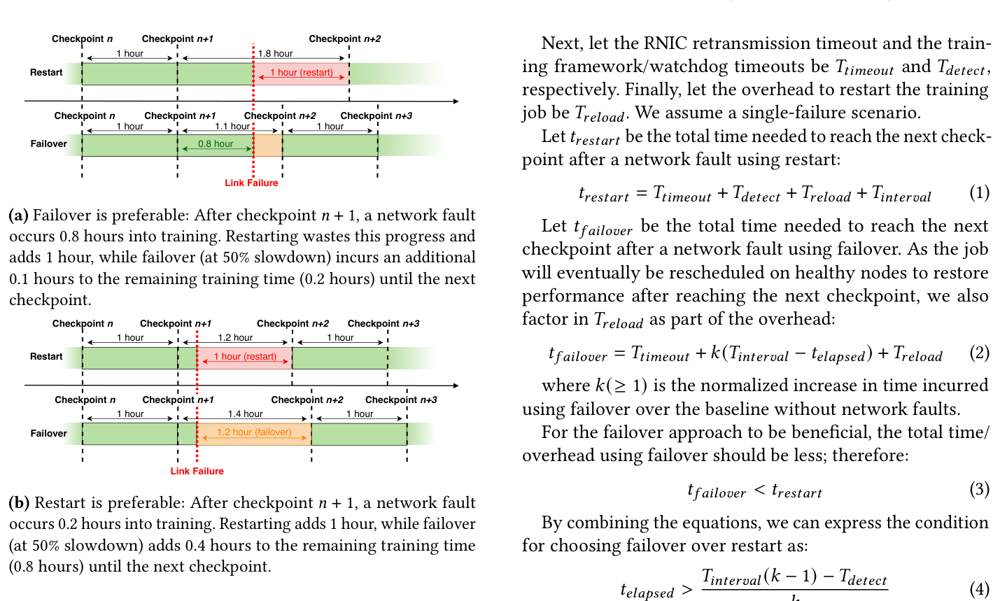
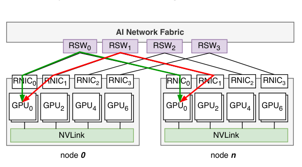
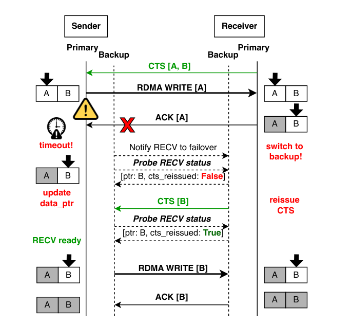
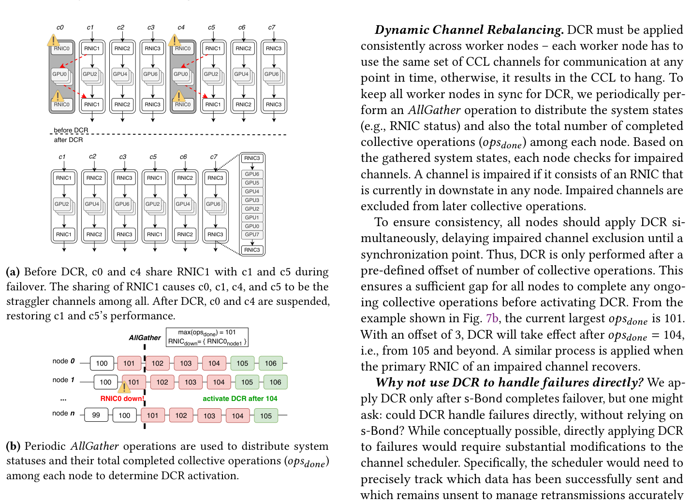
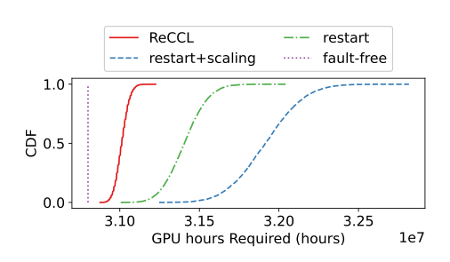
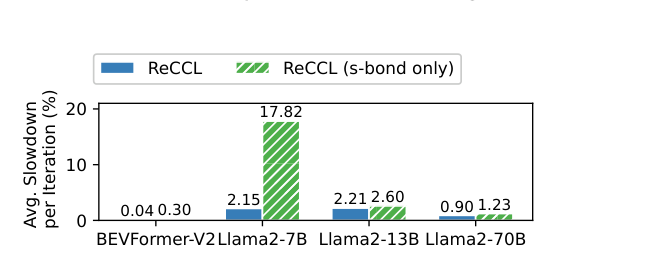
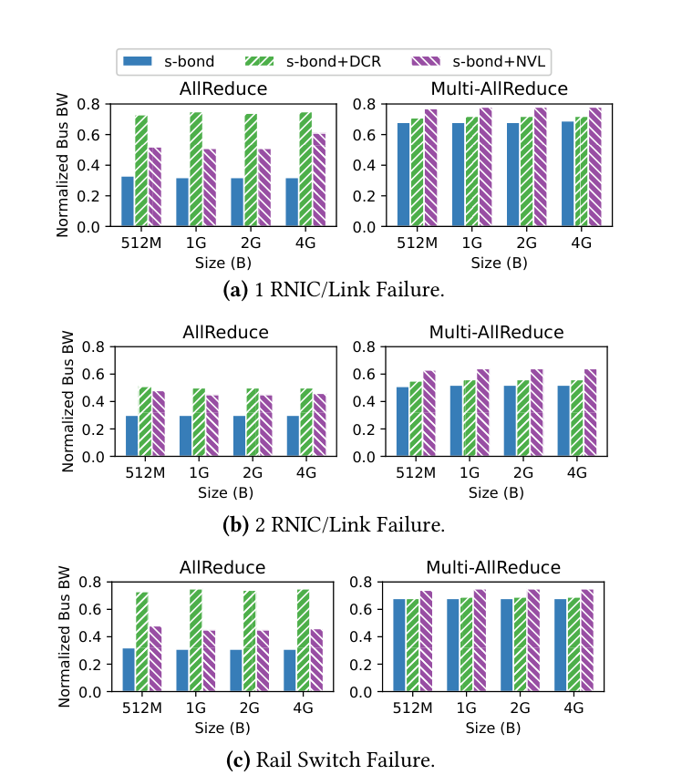
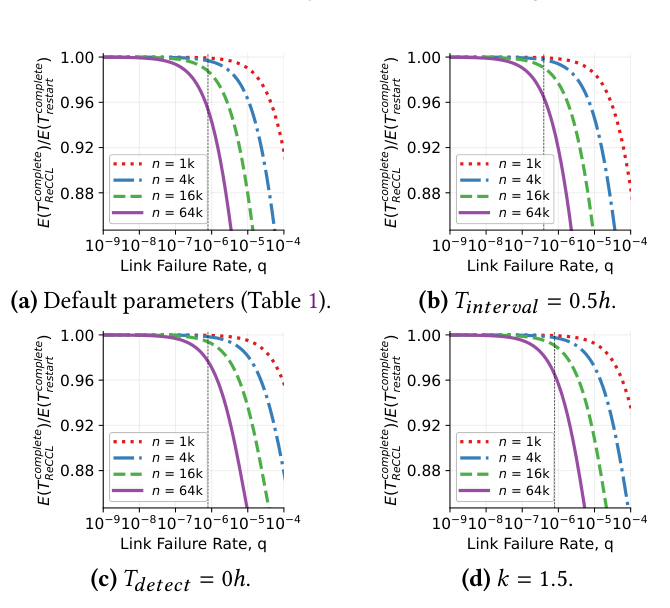

# Handling Network Faults in Distributed AI Training: Failover is Now an Option 阅读报告

| 元信息 | |
|---|---|
| **标题** | Handling Network Faults in Distributed AI Training: Failover is Now an Option |
| **作者 / 机构** | Xin Zhe Khooi, Zhuo Jiang, Pan Xie 等 25 人（National University of Singapore + ByteDance，第一作者在 ByteDance 实习期间完成） |
| **发表** | EuroSys 2026（2026-04-27~30，Edinburgh，pp. 263–278） |
| **链接** | [ACM DL（CC BY 4.0 开放获取，正式版）](https://dl.acm.org/doi/10.1145/3767295.3769322) |
| **本地文件** | `paper.pdf`（脚本直下被 Cloudflare 拦截，经浏览器获取的 ACM 正式版 PDF；无 TeX 源码） |
| **标签** | #fault-tolerance #network-faults #failover #ccl #nccl #rdma #rail-topology |

> 阅读日期：2026-11-03 · 整理：Claude Code

## 一句话总结

网络末跳（switch↔host）故障是大模型训练里占比超 12% 的失败根因，但今天的做法一律是 fail-stop + 从 checkpoint 重启。ReCCL 是**第一个容网络故障的集合通信库（CCL）**：故障发生时通过 s-Bond 把通信无缝切换到备份 RNIC 路径，训练不中断；配合 DCR / NVL 两个优化，failover 期间训练迭代 slowdown 仅 **0.04%–2.21%**（k ∈ [1.004, 1.0215]），无故障时与 NCCL 性能差 **±0.5%**。仿真显示在 Llama3-405B（16k GPU）规模上，相比 restart 可把额外 GPU 时（中位数）削减 **64.96%**（对比 restart+scaling 达 **80.97%**）。

## 背景与动机

- **痛点**：作者的生产经验中，链路抖动（link flapping）、RNIC 故障、ToR 交换机宕机这类**末跳网络故障**占已归档失败作业根因的 **>12%**；Meta 等其他超大规模厂商报告了类似量级。当前处理方式是 fail-stop：RNIC 重传失败产生错误 CQE → CCL 挂起 → watchdog 超时（可达 30 分钟）→ 作业被杀 → 调度器把任务换到健康节点、从上一个 checkpoint 重启（或缩容重启）。checkpoint 之后的计算进度全部作废，重启本身还有 0.5 小时级的 reload 开销。
- **关键洞察**：网络故障与软件 / GPU / 内存故障本质不同——**计算状态完好无损，只是网络断了**。而现代 GPU 服务器天然带多块 RNIC，就地换路（failover）比重启（restart）可能划算得多。
- **何时 failover 更优**（§2.1.1 模型，Fig. 1）：设 checkpoint 间隔 $T_{interval}$、故障时距上个 checkpoint 已过 $t_{elapsed}$、failover 期间降速系数 $k$，则 failover 更优的条件为 $t_{elapsed} > T_{interval}(k-1)/k - T_{detect}/k$。在 $k=1.5$、$t_{detect}=0$ 的保守假设下，只要已跑过 checkpoint 间隔的 **1/3**，failover 就优于 restart；实际 $k$ 远小于 1.5、$T_{detect}$ 非零，failover 的适用区间更大。


*图 1： motivating example。故障发生在接近下个 checkpoint 时（a），重启会浪费已算的进度，failover 明显更优；故障刚过 checkpoint 就发生时（b），重启反而更划算（摘自原文 Fig. 1）*

- **已有方案的不足**（§2.3）：
  1. **硬件 bonding**（双口 RNIC 双上联，如 Qian et al. 的拓扑）：处理不了 RNIC 自身故障；绑定特定硬件与拓扑，布线 / 配置复杂、运维成本高，存量集群无法享受。
  2. **软件层屏蔽**（LubeRDMA）：只支持双边 IB Verbs，而 CCL 用的是单边 Verbs，直接不适用；需要全集群部署外部 agent（部署复杂 + 引入新的单点故障）；对 host 内路径无可见性——例如 8 GPU + 4 RNIC 系统中 RNIC0 挂掉后，GPU0/1 换路要跨多个 PCIe switch / root complex，**原始带宽损失可达 64%**（Fig. 3 的系统实测，390 Gbps → 140 Gbps）。
- NCCL 假设通信路径无故障，断连即挂；NCCL 作者也公开承认在 CCL 内做 primary-backup failover 是个 hard problem（GitHub issue #998）。**本文目标：在 CCL 内原生支持 failover / recovery，且零部署成本、零无故障开销、failover 后性能尽量不掉。**

## 方法

ReCCL 以 `libreccl.so` 动态库的形式作为 NCCL（v2.19，已移植 v2.21）的 **drop-in 替换**：训练框架无需改代码、无需重编译。核心改动集中在 `net_ib.cc`（s-Bond + NVL 的数据 / 控制路径）、`enqueue.cc`（DCR 的 `addCollToPlan`）、`init.cc` / `bootstrap.cc`（周期性 AllGather）。

三大组件：**s-Bond**（容错机制）+ **DCR / NVL**（两类互补的性能优化，初始化时按通信组规模自动选择）。

### s-Bond：软件 bonding


*图 2：GPU 与 primary / backup RNIC 的关联示意（红线为备份路径）。RNIC 之间经由 rail-based 拓扑互连——这是 AI 训练集群的常见组网（摘自原文 Fig. 5）*

- **主备路径**：每个主机间 GPU↔GPU 通信对配一主一备两条 RNIC 路径。备份路径在 **CCL 初始化阶段就预建好**（standby），故障时零配置开销；standby 路径还复用为 failover 期间的带内信令通道。
- **备份 RNIC 选择**：用距离度量打分（每跨一个 PCIe switch +1、每跨一个 PCIe root complex +100、每跨一个 NUMA 节点 +200），选分数最低（= 带宽损耗最小）的 RNIC；同一 PCIe switch 下多块 RNIC 时加约束做负载均衡。
- **备份路径形态**：采用 **backup-to-backup 关联**（sender 的备份 RNIC ↔ receiver 的备份 RNIC），且贴合 rail-based / rail-optimized 拓扑——同 index 的 GPU 经同一条 rail 交换机互连，failover 流量留在同 rail 内，不引入跨 rail 额外跳数；集群硬件同构，两端无需协商即可自动对齐。
- **failover / recovery 协议**（保持收发端通信状态同步，Fig. 3）：


*图 3：sender 检测到 primary 路径故障后：先经备份路径通知 receiver，随后持续探测 receiver 状态；receiver 把所有 pending 请求的 CTS 重新发到备份 RNIC 并置 ready；双方 data pointer 对齐后恢复传输（摘自原文 Fig. 6）*

  正确性依赖两个不变量：**收发双方使用同一条路径**（同一个 RNIC）+ **data pointer 同步推进**。故障瞬间可能出现两类 desync：① ACK 丢失——receiver 已处理消息但 sender 没收到 ACK，重发时 receiver 的备份 RNIC 上没挂 Receive Request，触发 RNR 错误；② data pointer 错位——sender 重发旧数据 $n$，却消耗掉了 receiver 为 $n+1$ 挂的 RR，导致**错误的结果但表面完成**（这正是一致性校验要防的静默错误）。协议通过"先通知、再探测、重传前校验指针对齐"解决。故障修复（如换线）后还有对称的 recovery 过程切回 primary（RNIC 本体损坏则无法 recovery，只能维持 failover 状态）。
- **fast-failover**：维护全局 RNIC 状态表——某个活跃通道发现 RNIC 挂了，其他 idle 通道（同一 RNIC）不必等自己的超时，直接切换。

### DCR：动态通道重均衡（大通信组）


*图 4：(a) failover 后 c0/c4 与 c1/c5 共享 RNIC1 造成 straggler；DCR 禁用受损通道、把数据重分给 6 条健康通道。(b) 周期性 AllGather 分发各节点 RNIC 状态与已完成的集合操作数 opsdone，所有节点在统一同步点（max(opsdone)+offset）同时生效，避免 CCL 挂死（摘自原文 Fig. 7）*

failover 后备份 RNIC 被多通道共享，产生 straggler channel 拖慢整体。DCR 直接**禁用路径上含故障 RNIC 的受损通道**，由 channel scheduler 把数据均分到剩余健康通道。所有节点必须**同时**启用 / 恢复同一组通道（否则 CCL 挂死），因此用带外网络上的周期性 AllGather 同步状态、以固定 offset 延迟生效。

作者解释了为什么不让 DCR 直接处理故障（省掉 s-Bond）：那需要在通道级精确追踪"哪些数据已发 / 未发"并全局同步重传逻辑，复杂度和开销都不可取——s-Bond 管正确性，DCR 只管性能，分层清晰。

### NVL：经 NVLink 的 transit GPU（小通信组）

小通信组（如 TP / PP 的组间通信）各通道共用同一块 RNIC，DCR 无从发力。此时 PCIe 跨 switch / RC 的瓶颈（前述 64% 损失）用 **NVLink 绕行**解决：数据先经 NVLink 拷到同 PCIe switch 下、离备份 RNIC 近的 transit GPU 的缓冲区（每通道 30–40 MB 显存），再由该 GPU 挂 RNIC 发出；收端反向对称。不占 SM、不干扰计算；transit buffer 按用户可配的显存阈值 best-effort 分配，防止 OOM。

## 实验与结果

### 仿真：大规模端到端收益（§4.1，以 Llama3-405B 为对象）

| 参数 | 取值 | 参数 | 取值 |
|---|---|---|---|
| 训练规模 | 16k GPU，1925 h | $T_{interval}$ | 1.0 h |
| $T_{timeout}$ | 1 min | $T_{detect}$ | 0.5 h |
| $T_{reload}$ | 0.5 h | $k$ | 1.03 / 1.20 / 1.50（1 / 2 / ≥3 重故障） |
| 月链路故障率 $\lambda_{link}$ | 0.057% | 月 ToR 故障率 $\lambda_{switch}$ | 0.051% |

*（摘自原文 Table 1；每配置重复 10,000 次）*


*图 5：三种故障处理策略下完成训练所需总 GPU 时的 CDF。ReCCL 相比 restart / restart+scaling 把额外 GPU 时（中位数）削减 **64.96% / 80.97%**，P99 削减 **65.43% / 80.08%**（摘自原文 Fig. 9）*

敏感性分析（Fig. 10）：即使 failover 降速高达 50%（k=1.5）且 checkpoint 间隔激进到 1 分钟，仍可节省 **>200K GPU 时**——"有 failover 这个选项"本身就是价值。

### 测试床：4 节点 32 GPU（Hopper ×8/节点 + BlueField-3 400G ×4/节点，NVLink 全互联，rail-optimized RoCEv2，51.2T Tomahawk5）

- **无故障开销**：与原版 NCCL 相比，训练迭代时间在中位数与 P99 上差异 **±0.5%** 内——零开销，之后的结果均为 failover 性能。
- **failover 期间训练性能**（单链路 / RNIC 故障，Megatron-LM 实测）：

| 模型 | ReCCL 完整版 slowdown | s-Bond only slowdown | 优化贡献 |
|---|---|---|---|
| BEVFormer-V2 | **0.04%** | 0.30% | −0.26 pp |
| Llama2-7B | **2.15%** | 17.82% | **−15.67 pp** |
| Llama2-13B | **2.21%** | 2.60% | −0.39 pp |
| Llama2-70B | **0.90%** | 1.23% | −0.33 pp |

*（摘自原文 Fig. 11；对应 $k \in [1.004, 1.0215]$。Llama2-7B 收益最大：小模型 + DP-only，compute-to-communication 比值低，通信占比高）*


*图 6：failover 期间每训练迭代的平均 slowdown（越低越好）。完整 ReCCL 把 s-Bond only 的 17.82%（Llama2-7B）压到 2.15%（摘自原文 Fig. 11）*

- **并行策略影响**（Fig. 12）：TP / PP 度越大 slowdown 越小，TP=1 时 PP≥4 后几乎归零。
- **故障类型影响**（Fig. 13，Llama2-7B）：s-Bond only 在 1 RNIC / 2 RNIC / rail switch 三种故障下都 ~18%；完整 ReCCL 为 **2.15% / 7.42% / 2.12%**。rail switch 宕机与单 RNIC 故障影响同一组通道，故数值接近；两个不相交故障使可用通道减半，slowdown 升 ~5 pp。

### 消融：DCR vs NVL（§4.2.2，nccl-tests）


*图 7：故障下集合通信带宽（归一化到无故障基线，越高越好）。AllReduce（大组）上 DCR 最优——1 RNIC / rail switch 故障恢复到 ~75%，2 RNIC 故障 ~55%；Multi-AllReduce（小组，DCR 不适用）上 NVL 最优，比 s-Bond 高至多 11%（摘自原文 Fig. 14）*

显存开销：s-Bond / DCR 为 **0**；NVL 每通道 30–40 MB，默认 8 通道的 AllReduce 每卡 281–320 MB，**<1%** 显存。

### 生产验证与"何时 ReCCL 有意义"（§4.2.1 / §5）

- 1024 GPU 生产集群早期试验中，ReCCL 已从多次网络故障中完整恢复。
- 解析模型（Fig. 8）给出增益随作业规模与故障率的变化：按实测月链路故障率 0.057%，**1k / 4k / 16k / 64k GPU 作业的期望增益分别为 0.08% / 0.32% / 1.25% / 4.63%**——作业越大收益越大；64k GPU 训练三个月按 ~$800/卡/月折合约 $150M，4% 即数百万美元。小作业（≤4k）收益不足 1%，除非存在故障率异常高的"弱链"。


*图 8：不同作业规模 n 与链路故障率 q 下的期望完成时间之比（越低越好）。虚线为实测月故障率 0.057%。子图 (b)(c)(d) 分别考察更短 checkpoint 间隔、零检测延迟、k=1.5 的影响——**$T_{detect}$ 从 0.5h 降到 0 对增益伤害最大**（16k：1.25%→0.62%），但大作业收益仍在（摘自原文 Fig. 15）*

## 结论

ReCCL 是第一个网络容错的 CCL：网络故障从"一律重启"变成"可以选择 failover 就地换路"。作者反驳了 Qian et al. "定制 CCL 难以上生产"的判断——ReCCL 不改训练框架、不重编译，正在 ByteDance 生产集群分阶段 rollout，并已移植 NCCL v2.21、在向非 NVIDIA GPU 集群扩展。额外收益：**计划内网络维护（换线、交换机升级）也不必中断训练**。

## 与鲁棒 LLM 训练的关联

- **覆盖链条的哪一环**：**容错与恢复**（网络末跳故障的就地 failover / recovery），并延伸到**故障检测**（错误 CQE + 全局 RNIC 状态 + fast-failover）与**弹性调度**（failover-vs-restart 决策模型 §2.1.1 / §5，与 job scheduler 的交互接口）。与检查点一环是"减负"关系：保留 checkpoint 间的进度，即使配合 CheckFreq 等快速检查点机制，failover 仍更优。
- **与已读论文的关系**：
  - [Robust LLM Training Infrastructure at ByteDance](../sosp-2025-robust-llm-training-bytedance/report.md)：同源团队（多位共同作者）的全景论文，给出了网络故障占比与 restart 为主的处理现状；ReCCL 正是其中"网络故障"子类的深度解法，可视为该基础设施的一块拼图。
  - [TrainMover](../osdi-2026-trainmover/report.md)（OSDI 2026）：换节点迁移路线的 interruption-resilient runtime；ReCCL 走的是"不换节点、就地换网络路径"，二者互补——节点级故障找 TrainMover，链路级故障找 ReCCL。
  - [SDCs in the Wild](../osdi-2026-sdcs-in-the-wild/report.md) / [Training with Confidence](../osdi-2025-training-with-confidence/report.md)：处理的是**静默**数据损坏（位翻转类）；ReCCL 处理的是**显式断连**故障，但论文对"data pointer 错位导致静默错误结果"的防护（重传前指针对齐校验）正是两类故障在正确性上的交汇点。
  - [Mycroft](../sosp-2025-mycroft/report.md)：同样立足 CCL 层，做通信依赖追踪与故障诊断；ReCCL 在 CCL 层做容错——一个"诊"、一个"治"。
  - [Guard](../mlsys-2026-guard/report.md)：straggler 检测与节点健康管理；ReCCL 的 DCR 是网络层的 straggler channel 处理，视角互补。

## 局限性与思考

- **大规模结论主要靠仿真**：k 的取值（1.03/1.20/1.50）来自 32 GPU 测试床外推；16k/64k 规度的真实数据只有"1024 GPU 早期试验挺过多次故障"一句带过。
- **只覆盖末跳故障**：交换机之间的故障因数据中心路径冗余很少导致 CCL 断连，作者明确排除（合理，但意味着 Fabric 级故障仍需其他机制）。
- **RNIC 本体故障无法 recovery**：只能长期停留在 failover 降级态；多故障时 DCR 可用通道锐减（两个故障即减半），性能增益收缩，极端情况下 restart 反而更优——论文用 eq. (4) 把决策交给 job scheduler，但 **scheduler 侧的设计超出本文范围**，"何时 failover"在生产中如何落地是开放问题。
- **拓扑依赖**：backup-to-backup 关联与"留在同 rail"的优化依赖 rail-based / rail-optimized 组网与同构硬件；非 rail 拓扑下的效果论文未讨论。
- **failover 态的次生风险**（个人理解）：降级运行期间若再发故障，k 会叠到 1.20/1.50，仿真里计及了但真实系统的调度器需要在"降级时长"与"二次故障概率"之间权衡——这其实回到了弹性调度问题。
- 可跟进的点：NCCL 官方 MERGE_NIC 等多路径选项是否会吸收 failover 能力；ReCCL 对非 NVIDIA 集群（RCCL）的移植进展；与快速检查点（如 CheckFreq）联合调度的端到端最优策略。

---

*BibTeX（依 ACM DL 元数据整理）：*

```bibtex
@inproceedings{khooi2026reccl,
  author    = {Khooi, Xin Zhe and Jiang, Zhuo and Xie, Pan and Cui, Zhigang and Wang, Meng and Jin, Yuze and Huo, Pengfei and Wang, Dongyang and Chen, Lulu and Wang, Lei and Feng, Liaoyuan and Liu, Xiaodong and Li, Peng and Wang, Qinlong and Bai, Yang and Wang, Yongcan and Jin, Hao and Sun, Jinshuai and Lu, Shan and Shi, Xiang and Zhao, Yingkai and Chen, Haiquan and Li, Yi and Ye, Jianxi and Chan, Mun Choon},
  title     = {Handling Network Faults in Distributed AI Training: Failover is Now an Option},
  booktitle = {Proceedings of the 21st European Conference on Computer Systems (EuroSys '26)},
  year      = {2026},
  address   = {Edinburgh, United Kingdom},
  publisher = {ACM},
  doi       = {10.1145/3767295.3769322}
}
```
