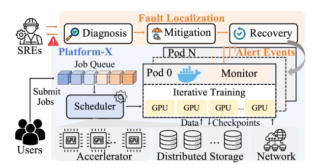
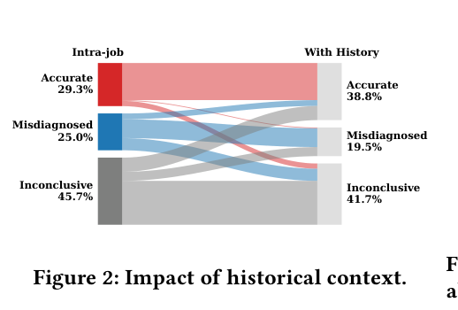
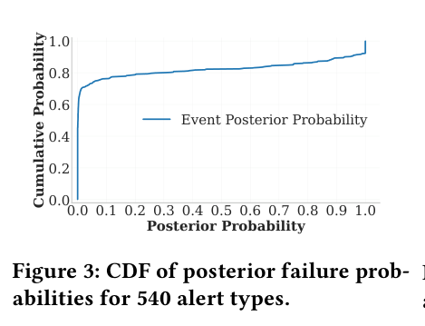
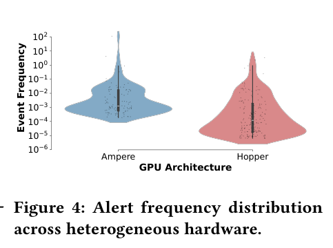
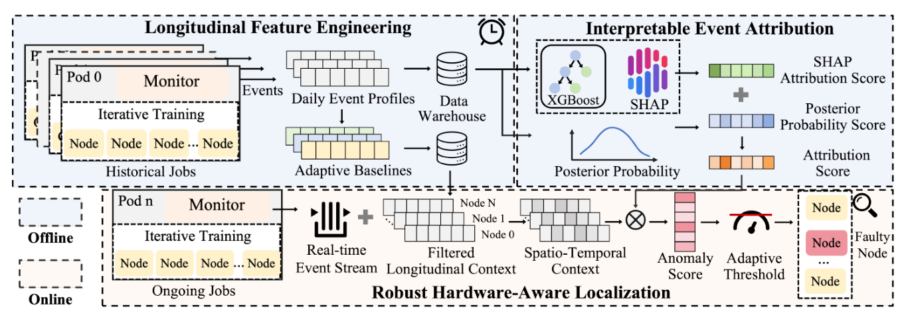
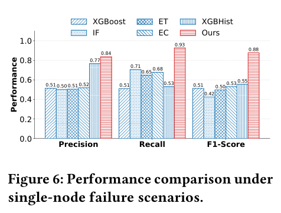
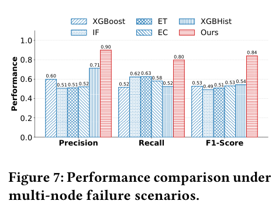
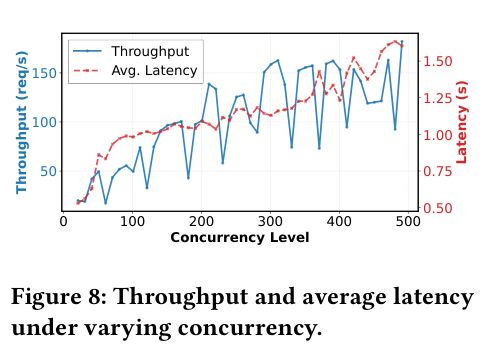

# Reflex: Event-Driven Automated Fault Localization for Large-Scale LLM Training 阅读报告

| 元信息 | |
|---|---|
| **标题** | Reflex: Event-Driven Automated Fault Localization for Large-Scale LLM Training |
| **作者 / 机构** | Hua Ding, Yun Zhang, Bo Zhang, Wenxiao Wang, Libo Chen, Huan Yu, Zhe Nan, Zuquan Song, Weiqiang Lou, Gaohong Liu, Xi Yang, Yuhan Li, Qinlong Wang, Shuguang Wang, Wencong Xiao, Shenghong Li（上海交通大学 + ByteDance Seed；Platform-X 为 ByteDance 生产平台的匿名化称呼，个人依据作者构成与 [70] 引用推断） |
| **发表** | ESEC/FSE 2026（FSE Companion '26, Industry Track） |
| **链接** | [ACM DL](https://dl.acm.org/doi/10.1145/3803437.3805245)（CC BY 4.0 开放获取） |
| **本地文件** | `paper.pdf` |
| **标签** | #fault-localization #fault-detection #empirical-study #AIOps #alert-mining #LLM-training |

> 阅读日期：2026-11-03 · 整理：Claude Code

## 一句话总结

针对大规模 LLM 训练中"故障后人工定位耗时数小时到数天"的痛点，本文基于 ByteDance 生产平台 6 个月 **2,943 次训练故障**的实证研究提炼出三条设计洞察（时空上下文、隐式故障模式、硬件异构性），据此构建事件驱动的自动故障定位框架 **Reflex**：离线做纵向特征画像与可解释事件归因（SHAP + 后验概率），在线做自适应噪声抑制与硬件感知评分定位。生产部署中单节点故障 **F1 = 0.88**（最强基线 0.55），高并发（500）下诊断延迟稳定在 **1.6s**。

## 背景与动机

- **故障是常态**：Llama 3-405B 预训练用 16,384 张 H100 连跑 54 天，期间发生 419 次意外中断，78% 归因于硬件；而 LLM 训练故障的**平均诊断时间长达 34.7 小时**，41.9% 的案例超过 24 小时——在云成本高企的背景下，这直接侵蚀 ETTR（Effective Training Time Ratio，有效训练时间占比）。
- **现有方案是"被动 + 人工"三阶段流程**（§2.2）：
  1. Stage 1：SRE 人工审查 job 级告警流，找显式致命错误（OOM、Xid、HDFS 错误）；
  2. Stage 2：日志逐层排查（dmesg / netstat / Grafana），区分基础设施故障与用户代码错误；
  3. Stage 3：对疑似节点做离线二分压力测试，耗时数小时到数天。
- **真实案例（Job Hang）**：一个 192 节点训练 job hang 30 分钟。同步训练的紧耦合让故障传播成数百节点的告警风暴（`wait_barrier`、`nccl_conn_warning`、`host_port_flapping`），Stage 1 失效；SRE 先做代码回滚排除用户因素，40 分钟日志分析才把故障域缩到 24 节点 DP 组，最后靠离线压测定位到**单个 NIC flapping 节点**，全程数小时。事后回看，该节点在 job 开始前 48 小时内就发出过多次 `batched_nic_down` 前兆告警——**根因其实早就写在历史里**。
- 作者由此归纳现有流程三大缺陷：对累积退化"失明"（fail-stop 之后才介入、只看当前 job 窗口）、高度依赖跨团队专家经验（并行策略 / RDMA / 加速器健康各管一摊）、延迟与规模瓶颈随集群规模非线性恶化。
- **学术方法落不了地**：日志异常检测（DeepLog 一系）是黑盒、不可解释，且把日志当独立序列、无视分布式训练的故障传播；根因定位工作（MicroHECL、MRCA 等）计算开销大、对异构集群不鲁棒、缺乏可解释性，SRE 无法验证诊断结论。


*图 1：Platform-X 系统架构——用户提交 Megatron-LM / DeepSpeed / PyTorch Distributed 训练 job，调度器编排到异构算力（InfiniBand / RoCE 互连），Monitor 以 7 层层次化巡检持续产出结构化告警事件（摘自原文 Fig. 1）*

## 方法

### 实证研究：2,943 次故障说了什么（§3）

研究数据来自 Platform-X 2025 年 4–9 月的 2,943 次训练异常终止（覆盖 MoE / dense 模型、DP / TP / PP / SP 并行、NVIDIA Ampere / Hopper 异构硬件），围绕 4 个 RQ 展开：

**RQ1（故障分类）**——按 Platform-X 的 7 层监控栈分类：

| 层 | 占比 | 代表故障模式 | 典型告警事件 |
|---|---|---|---|
| Accelerator | **40.4%** | 致命 Xid 错误、显存重映射失败、热节流、ECC 故障 | `dcgm_err_xid_65`, `mem_row_remap_alert`, `gpu_ecc_error` |
| Network | **21.6%** | NIC 持续掉链路、IB 连接超时、丢包激增 | `nic_link_down`, `ib_connection_timeout`, `rdma_link_flap_exceeded` |
| User | **20.4%** | 配置错误、NCCL 死锁、模型逻辑错误 | `failed_to_forward`, `error_on_ray`, `nccl_error` |
| Host | **14.5%** | CPU 过载、OOM、磁盘不足、内核恐慌 | `kern_oom_kill`, `rcu_stall`, `pod_is_evicted` |
| CUDA | 1.7% | kernel 启动失败、非法显存访问 | `cuda_launch_failed`, `cuda_illegal_address` |
| Training | 0.7% | loss 发散（NaN/Inf）、梯度爆炸、dataloader 停滞 | `loss_nan_inf`, `dataloader_stall` |
| Framework | 0.6% | checkpoint 读写失败、HDFS I/O 错误 | `hdfs_iops_error`, `ckpt_access_denied` |

> **Finding 1**：硬件相关层合计 **>76%**，加速器是头号故障源（40.4%）；软件栈（CUDA / Framework / Training）合计仅 ~3%——症状常表现为软件层停滞，根因却主要在物理层。

**RQ2（历史上下文的价值）**——从基础设施故障中抽 1,000 个 job，对比"只看 job 内告警"与"加入 2 天回溯历史"：


*图 2：左侧仅用 job 内告警，正确率 29.3%（误诊 25.0%、无法定论 45.7%）；加入历史后正确率升至 38.8%（摘自原文 Fig. 2）*

> **Finding 2**：纵向分析让 13.6% 的案例从误诊/无法定论转为正确，但 **4.1% 出现诊断退化**（历史噪声引入虚假相关）——需要"能过滤噪声的智能历史融合"，而非朴素聚合。

**RQ3（告警的诊断效用分布）**——对 540 种基础设施告警类型计算后验故障概率 P(F=1|E_i=1)（告警后 24h 内确认节点故障的似然）：


*图 3：540 种告警的后验故障概率 CDF，分布高度偏斜（摘自原文 Fig. 3）*

> **Finding 3**：仅 **10.7%** 的告警类型是近确定性指标（后验 > 0.9），**76.2%** 表现为弱相关（< 0.1）的"良性"瞬时异常。大量故障由这些弱信号**累积交互**诱发——诊断系统必须同时抓致命指标 + 建模良性事件的复合影响。

**RQ4（硬件异构性）**——Ampere 与 Hopper 的日均告警频率分布（violin plot）：


*图 4：Ampere 呈重尾分布（高频域可到 10³），Hopper 基线低且集中在低频段（摘自原文 Fig. 4）*

> **Finding 4**：故障签名随硬件代际分布性漂移，静态、硬件无关的规则不可行。

### Reflex 框架（§4）

三条 Finding 对应三个设计原则，组织成**离线重计算 / 在线轻路径**分离的架构：


*图 5：Reflex 总体框架——离线侧做纵向特征工程与可解释事件归因，在线侧做上下文检索、噪声抑制、异常评分与硬件感知阈值（摘自原文 Fig. 5）*

**组件 1：Longitudinal Feature Engineering（离线，对应 Finding 1/2 的时空上下文）**

- 每台机器每天聚合成 |E| 维（540 维）事件计数向量 `v_{i,d}`，附标签 `y_{i,d}`（当天是否确认故障）与硬件型号 `g_i`，落 ClickHouse 数据仓库；
- **自适应基线** `b_{g,d}` = 同型号健康机器当日事件分布的质心，按硬件型号 × 日期预计算索引，在线 O(1) 检索。

**组件 2：Interpretable Event Attribution（离线，对应 Finding 3 的隐式模式）**

- 计数向量先二值化为**出现/不出现**向量（优先"是否出现"而非频率，规避心跳类周期告警与瞬时错误突发之间的协议差异）；
- 训练 **XGBoost** 分类器预测机器故障概率，用 **SHAP** 把非线性预测分解为各事件的边际贡献，全局归因分数 `S_SHAP(e_k)` = 全历史样本上 |φ_k| 的均值——捕捉弱信号间的交互效应；
- 但 SHAP 会稀释**罕见但致命**的指标（全局平均被大量未出现样本摊薄），因此引入后验概率分数 `S_post(e_k) = P(y=1 | x^(k)=1)` 突出强独立预测子；
- 最终融合：`S_k = α·Norm(S_SHAP) + (1−α)·Norm(S_post)`，α 默认 0.5。

**组件 3：Robust Hardware-Aware Localization（在线三阶段，对应 Finding 4）**

1. **上下文检索**：实时摄入 job 内事件计数 `v^job_{i,t}`，同时取参与机器 N=2 天回溯的纵向画像、对应硬件基线、最新归因分数向量；
2. **自适应噪声抑制**：逐元素阈值化 `a_{i,d'} = 1[v_{i,d'} > b_{g,d'}]`，只保留显著偏离该硬件型号"正常签名"的事件——这正是消融掉历史噪声、避免 RQ2 那种 4.1% 诊断退化的关键；
3. **异常评分与决策**：`A(m_i) = Σ_{d'} S·a_{i,d'}（历史退化） + S·x^job_{i,t}（job 内影响）`；按硬件型号用滑动窗口历史数据网格搜索最大化 F1 标定阈值 `τ_g`，超阈值即自动缓解（cordon 节点 + Kubernetes Pod 驱逐 + checkpoint 恢复）。

**实现（§5）**：Kafka 异步摄入告警流 → ClickHouse（MergeTree，按日期分区、机器 ID 索引）；每日离线任务 8 CPU / 32 GB；归因模型**每季度**用 3 个月滚动窗口重训；在线后端 32 CPU / 128 GB，微批处理。与训练负载完全解耦，不抢 GPU/CPU/网络带宽。

## 实验与结果

数据集：生产环境 6 个月收集的 **220 个故障 job**（187 个单节点故障 + 33 个并发多节点故障），只保留基础设施故障（剔除用户代码错误），ground truth 由工程专家按标准协议验证。基线 5 个：XGBoost、Isolation Forest（IF）、启发式 ErrorTime（ET）/ ErrorCount（EC，取 top 2% 节点）、以及为隔离"历史上下文贡献"而构造的 **XGBHist**（XGBoost + 与 Reflex 相同回溯窗口的历史特征）。


*图 6：单节点故障场景下 Reflex 与 5 个基线的 Precision / Recall / F1（摘自原文 Fig. 6）*


*图 7：并发多节点故障场景，Reflex 仍保持 P=0.90 / F1=0.84（摘自原文 Fig. 7）*

| 方法 | 单节点 P / R / F1 | 多节点 P / R / F1 |
|---|---|---|
| XGBoost | 0.51 / 0.51 / 0.51 | 0.60 / 0.52 / 0.53 |
| IF | 0.50 / 0.71 / 0.51 | 0.51 / 0.62 / 0.49 |
| ET | 0.65 / 0.50 / 0.52 | 0.63 / 0.51 / 0.52 |
| EC | 0.68 / 0.53 / 0.55 | 0.58 / 0.53 / 0.54 |
| XGBHist | 0.77 / 0.53 / 0.55 | 0.71 / 0.52 / 0.54 |
| **Reflex** | **0.84 / 0.93 / 0.88** | **0.90 / 0.80 / 0.84** |

**关键结论**：

- 单节点场景 Reflex **F1 = 0.88**，较最强基线 XGBHist（0.55）**相对提升 58%**；XGBHist 优于原始 XGBoost 说明历史特征有价值，但 Reflex 的进一步领先证明**自适应噪声抑制与事件归因**才是把历史用好所必需的；
- 多节点场景 Reflex **F1 = 0.84（P = 0.90）**，相对 XGBHist（0.54）**提升 55%**——同时失效的干扰下硬件感知阈值 + 归因机制仍能保持精度；
- IF 的高 recall（0.71）伴随低 precision（0.50），典型的"分不清良性噪声与真实故障"。

**消融实验（Table 2，原文表格重录）**：

| 变体 | 单节点 P / R / F1 | 多节点 P / R / F1 |
|---|---|---|
| Reflex 完整版 | 0.84 / 0.93 / **0.88** | 0.90 / 0.80 / **0.84** |
| w.o. LC（纵向上下文） | 0.86 / **↓0.74** / 0.79 | 0.89 / **↓0.59** / 0.64 |
| w.o. ANS（噪声抑制） | **↓0.74** / 0.90 / 0.80 | **↓0.64** / 0.88 / 0.70 |
| w.o. Prob.（后验分数） | 0.78 / 0.74 / 0.76 | 0.68 / 0.59 / 0.62 |
| w.o. SHAP | 0.76 / 0.90 / 0.82 | 0.73 / 0.83 / 0.77 |

- 去掉纵向上下文（LC）**recall 崩**（单节点 −0.19、多节点 −0.21）——累积退化抓不到了；
- 去掉噪声抑制（ANS）**precision 崩**（多节点 −0.26）——印证 RQ2 发现的历史噪声问题；
- SHAP 与后验概率缺一不可，去掉任一 P、R 双降。


*图 8：并发 20→300 吞吐线性扩展，峰值约 160 req/s；并发逼近 500 时平均延迟稳定在约 1.6s，全程 0% 错误率（摘自原文 Fig. 8）*

**关键数字**：单节点 **F1 0.88** / 多节点 **F1 0.84**（最强基线分别 0.55 / 0.54）；并发 500 下平均诊断延迟 **~1.6s**、峰值吞吐 **~160 req/s**、错误率 **0%**；回溯窗口 **N=2 天**；归因模型季度重训。

## 部署经验（§7）

- **Case 1（成功，静默 hang）**：192 节点 job 运行 40 分钟后 hang，**job 内零告警**，job 内诊断完全不可行。Reflex 回溯 5 天降噪后的事件画像，锁定一个统计显著离群节点——历史前兆 `process_group_nccl_watchdog_stuck`、`unknown_exit_node`、`gpu_memory_page_fault` 反复出现，指向 PCIe / 内存完整性退化导致通信死锁。隔离该节点后 job 重启恢复正常。
- **Case 2（失败，暴露边界）**：512 节点 job 因 **straggler**（高延迟计算单元拖慢 All-Reduce 等同步集合通信）吞吐骤降，但当前执行与历史回溯窗口内**均无任何告警事件**，Reflex 全部打零分、无法定位，最终靠人工按 DP 组逐组 profile 计算与通信时序定位慢节点。作者明确承认：这不是算法缺陷，而是**可观测性鸿沟（observability gap）**——事件驱动系统的上限由上游遥测的灵敏度与覆盖度决定。
- **工程教训**：① 诊断系统必须与上游监控**协同进化**，监控盲区（如 straggler 的细粒度时序指标）暴露后要反哺监控体系；② 粗粒度的硬件代际分类（Ampere vs Hopper）不够，同一微架构内**外形 / TDP / 互连拓扑（PCIe vs NVLink）**差异也会产生不同故障签名，需要 GPU 型号 × 互连拓扑级别的细粒度配置画像。

## 结论

作者用 6 个月生产数据（2,943 次故障）的实证研究证明了"被动人工诊断"的结构性缺陷，并交付了 Reflex：事件驱动、可解释、硬件感知的自动故障定位框架，在 ByteDance Platform-X 生产部署 6 个月，F1 0.88 / 延迟 1.6s，并开源了匿名化生产告警轨迹数据集（[LLMAlertTrace](https://github.com/Amanda-HuaDing/LLMAlertTrace)）。未来方向是 LLM 赋能的自主可靠性 agent：语义化事件提取（解析非结构式多源日志）、人在环路的参数自适应、对话式根因解释。

## 与鲁棒 LLM 训练的关联

- **覆盖链条的哪一环**：**故障检测**环——更准确说是故障检测之后的**故障定位（fault localization / faulty node pinpointing）**，并直接驱动下游**容错与恢复**（定位后自动 cordon 节点 + Pod 驱逐 + checkpoint 恢复，把"数小时级人工排查"压缩到秒级自动闭环）。它不解决检测本身（依赖上游 7 层监控已产出的告警事件），也不做训练正确性校验。
- **与已读论文的关系**：
  - **[Robust LLM Training Infrastructure at ByteDance (SOSP'25)](../sosp-2025-robust-llm-training-bytedance/report.md)**：同源工作——Reflex 正是那篇综述式论文中"故障检测与定位"环节的深化落地，作者阵容高度重叠（Wencong Xiao、Zuquan Song、Gaohong Liu 等同时出现在两篇中）。SOSP'25 论文给出全景，Reflex 补上"节点级定位"这一格的技术细节与量化效果。
  - **[Training with Confidence (OSDI'25)](../osdi-2025-training-with-confidence/report.md)**：互补关系。Training with Confidence 在**算法 / 数据层面**用主动校验捕获静默错误（模型状态检查），Reflex 在**基础设施遥测层面**做节点定位。前者的检查点也能产生 Reflex 可消费的告警信号（Training Layer 告警）。
  - **[SDCs in the Wild (OSDI'26)](../osdi-2026-sdcs-in-the-wild/report.md)**：直接互补。SDC 缺陷 GPU 恰是"零告警静默故障"的典型，对应 Reflex Case 2 承认的可观测性鸿沟——SDC 需要专门的一致性校验手段，Reflex 的事件驱动机制覆盖不了；反过来说，SDC 专项检测的产出（缺陷 GPU 名单）可以作为 Reflex 的告警类型接入。
  - **[TrainMover (OSDI'26)](../osdi-2026-trainmover/report.md)**：上下游衔接——Reflex 负责快速定位故障节点并触发驱逐，TrainMover 一类弹性运行时负责在节点替换 / 恢复期间保住训练连续性，二者共同缩短 MTTR。
  - **[Guard (MLSys'26)](../mlsys-2026-guard/report.md)**：正面互补——Guard 做的 straggler 检测 / 节点健康管理恰好落在 Reflex Case 2 承认的"可观测性鸿沟"上（straggler 不产告警事件，Reflex 打零分失效）。两者可以事件总线的方式打通：Guard 的检测结果注册为告警类型进入 Reflex 的事件流，即可低成本补上这类静默故障的定位能力。
  - 相关工作中对比的 **Minder (NSDI'25)**、**Unicron**、**L4 (FSE'25)** 分别代表机器级指标监控、依赖图异常定位、日志诊断路线；Reflex 的差异化在**纵向历史画像 + 可解释归因 + 硬件感知**三者的组合。

## 局限性与思考

- **事件驱动范式的天花板（作者自认）**：Case 2 表明上游监控不产事件，Reflex 就是"巧妇难为无米之炊"。straggler、微妙的性能衰减、SDC 类静默故障都可能在告警维度上隐身，这类故障仍需 Training with Confidence 式的主动校验或 SDC 专项手段兜底。
- **硬件同构假设**：Phase 1 假设单个 job 内硬件同构（大规模训练的标准实践），但随着训练走向异构混部，这个假设会松动；作者自己也在教训 ② 中承认粗粒度代际分组不够，细粒度配置画像仍是待完善项。
- **评估规模与划分**：评估集只有 220 个故障 job（33 个多节点），30:70 划分对 F1 的置信区间影响未讨论；2,943 的实证数据与 220 的评估集之间的抽样关系也没有完全交代（个人理解，可能是 ground truth 验证成本所限）。
- **阈值标定的滞后性**：`τ_g` 靠历史滑动窗口网格搜索，新硬件型号上线初期或故障模式漂移时（论文提到归因模型季度重训），阈值与分数可能短暂失配——季度的重训周期是否够快，值得追问。
- **标签质量**：`y_{i,d}` 来自人工诊断或自动巡检，而 Reflex 的目标又是替代人工诊断——存在"用旧诊断教新诊断"的自举偏置风险，论文未讨论 ground truth 噪声的影响（个人理解）。
- **可跟进的点**：① L4 / Reflex 两代诊断系统的效果能否在同一数据集上对比？作者开源了 LLMAlertTrace 数据集，是复现的好入口；② Reflex 承认的"可观测性鸿沟"正好可以和 straggler 检测（如 OSDI'25 What-if Analysis）联动——把 straggler 检测器的输出注册为一种"合成告警事件"，可能是低成本的补洞方式；③ 与 checkpoint 系统（ByteCheckpoint / FlowCheck）的联动只写了"cordon + 驱逐 + checkpoint 恢复"一句话，恢复路径上的细节（坏节点上的最近 checkpoint 是否可信）未展开。

---

*BibTeX（依据 ACM DL 页面信息构造）：*

```bibtex
@inproceedings{ding2026reflex,
  author    = {Ding, Hua and Zhang, Yun and Zhang, Bo and Wang, Wenxiao and Chen, Libo and Yu, Huan and Nan, Zhe and Song, Zuquan and Lou, Weiqiang and Liu, Gaohong and Yang, Xi and Li, Yuhan and Wang, Qinlong and Wang, Shuguang and Xiao, Wencong and Li, Shenghong},
  title     = {Reflex: Event-Driven Automated Fault Localization for Large-Scale LLM Training},
  booktitle = {Proceedings of the 34th ACM International Conference on the Foundations of Software Engineering (FSE Companion '26)},
  year      = {2026},
  isbn      = {979-8-4007-2636-1/26/07},
  publisher = {Association for Computing Machinery},
  address   = {New York, NY, USA},
  url       = {https://doi.org/10.1145/3803437.3805245},
  doi       = {10.1145/3803437.3805245},
  pages     = {731--742},
  location  = {Montreal, QC, Canada}
}
```
