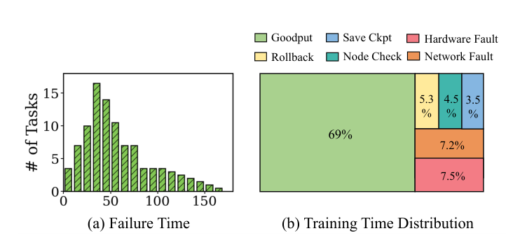
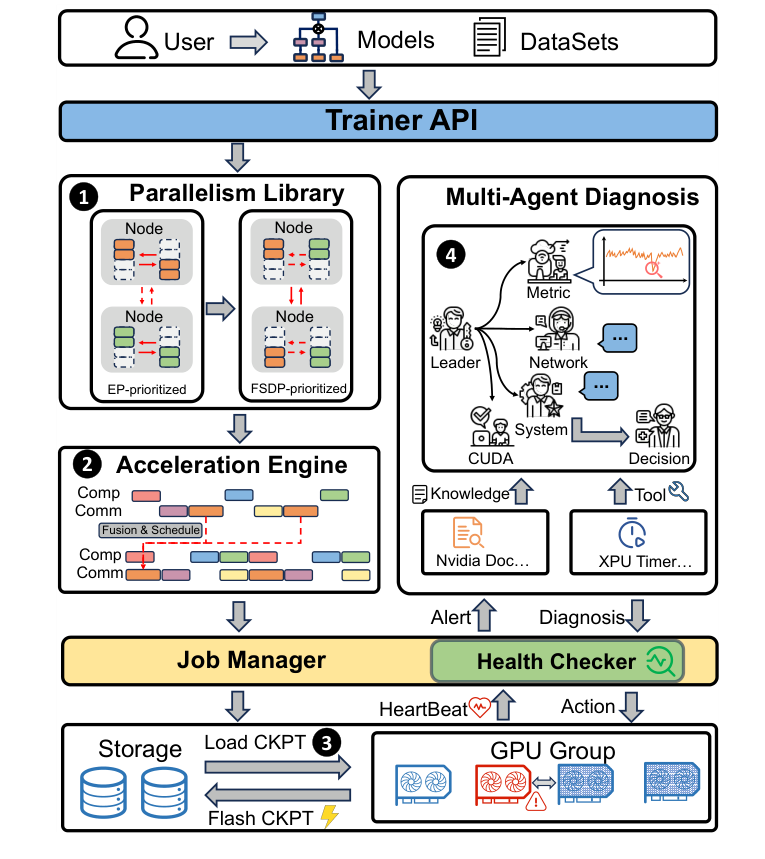
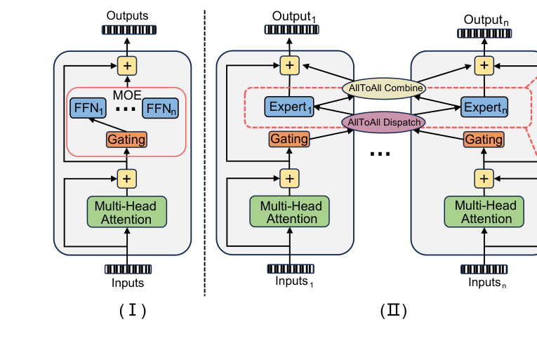
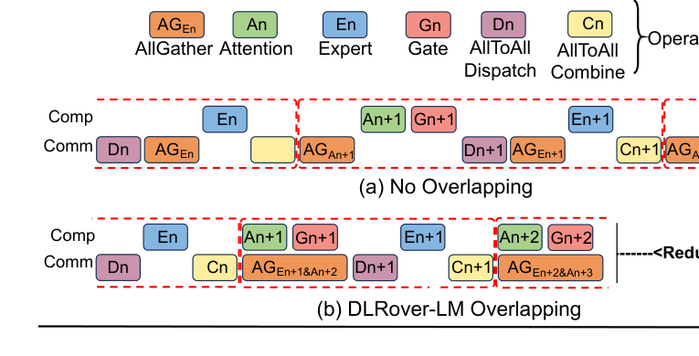
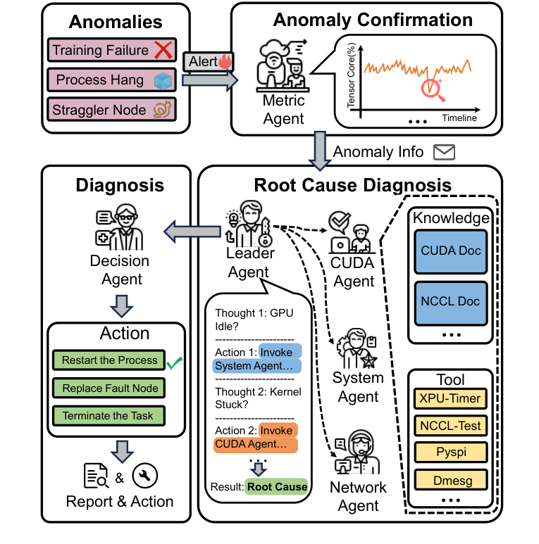
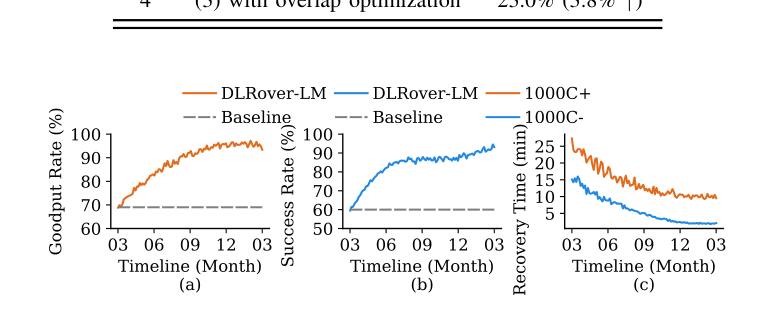
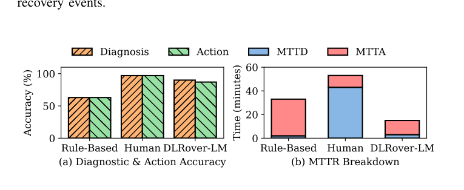
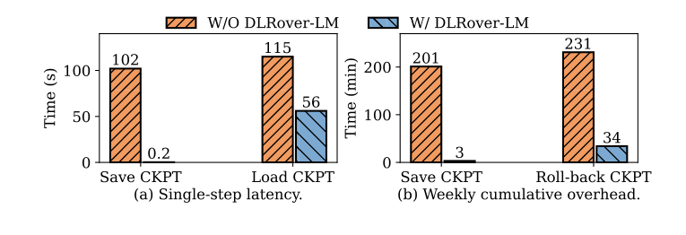

# DLRover-LM: LLM Pre-Training Framework with Thousands of Accelerators in AntGroup 阅读报告

| 元信息 | |
|---|---|
| **标题** | DLRover-LM: LLM Pre-Training Framework with Thousands of Accelerators in AntGroup |
| **作者 / 机构** | Ziling Huang, Zhengmao Ye, Qingsong Cai, Zelong Huang, Mingjie Tang（Sichuan University）；Bo Sang, Haitao Zhang（Ant Group）；Jian Sha（Tsinghua University）；Tingfeng Lan（University of Virginia）；Hui Lu（UT Arlington）；Yuanchun Zhou（中科院） |
| **发表** | IEEE ICDE 2026（Industry and Application Track，pp. 3639–3650） |
| **链接** | [IEEE Xplore](https://ieeexplore.ieee.org/document/11629553/)（DOI: 10.1109/ICDE65706.2026.00271）· [代码](https://github.com/intelligent-machine-learning/dlrover) |
| **本地文件** | `paper.pdf`（IEEE 无开放版本，经浏览器登录态手动下载） |
| **标签** | #fault-tolerance #fault-diagnosis #multi-agent #checkpointing #hybrid-parallelism #production-system |

> 阅读日期：2026-11-03 · 整理：Claude Code

## 一句话总结

蚂蚁集团把生产级 MoE LLM 训练框架 DLRover-LM 开源并系统化总结：用**易配置的 FSDP+EP 混合并行**（配合通信-计算重叠与算子融合）在 3,072 卡上把 290B MoE 模型训到 **24% MFU**（与精调 3D 并行的 Megatron-LM 相当，但调优只需 1–2 次尝试 vs. 6–16 次）；用**健康检查 + 多智能体（multi-agent）故障诊断 + flash checkpointing** 把生产集群 goodput 从 **69% 提到 95%**，故障停机只占总训练时间 **5%**。

## 背景与动机

论文从蚂蚁集团生产集群的一手数据出发，指出千卡级 MoE 训练的两大瓶颈：

**1. 并行训练的配置复杂度与通信开销**

- 3D 并行（TP+PP+DP）虽然可扩展，但最优配置组合空间爆炸：同样是 7B 模型 8 卡，TP2/PP2/DP2 的 HFU 只有 **49.9%**，TP1/PP2/DP4 则有 **61.0%**；80B 模型 1,856 卡时不同配置的 HFU 在 **17%–27%** 之间波动（Table I）。Megatron-LM 训 290B/3,000 卡需要**数天**的调优。
- 反过来，单用 FSDP 虽然配置极简（单命令即可起任务），但 AllGather/ReduceScatter 逐层同步，规模越大通信占比越高——训 Qwen2-57B-A14B 时 FSDP 的 MFU 随卡数增加持续下降（Fig. 4）。

**2. 高故障率与低效的恢复流程**


*图 1：蚂蚁集群 LLM 训练任务统计——(a) 多个任务的故障时间分布；(b) GLM-65B 千卡训练的时间分布（摘自原文 Fig. 1）*

- 蚂蚁集群中**只有 2% 的训练任务从头到尾没遇到故障**；GLM-65B 千卡任务中**只有 69% 的时间在真正训练**，其余被存 checkpoint（5.3%）、硬件故障（4.5%）、回滚（3.5%）、节点检查（7.2%）、网络故障（7.5%）吃掉（Fig. 1）。
- 一年观察数百个生产任务：**GPU 相关问题占全部故障的 48.4%**，且症状跨 rank 不一致、有误导性；训练 hang 往往要等 15–30 分钟超时才被确认为故障；硬件故障的"人工检查→换节点→回滚"流程要 **1–2 小时**（Fig. 5）。
- 常规"先重启、不行再换节点"的两步恢复经常误分类，造成反复无效重启。

## 方法


*图 2：DLRover-LM 总体架构——Trainer API + 混合并行训练引擎 + Health Checker / Job Manager / Multi-Agent Diagnosis 三层自愈体系（摘自原文 Fig. 6）*

系统分两条主线：**效率**（§IV-A，混合并行 + 通信重叠 + 算子融合）与**可靠性**（§IV-B，健康检查 + 多智能体诊断 + flash checkpointing）。

### 1. FSDP + EP 混合并行策略


*图 3：(I) MoE 结构与 Expert Parallelism；(a)(b) FSDP+EP 的两种切分优先级——EP-prioritized vs. FSDP-prioritized（摘自原文 Fig. 2）*

关键设计抉择是**哪种集合通信放在节点内（快链路）**：

- 通信量建模：AllGather 的通信量 `Cα = P×(N−1)/N`（P 为每层 MoE 参数量，N 为加速器数）；AllToAll 的通信量 `Cβ = D×K×H×(N−1)/N`（D 为 token 规模，K 为每 token 路由的专家数，H 为 FFN 隐层宽度）；总通信量 `C = Cα + 2Cβ`。
- 两种切分方案：**EP-prioritized**（专家先按节点切，节点内再分卡）时延 `Tep = Cα/Bi + 2Cβ/Ba`；**FSDP-prioritized**（专家先切片、每节点放各专家的一片）时延 `Tfsdp = Cα/Ba + 2Cβ/Bi`（Bi/Ba 为节点内/节点间带宽）。
- 蚂蚁集群 NVLink 节点内 **900 GB/s** vs. InfiniBand 节点间 **50 GB/s**，且生产中 `Cα < Cβ`——因此把两次 AllToAll（2Cβ）留在节点内的 **FSDP-prioritized 是默认策略**；当节点间带宽提升或模型大到 Cβ 占主导时，可基于硬件 profiling 切换到 EP-prioritized。

### 2. 通信-计算重叠：约束求解调度


*图 4：通信算子调度时间线——(a) 无重叠 vs. (b) DLRover-LM 重叠后 AllGather 全部被计算遮盖（摘自原文 Fig. 7）*

- 把通信-计算调度形式化为**约束优化问题**（依赖关系 + 显存容量约束下最小化最后一个算子的完成时间），用 Google OR-Tools 求解，得到各算子的最优启动时刻与 AllGather 融合分组；若超出显存则迭代调整。
- 落地模式：把第 n 层 Expert 与第 n+1 层 Attention 的 AllGather **融合为一次集合通信**，与第 n 层的 attention/gate 计算重叠——**100% 遮蔽 AllGather 时延**，集合通信启动开销减半。

### 3. 专家引导的局部编译

- 全图 XLA 编译不现实（7B 模型要 30+ 分钟，输入变化还要重编）；纯手写 kernel（如 FlashAttention）又不可扩展。
- DLRover-LM 的做法：先用 Nsight Systems 定位瓶颈子图，**只对热点子图做局部 XLA 编译**（如把 Dropout+Add+LayerNorm 融合成一个算子），再用 **Triton** 做关键算子（Cross-entropy、RMSNorm）的二次开发，兼顾跨加速器移植性（论文实验含三种非典型 GPU 型号 Device A/B/C）。

### 4. 多智能体协同自愈


*图 5：DLRover-LM 多智能体协同自愈系统——Metric Agent 分诊、Leader Agent 组队与协调、领域 Agent（System/Network/CUDA）调用工具排查、Decision Agent 决策（摘自原文 Fig. 9）*

三层机制配合：

**(1) 节点健康监控（被动心跳 + 主动预检）**
- 被动层：每个 GPU 组每几秒上报心跳（GPU 温度、SM 利用率、NCCL/CUDA 日志），心跳缺失/异常即标记故障。
- 主动层（pre-check）：集群初始化时分组跑轻量计算（Gemm）与通信（AllGather）探针；可疑节点需与已知健康节点二次验证才判死；**空闲节点在顶替故障节点前预先验证**，保证即换即用；训练期间周期性性能审计捕捉缓慢劣化。

**(2) 多智能体异常诊断**
- 角色分工：Metric Agent 快速分诊（tensor core 利用率/温度/通信吞吐）→ Leader Agent 查历史记录、组建诊断团队、汇总证据迭代修正假设 → System Agent（pyspi 栈回溯、dmesg）/ Network Agent（NCCL-Test 连通性）/ CUDA Agent（XPU-Timer kernel 级追踪）各查各的子系统 → Decision Agent 选恢复策略（重启进程 / 换节点 / 终止任务）。
- 内部 LLM 在**精选诊断文档与日志标注上微调**，才能读懂 NCCL 日志、CUDA trace 这类专业语料；每次诊断与决策自动入知识库沉淀。
- 论文给了一个完整的 hang 诊断案例（Fig. 10）：先用 pyspi 区分用户态/内核态卡死 → dmesg 与连通性排除基础设施 → 疑点收敛到同步 barrier → XPU-Timer 追踪发现 rank 1 缺席、ranks 0/2–7 阻塞在 `synchronize()`，定位到单个 worker 卡死。

**(3) Flash Checkpointing**
- 观察：**75% 的训练中断是短命瞬时故障**（NCCL 超时、网络抖动），根本不需要走远端存储恢复。
- 设计：GPU 与远端存储（CPFS）之间加 **CPU 侧缓存**——训练态经 PCIe 流式写入 host memory（**0.2 秒**完成一次多 GB checkpoint），后台再异步刷到远端；瞬时故障直接本地缓存重载（秒级恢复），严重节点故障才从远端拉取。
- 检查点频率因此从每 250 步提高到**每 10 步**，吞吐无损。

## 实验与结果

**设置**：蚂蚁生产 HPC 集群 3,072 卡（默认 Device C：312 TFLOPS/80GB/NVLink 600GB/s；另测 Device A：989T/140GB/900GB/s），模型 Qwen2-57B / Qwen3-235B / Ling-Plus-290B（64 专家、hidden 5376、88 层），序列长 4096；基线 Megatron-LM（多轮专家调优的 3D 并行）与 PyTorch FSDP-V2。

**强扩展（290B 模型，Table V）**：

| 加速器数 | Megatron 迭代时间 (s) | DLRover 迭代时间 (s) | Megatron 吞吐 | DLRover 吞吐 | Megatron 调优 | DLRover 调优 |
|---|---|---|---|---|---|---|
| 256 | 132.4 | **131.0** | 360.5k | **372.1k** | 6 次 / 60–90 min | **1 次 / 8–10 min** |
| 512 | 68.8 | 69.0 | 727.5k | 727.0k | 7 次 / 90–130 min | 1 次 / 10–15 min |
| 1024 | 35.1 | 35.7 | 1428.4k | 1402.6k | 10 次 / 150–220 min | 1 次 / 15–20 min |
| 2048 | 18.7 | 19.3 | 2681.7k | 2596.8k | 12 次 / 240–360 min | 2 次 / 40–60 min |
| 3072 | 13.3 | 14.0 | 3770.5k | 3582.7k | 16 次 / **400–600 min** | 2 次 / **50–70 min** |

性能与调优后的 Megatron-LM 差距在 5% 以内（3072 卡），调优开销降低一个数量级；弱扩展（64→512 卡）下吞吐为 Megatron 的 **1.05–1.06×**；loss 曲线与 Megatron 重合（收敛一致）。

**消融（290B / 3,072 卡，Table VI）**：

| 配置 | MFU | 增量 |
|---|---|---|
| baseline（FSDP-V2） | 8.7% | — |
| + expert parallelism（FSDP+EP） | 18.0% | +9.3% |
| + 高性能算子 | 19.2% | +1.2% |
| + 通信-计算重叠 | **23.0%** | +3.8% |

整体相对 baseline **1.64×**；对比纯 FSDP-V2 最高 **1.57×** MFU（235B 模型）。摘要口径的 24% MFU 为取整值。

**生产稳定性（2024.01–2025.01 全年趋势，Fig. 13）**：


*图 6：一年期生产指标——(a) goodput rate；(b) 容错成功率；(c) 平均异常恢复时间（摘自原文 Fig. 13）*

- goodput rate：**69% → 95%**（摘要口径：故障停机仅占总训练时间 **5%**）；
- 容错成功率：**60% → 93%**；
- 平均异常恢复时间：<1,000 卡任务 **~15 min → 2 min**，>1,000 卡任务 **~25 min → 10 min**；
- 追踪 290B 两周生产任务（3,000+ 卡）：自动处理 **20+ 次异常**，其中一次用 XPUTimer **1 分钟**识别网络拥塞 hang（避免 30 分钟超时），整体 **97% 在线率、95% 有效训练时间**；
- pre-check：1,024 卡任务的故障节点定位从人工 ~2 小时缩短到 **~5 分钟**，集群异常数减少约 **15%**。

**多智能体诊断评测（30 个真实案例，Fig. 15）**：


*图 7：诊断准确率与 MTTR 对比——DLRover-LM vs. 规则引擎 vs. 人类专家（摘自原文 Fig. 15）*

- 诊断/动作准确率：**DLRover-LM 90% / 87%**，接近人类专家（97%），远超规则引擎（63%）；
- MTTR：**DLRover-LM 15 min**，人类专家平均 53 min；规则引擎虽然初判快，但误诊导致反复失败重启，MTTR 反而膨胀到 33 min。

**Flash checkpointing（57B / 1,536 卡，Fig. 16）**：


*图 8：flash checkpointing 效果——(a) 单次保存/加载时延；(b) 一周累计 checkpoint 开销（摘自原文 Fig. 16）*

- 单次保存阻塞时间 **2 min → 0.2 s**（**600×**），检查点频率 250 步 → 10 步无吞吐损失；
- 一周累计 checkpoint 开销 **201 min → 3 min**（降 **99%**）；
- 故障后平均恢复时间 **231 min → 34 min**（**6.8×**）；加载耗时只降约 50%，瓶颈在 FSDP 逐层初始化（作者列为未来优化点）。

## 结论

DLRover-LM 已在蚂蚁生产环境自 2024 年 1 月起持续运行（3,000+ 卡 HPC 集群），代码约 **130K 行 Python + 15K 行 Go**，全部开源。论文的结论是：对数千卡规模的 MoE 训练，"简单但够用"的 FSDP+EP 混合并行 + 系统化的重叠/算子优化，可以在几乎免调优的前提下达到精调 3D 并行的性能；而健康检查、多智能体诊断与 flash checkpointing 的组合能把故障停机压到总时间的 5%。

## 与鲁棒 LLM 训练的关联

- **覆盖链条的哪一环**：这是本仓库目前覆盖面最宽的一篇工业界论文——**故障检测**（被动心跳 + 主动 pre-check 探针）、**故障诊断**（多智能体根因定位）、**容错与恢复**（换节点 / 重启 / 终止的决策执行）、**检查点**（CPU 缓存式 flash checkpointing，故障感知的分级恢复）、**弹性调度**（空闲节点预验证后即换即用）全覆盖；并行策略部分（FSDP+EP、通信重叠）属于效率侧而非鲁棒侧，但"少调优、开箱即用"本身就是稳定性的一部分（配置错误也是故障源之一，见 Table II 的 Inappropriate Configuration）。
- **与已读论文的关系**：
  - [SOSP'25 字节跳动鲁棒训练基础设施](../sosp-2025-robust-llm-training-bytedance/report.md)：同一量级的"生产集群全景"论文，字节覆盖更全的静默错误检测体系；DLRover-LM 的差异化在**用微调过的 LLM 多智能体做根因诊断**，以及效率侧的免调优并行——两篇对照着读可以看出头部公司不同的工程取舍。
  - [OSDI'26 SDCs in the Wild](../osdi-2026-sdcs-in-the-wild/report.md)：该文刻画 SDC 缺陷 GPU 的行为特征，DLRover-LM 的 pre-check（Gemm/AllGather 探针）正是这类问题的运行时工程解（未涉及 SDC 精度校验，只有性能/可用性探测）。
  - [MLSys'26 Guard](../mlsys-2026-guard/report.md)：Guard 做慢节点检测与节点健康管理，与 DLRover-LM 的 health checker + 空闲节点预验证定位相近，但 DLRover-LM 更进一步把诊断-决策闭环交给 LLM 智能体。
  - [OSDI'25 Training with Confidence](../osdi-2025-training-with-confidence/report.md)：主动式检查的思想一致——一个在算法侧主动验证训练正确性，一个在基础设施侧主动探测节点健康。
  - [OSDI'26 TrainMover](../osdi-2026-trainmover/report.md)：TrainMover 从调度/运行时层减少中断影响，DLRover-LM 的 flash ckpt + 分级恢复是恢复路径上的互补方案。
  - 诊断工具链上直接引用了 **XPU-Timer**（MegEngine 系异常诊断工具），与字节系论文共享同一工具生态。

## 局限性与思考

- **规模上限**：论文标题即限定 "thousands of accelerators"；脚注承认更大规模生产训练仍需手动切回 Megatron-LM 的 3D 并行。FSDP-prioritized 的优势建立在节点内带宽（900 GB/s）远大于节点间（50 GB/s）的前提上，超节点/大规模互联演进后结论可能变化（论文也留了 profiling 切换的后门）。
- **MFU 绝对值**：24% 与 Megatron "相当"，但绝对值不高（MoE 的 AllToAll 开销 + Device C 本身 312 TFLOPS 的限制）；论文没有与 DeepSeek 风格的 EP 优化（如低精度/重叠 AllToAll）对比。
- **诊断评测规模小**：30 个案例、准确率 90%/87%，距人类 97% 仍有差距；错误诊断在千卡场景代价不小（错误换节点/终止），论文未讨论误诊的兜底机制（仅提到日志可审计、人可介入）。
- **依赖内部微调 LLM**：多智能体的能力建立在"精选诊断文档 + 日志标注"的私有语料上，开源代码不含这些模型权重的话，社区复现诊断能力存疑（个人理解）。
- **Load CKPT 只降 50%**：FSDP 逐层初始化成为新瓶颈，作者自己标注为 future work。
- **可跟进的点**（个人理解）：flash checkpointing 的 CPU 缓存方案与 FlowCheck（解耦存训练）的对比；multi-agent 诊断与 Reflex（FSE'26 事件驱动故障定位）在定位粒度与自动化程度上的互补；把 pre-check 探针升级为带数值校验的 SDC 检测，可能是在此框架上补静默数据损坏防护的自然切入点。

---

*BibTeX（来自作者主页公开条目，页码与 DOI 按正式版补全）：*

```bibtex
@inproceedings{huang2026dlroverlm,
  author    = {Ziling Huang and Zhengmao Ye and Qingsong Cai and Zelong Huang and Bo Sang and Haitao Zhang and Jian Sha and Tingfeng Lan and Hui Lu and Yuanchun Zhou and Mingjie Tang},
  title     = {{DLRover-LM}: {LLM} Pre-Training Framework with Thousands of Accelerators in {AntGroup}},
  booktitle = {Proceedings of the IEEE International Conference on Data Engineering (ICDE '26)},
  pages     = {3639--3650},
  year      = {2026},
  doi       = {10.1109/ICDE65706.2026.00271}
}
```
