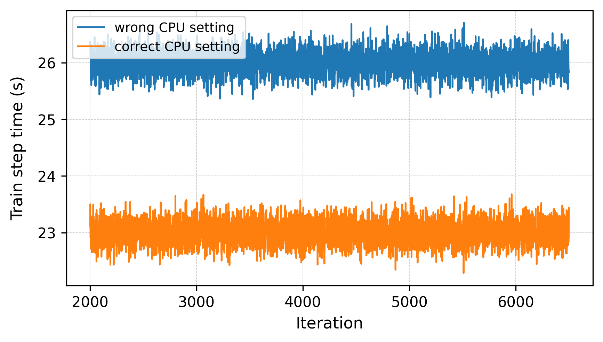
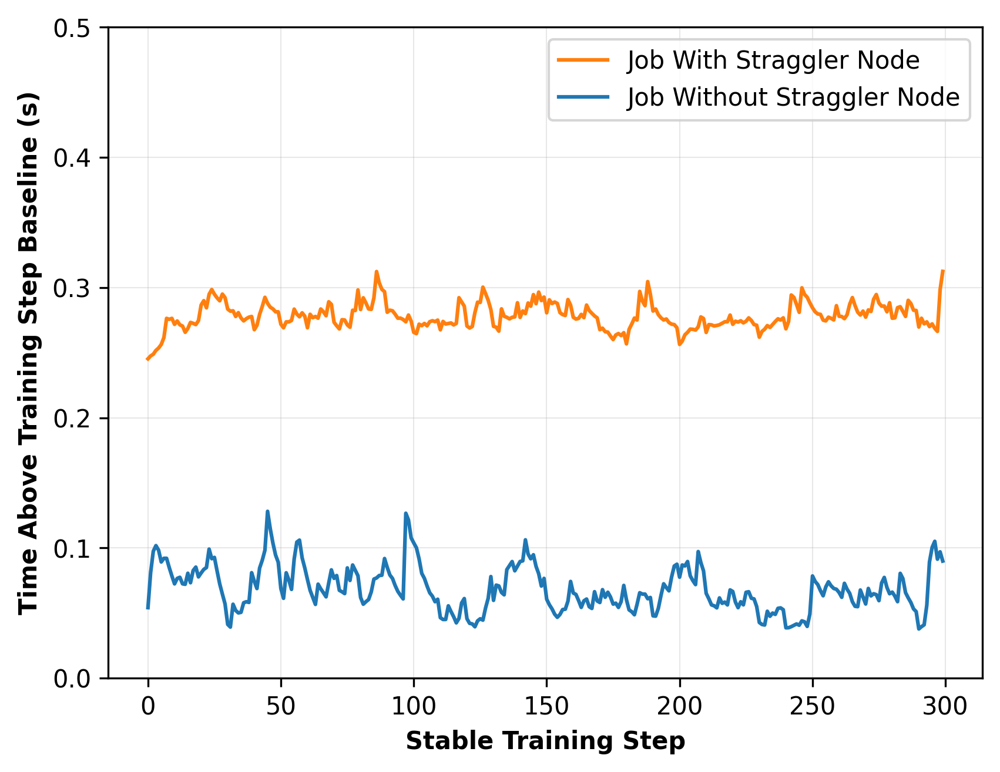
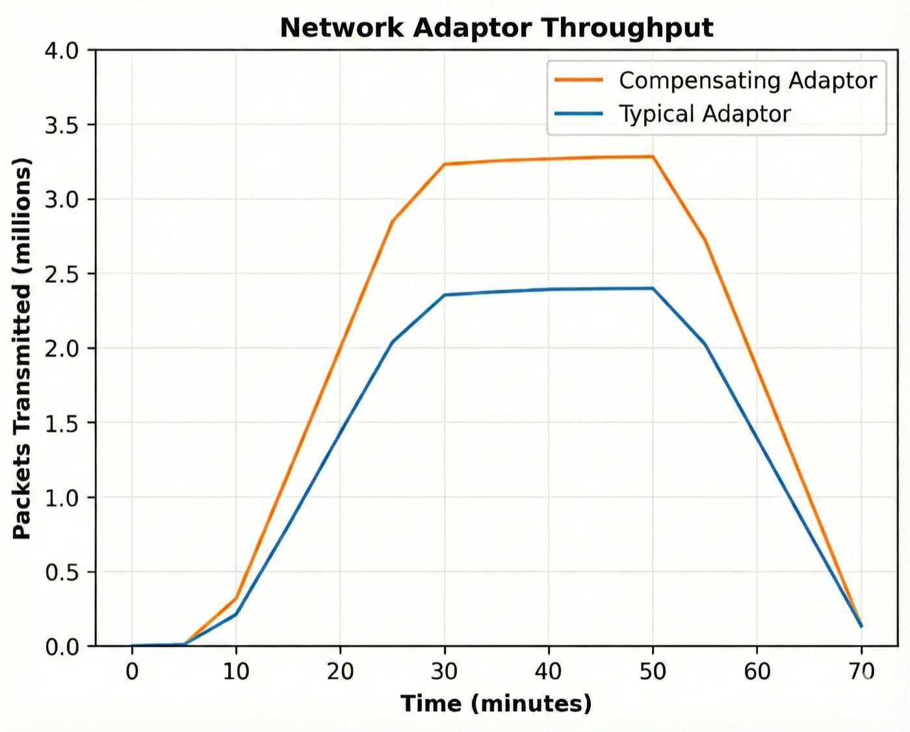
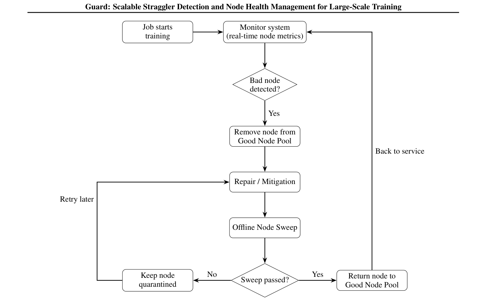
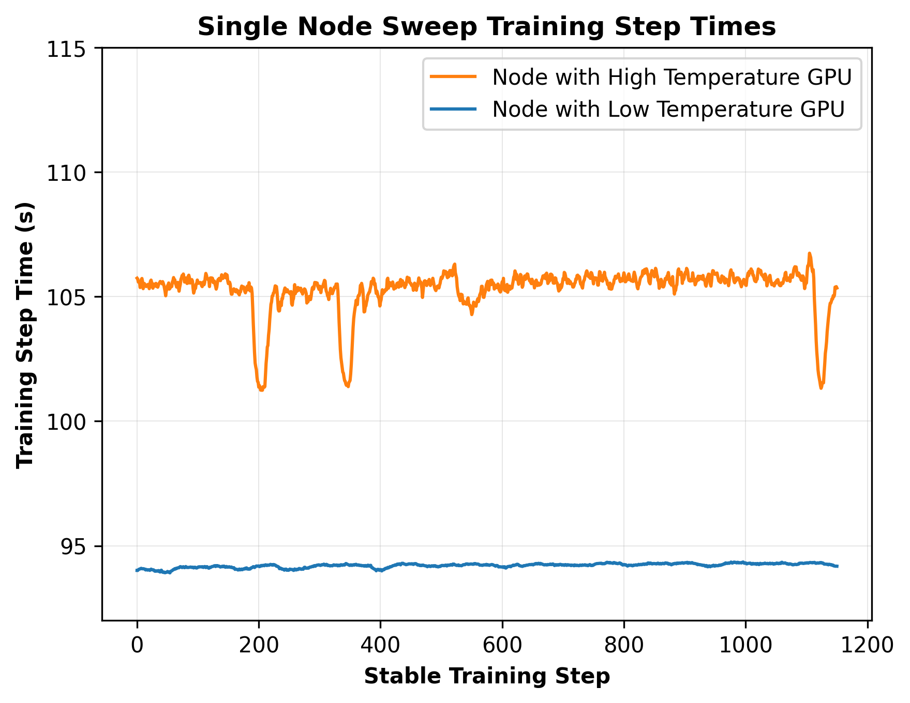
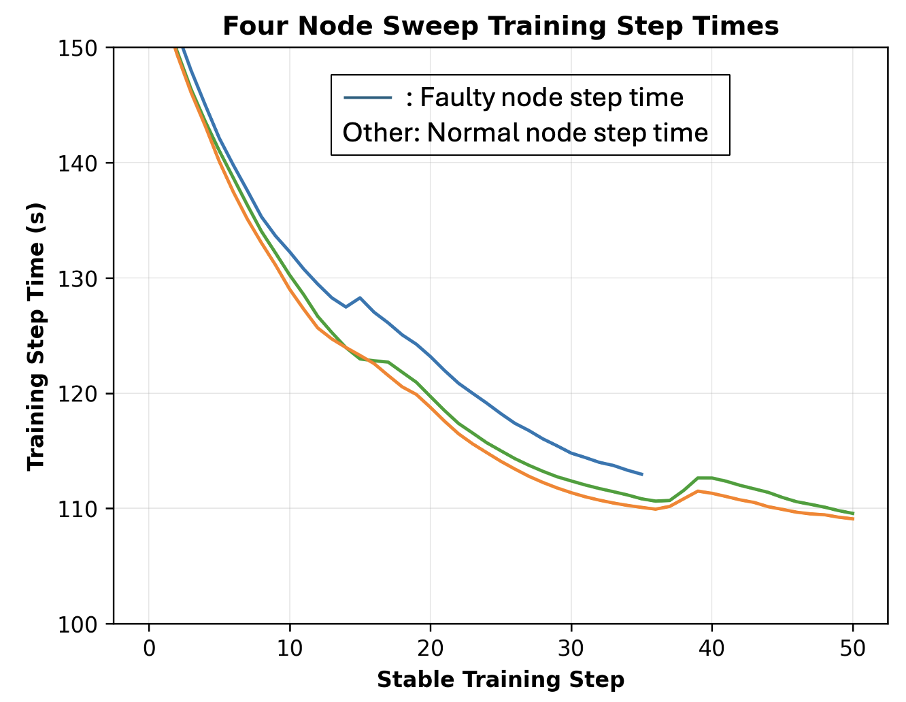
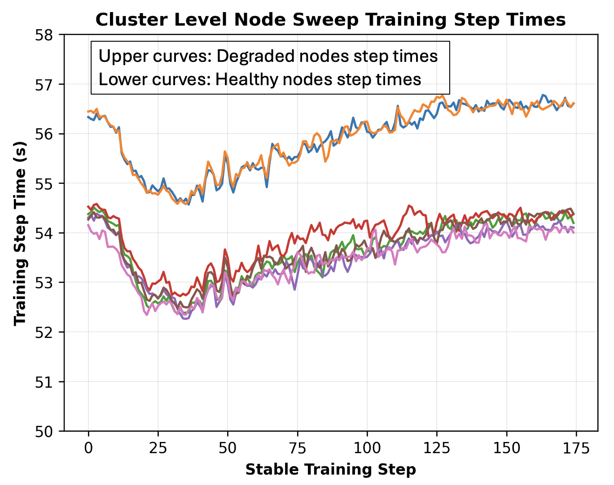
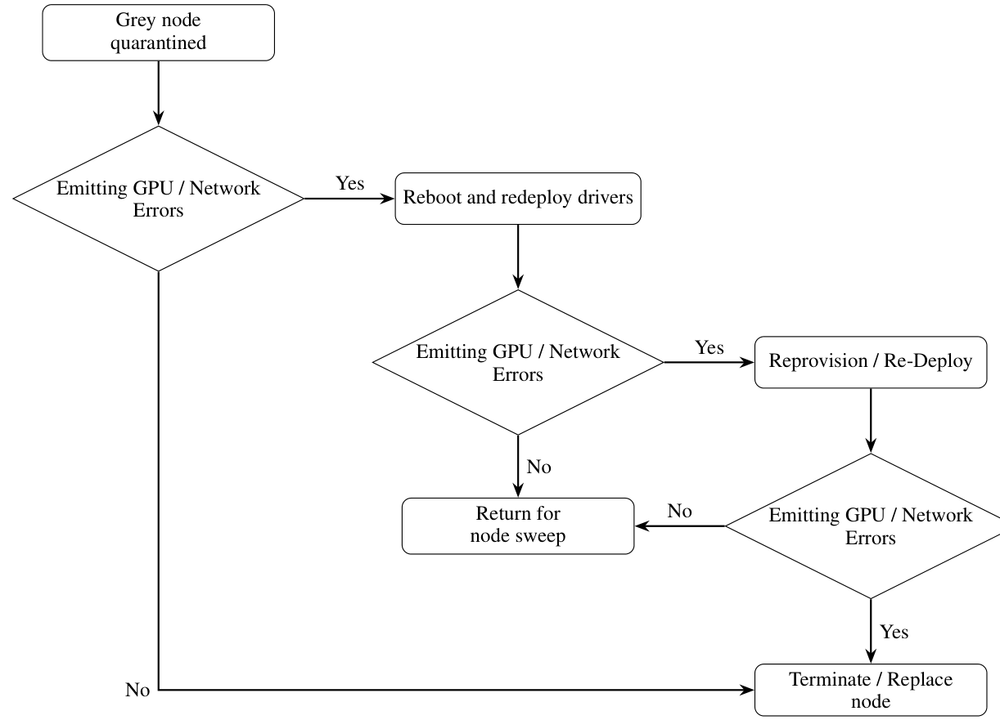
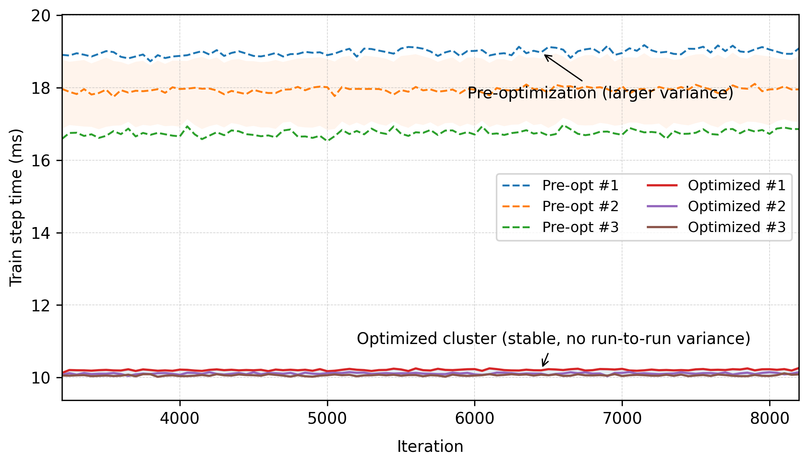
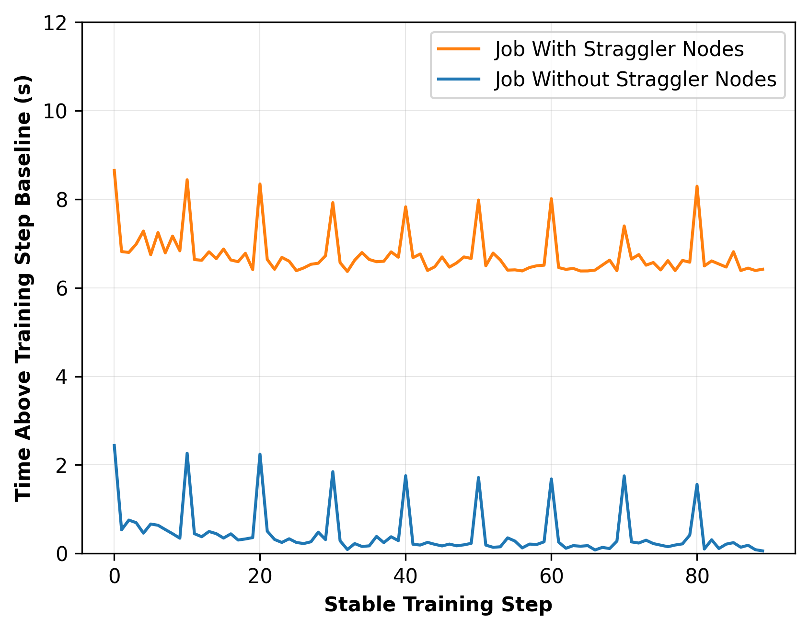

# Guard: Scalable Straggler Detection and Node Health Management for Large-Scale Training 阅读报告

| 元信息 | |
|---|---|
| **标题** | Guard: Scalable Straggler Detection and Node Health Management for Large-Scale Training |
| **作者 / 机构** | Guanliang Liu, Abhinandan Patni, Congzhu Lin, Zoe Zeng, Jack Wittmayer, Josh Wu, Ashvin Nihalani, Binxuan Huang, Yinghong Liu, Rory Na, Anthony Ko, Alexander Zhipa, Cong Cheng, Mi Sun, Vijay Rajakumar, Rejith George Joseph, Parthasarathy Govindarajen（Amazon Store Foundational AI, Seattle；共 17 人） |
| **发表** | MLSys 2026（Proceedings of the 9th MLSys Conference, Bellevue, WA, USA） |
| **链接** | [arXiv:2605.17879](https://arxiv.org/abs/2605.17879)（cs.DC，2026-05-18 v1） |
| **本地文件** | `paper.pdf`，`src/`（TeX 源码） |
| **标签** | #straggler-detection #grey-node #fail-slow #node-health-management #online-monitoring #fault-detection |

> 阅读日期：2026-11-03 · 整理：ZCode

## 一句话总结

Guard 是 Amazon 面向大规模 LLM 预训练的**"灰节点"（grey node / fail-slow）检测与节点健康管理系统**：以训练 step time 为首要端到端信号，用"在线轻量监控 + 离线 node-sweep 验证 + 分级分诊"的闭环替代传统 NCCL 测试 / GPU burn-in 这类只验功能正确性的健康检查。在数千 GPU 的生产预训练上，MFU 最高提升 **1.7×（10%→17%）**，run-to-run step time 方差从 **20% 降到 1%**，平均 MTTF 从 8.1h 提升到 **16.7h**。

## 背景与动机

- **规模放大效应**：前沿模型训练协调数万 GPU、持续数月，DP/TP/PP/EP 混合并行使 all-reduce / all-to-all 等同步操作极度密集，整体进度被**最慢参与者**卡住——单节点几个百分点的减速会在数千卡、数百万 step 上累积成巨大浪费。
- **灰节点问题**：指那些能通过标准健康检查（针对 fail-stop 故障设计）、却在真实负载下持续性能退化的机器。它们不报错、不崩溃，只是默默拖慢全局，是多周训练里稳定性的主要敌人。
- **传统手段为什么抓不住**：
  - *NCCL 测试*只跑几秒、只验连通性与集合通信正确性；更糟的是 NCCL 的容错机制会在网卡退化时**透明重路由**，测试照样通过，带宽损失被掩盖；
  - *GPU burn-in* 短时长、只强调算术正确性，压不到内存带宽、NVLink、PCIe 等持续负载下才暴露的子系统退化。
- **根因跨越多层**（作者的生产观察，Section 3）：
  1. **CPU 配置**：固定频率优于动态调频；MoE 等重通信模型比 dense 模型需要显著更多 CPU；配置不当吞吐损失可达 **15%**——GPU 利用率相同也不能说明节点健康（见下图）。
  2. **慢通信**：某 GPU 的网卡故障后，NCCL 自动改道走其他 GPU 的网卡（如 GPU7 的流量改走 GPU0），无任何告警，但该网卡流量翻倍、每 step 慢约 **0.3s**（8.7s→8.4s）。
  3. **GPU 退化**：温度从 50°C 升到 77°C，核心频率从 **1.93 GHz 掉到 1.38 GHz**；功耗低于集群均值 10–15% 的节点 FLOPS 利用率明显下降（供电/电压调节问题的信号）；内存老化 / ECC、灰尘与散热不均同样只影响持续吞吐。


*图 1：不同 CPU 配置下的训练 step time——GPU 硬件与利用率不变，吞吐差可达 15%（摘自原文 Fig. 2）*


*图 2：移除一条退化的通信路径后，训练 step time 从 8.7s 降到 8.4s（摘自原文 Fig. 3）*


*图 3：异常网卡（被 NCCL 重路由兜底的那块）的传输包指标， workload 异常翻倍（摘自原文 Fig. 4）*

## 方法


*图 4：自动节点健康管理工作流——在线监控发现坏节点 → 移出健康池 → 修复/缓解 → 离线 node sweep → 通过则回池、否则继续隔离（摘自原文 Fig. 1，TikZ 图，由 PDF 渲染提取）*

Guard = **在线监控（检测）+ 离线 node sweep（验证）+ 分级分诊（修复）** 的闭环，核心设计原则是：训练 step time（用户可见性能）是主信号，硬件指标只作辅助证据；所有指标**相对同作业的 peer 节点**评估而非绝对阈值。

### 在线节点健康监控

- **监控指标**（NVIDIA DCGM + 自研 sidecar 采集，30s–1min 轮询，低开销不干扰训练）：
  - GPU 侧：温度、利用率、核心频率、功耗（"高利用率但功耗异常低"是供电问题的强信号）；
  - 网络侧：网卡错误计数（重传、链路重试、link flap）、传输速率（Gb/s）、链路状态（网卡间歇性 reset 会被 NCCL 兜底掩盖）。
- **判定策略**：多信号 + 时间持续性过滤（须在**连续多个评估窗口**持续偏离 peer 基线才标记），抑制瞬态抖动导致的误报。
- **分级响应**（按性能影响严重度平衡处置紧迫性与作业打扰）：

| 观测到的影响 | 动作 |
|---|---|
| 无可观测影响 | 标记 pending verification，作业不动，加密监控 |
| 中等持续减速（~10%） | 可处理但不紧急，推迟到**下一个 checkpoint** 再处置 |
| 严重退化 / 停滞（≥20%） | 立即用健康节点替换并重启作业，节点下线维修 |

### 离线 node sweep（节点验证）

节点被移出健康池后，跑轻量诊断负载复现真实通信/同步模式，做端到端性能验证：

- **单节点 sweep**：测每张 GPU 的持续 FLOPS 一致性 + 节点内 NVLink 两两带宽与对称性——专抓 burn-in 抓不到的"卡内不对称"；
- **多节点 sweep**：压测跨节点集合通信。实验对比 2/4/8 节点配置，发现**绝大多数通信退化在 2 节点配置下就能暴露**（降级链路/错误路由立刻表现为延迟升高或带宽下降），故默认用 2 节点 sweep，性价比最高；
- **执行策略**：事件驱动（在线监控报警或维修后复检才触发），不做定期全量扫描；单次 1–2 小时足以暴露持续性退化；解读从保守——单节点 + 多节点都通过才回健康池，否则继续隔离。


*图 5：单节点 sweep 揭示同节点内各 GPU 的性能分化——这些 GPU 都通过了传统验证（摘自原文 Fig. 5）*


*图 6：2 节点 sweep 中纳入一个故障节点导致的 step time 膨胀（摘自原文 Fig. 6）*


*图 7：集群级 node sweep，随故障节点引入展示离线验证方法的可扩展性（摘自原文 Fig. 7）*

### 分级分诊工作流（triage）

灰节点故障根因不可见，修复采用自动化分级升级：有 GPU/网络报错 → 重启 + 重装驱动 → reprovision/重部署 → 仍报错则**终止/更换节点**；无报错则送回 node sweep 验证。经验规则：**一周内被标记 3 次**的节点直接人工判死换新（阈值依集群配置而定）。


*图 8：坏节点分级修复工作流——逐级升级的补救动作，失败最终走向更换节点（摘自原文 Fig. 8，TikZ 图，由 PDF 渲染提取）*

## 实验与结果

**环境**：数千 GPU 生产集群，8 卡节点（NVLink 节点内 + 外部高速网卡节点间），BF16 混合精度，DP/TP/PP/EP 全并行；数月 foundation model 预训练、数万亿 token 语料。


*图 9：应用节点健康监控系统前后，run-to-run 训练 step time 方差对比：**20% → 1%**（摘自原文 Fig. 9）*


*图 10：应用节点健康监控与节点选择策略后，平均训练 step time 从 17s 降到 10s（摘自原文 Fig. 10）*

| 实验 | 设置 | 关键结论 |
|---|---|---|
| 稳定性 | 数月生产预训练 | 坏节点被有效检测、隔离、恢复，run-to-run 方差 **20%→1%** |
| 训练效率 | 应用 Guard 前后 | 平均 step time **17s→10s**，吞吐约 **1.7×**（论文称 70% improvement，即 MFU 10%→17%） |
| 消融：+Node Sweep | 在 NCCL/burn-in 基础上加离线扫描 | MTTF 6.6h→8.1h，MFU 5%→10%，但**检测不到硬件退化** |
| 消融：+Online Monitoring | 再加在线监控 | MTTF **8.1h→9.2h（+14%）**，人工干预间隔 2.0h→1.2h（−40%），MFU 10%→14%，开始能检测硬件退化 |
| 消融：+Enhanced Node Sweep | 完整系统 | MTTF **9.2h→16.7h（+82%）**，人工干预 1.2h→**0.5h**（−58%），MFU 14%→**17%** |
| 分类准确性 | 1000 正/1000 负样本 | **FPR 12.4%**，**FNR 7.8%**——支撑了分级、可逆的保守分诊设计 |

**关键数字**：MFU 峰值提升 **1.7×**；MTTF 最高 **16.7h**；人工干预间隔降至 **0.5h**；step time 方差压到 **1%**；单次 node sweep 成本仅 **1–2 小时**（2 节点）。

作者已将监控与检测工具的子集开源进 Amazon 的 [fkat（Foundational Software Kit for AI Training）](https://github.com/amzn/fkat)。

## 结论

论文交付了一套生产级闭环系统：以 step time 为主的在线监控负责低成本实时发现可疑节点，离线 node sweep 负责在节点回池前做端到端验证，分级分诊负责自动化修复与淘汰。作者论证：主动的 straggler 检测 + 系统化的节点资质验证（node qualification）是维持大规模训练稳定与高效的关键，且该方案轻量、可扩展（在线监控开销固定、离线扫描不随集群规模增长）、可直接落地。

## 与鲁棒 LLM 训练的关联

- **覆盖链条的哪一环**：**故障检测**（面向 fail-slow/性能型故障，而非 fail-stop）+ **容错与恢复**（健康池管理、分级修复、节点替换）。它不做一致性校验，也不做检查点本身，但"中等减速推迟到下一个 checkpoint 处理"的分级策略与检查点环节直接衔接。
- **与已读论文的关系**：
  - 与 [SDCs in the Wild (OSDI 2026)](../osdi-2026-sdcs-in-the-wild/report.md) 恰好构成"灰色故障"的两个正交维度：那篇刻画**静默数据损坏**（正确性维度的 fail-slow），Guard 处理**静默性能退化**（效率维度的 fail-slow）；两者都指出"通过标准健康检查但在生产负载下出问题"是共性痛点。
  - 与 [Understanding Stragglers (OSDI 2025)](https://www.usenix.org/conference/osdi25/presentation/lin-jinkun) 的问题域直接重叠：那篇用 what-if 分析做 straggler 的**根因归因与诊断**，Guard 是**在线检测 + 闭环处置**的生产系统；一个回答"为什么慢"，一个回答"谁在拖后腿并处理掉它"。
  - 与 [ByteDance 鲁棒训练基础设施 (SOSP 2025)](../sosp-2025-robust-llm-training-bytedance/report.md) 相比，ByteDance 覆盖以 fail-stop 为主的检测/容错全景，Guard 深耕 fail-slow 这一细分环，可视为该链条在性能型故障上的专门补强。
  - Guard 的输出（坏节点名单 + 分级动作）天然是 [TrainMover (OSDI 2026)](../osdi-2026-trainmover/report.md)、Anchor 这类弹性运行时/恢复系统的上游输入。

## 局限性与思考

- **检测算法细节缺失**：论文只给出指标清单和"相对 peer + 多信号 + 连续窗口"的原则性描述，没有具体的统计模型、阈值或算法伪代码，第三方复现门槛高。定位是生产系统经验论文而非方法论论文（个人理解）。
- **FPR 12.4% 不低**：约每 8 个健康节点就有 1 个被误伤进 1–2 小时的 sweep 验证流程；论文靠"早期动作轻量可逆 + 分级升级"来兜住误伤成本，但没有给出闭环误伤总开销的量化。
- **"17s→10s（70% improvement）"的对比条件未完全隔离**：该数字来自生产环境前后对比，可能混入同期其他运维改进（如 CPU 配置修复）；消融表（MTTF/MFU）相对更可信（个人理解）。
- **MFU 绝对值偏低（5%–17%）**：论文未说明具体模型类型（疑似 MoE）与负载细节，与其他论文横向比较 MFU 需谨慎。
- **轮询粒度 30s–1min**：论文自己强调 transient step time 尖刺是一类重要模式，但这个采样粒度对亚分钟级瞬态的捕获能力存疑（个人理解）。
- **2 节点 sweep 的覆盖边界**：依赖更大拓扑（跨交换机路径、全局路由）的退化未必能被 2 节点配置暴露，作者承认更大配置边际收益递减但未给 4/8 节点的定量对比数据。
- **"一周 3 次判死"等经验阈值**依赖特定集群的故障率与配置，迁移到其他环境需要重新调参。

---

*BibTeX（按 arXiv 元数据与 MLSys 2026 proceedings 信息整理）：*

```bibtex
@inproceedings{liu2026guard,
  title     = {Guard: Scalable Straggler Detection and Node Health Management for Large-Scale Training},
  author    = {Liu, Guanliang and Patni, Abhinandan and Lin, Congzhu and Zeng, Zoe and Wittmayer, Jack and Wu, Josh and Nihalani, Ashvin and Huang, Binxuan and Liu, Yinghong and Na, Rory and Ko, Anthony and Zhipa, Alexander and Cheng, Cong and Sun, Mi and Rajakumar, Vijay and Joseph, Rejith George and Govindarajen, Parthasarathy},
  booktitle = {Proceedings of the 9th MLSys Conference (MLSys)},
  year      = {2026},
  address   = {Bellevue, WA, USA},
  note      = {arXiv:2605.17879 [cs.DC]}
}
```
