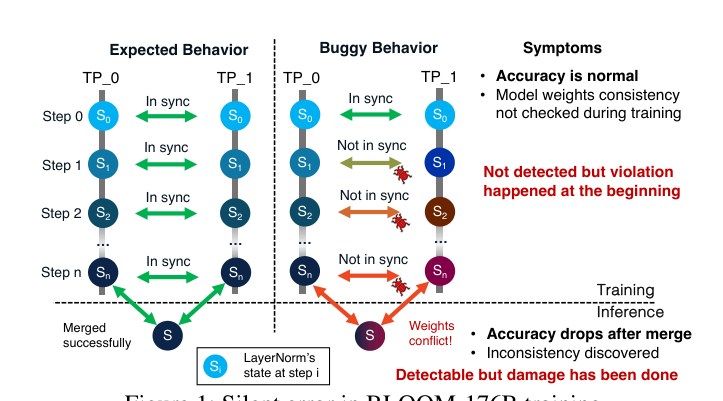
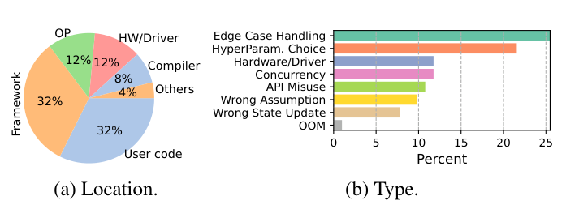
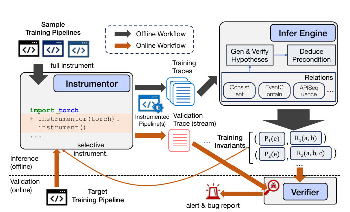
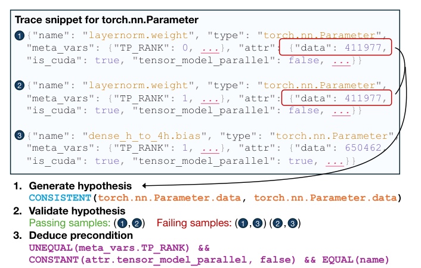
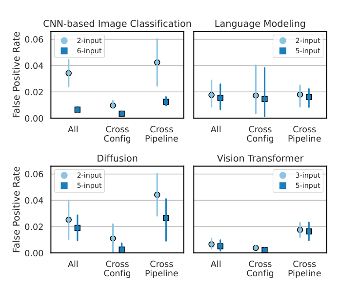
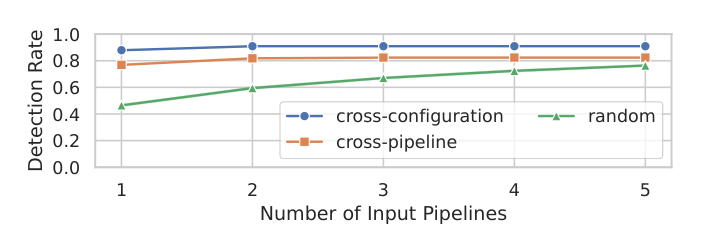
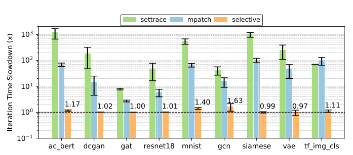

# Training with Confidence 阅读报告

| 元信息 | |
|---|---|
| **标题** | Training with Confidence: Catching Silent Errors in Deep Learning Training with Automated Proactive Checks |
| **作者 / 机构** | Yuxuan Jiang, Ziming Zhou, Boyu Xu, Beijie Liu, Runhui Xu, Peng Huang（University of Michigan, OrderLab） |
| **发表** | OSDI 2025 |
| **链接** | [USENIX: osdi25/presentation/jiang](https://www.usenix.org/conference/osdi25/presentation/jiang) · 开源：<https://github.com/OrderLab/TrainCheck> |
| **本地文件** | `paper.pdf` |
| **标签** | #fault-detection #silent-errors #invariant-inference #consistency-checking #debugging |

> 阅读日期：2026-11-03 · 整理：ZCode（基于 USENIX PDF 通读）

## 一句话总结

深度学习训练中存在大量**静默错误**——不抛异常、loss/accuracy 也正常，但模型悄悄变坏（典型案例：BLOOM-176B 训练中 DeepSpeed 梯度裁剪 bug 使 LayerNorm 权重跨 TP rank 发散，**10 天才被发现**）。本文提出 TRAINCHECK：从样例训练管线**自动推断带前置条件的"训练不变量"**（如"同一迭代内、跨 TP rank 复制的参数应当一致"），在训练运行时流式校验，对 20 个真实静默错误**检出 18 个且全部在根因触发后一个迭代内报出**（对比：基于 loss/accuracy 信号的检测器只检出 2 个），另发现 6 个未知 bug（3 个已修复），在线选择性插桩开销典型 **<2%**。

## 背景与动机

**静默错误是 DL 训练的隐形杀手。** 训练栈横跨用户代码、框架、编译器、数学算子、驱动与分布式系统，且组件高频更新。部分错误立即崩溃（OOM、参数异常），容易处理；另一类**静默 / 潜伏错误**不中断训练，最终产出次优或错误模型，或者很久之后才显性失败。


*图 1：动机案例。Megatron 风格 TP 下 LayerNorm 不切分、各 rank 复制；DeepSpeed BF16Optimizer 的梯度裁剪 bug 只在第一个 GPU 上生效，LayerNorm 权重从训练一开始就静默发散。训练期间 accuracy 正常（权重一致性从未被检查），直到合并 checkpoint 时冲突才暴露——BLOOM-176B（384 A100 × 3.5 个月）为此耗费 10 天检测 + 9 天修复（摘自原文 Fig. 1）*

作者复现了该 bug（4 TP × 2 DP 小 transformer，CodeParrot 数据集）：训练 2000/4000 迭代后合并权重，验证/测试集 loss 与 ppl 偏差达 **+1.14% ~ +4.79%**，且随迭代数增大（Table 1）——静默错误的影响会持续累积。

**实证研究（§2，88 个真实案例）**：从 PyTorch/DeepSpeed GitHub issues（70）、StackOverflow/PyTorch 论坛（16）、工业报告（2：BLOOM、OPT）中筛选根因明确的静默错误：


*图 2：88 个静默错误的根因位置与类型分布。位置上用户代码与框架各占 32%，算子 12%、硬件/驱动 12%、编译器 8%——**全栈皆可致病**；类型上覆盖边界处理、超参、并发、API 误用、错误假设、错误状态更新等（摘自原文 Fig. 2）*

**现有手段为什么不行**：

1. **loss / accuracy / 梯度范数等高层信号**：不是为检错设计的——噪声大、只周期性评估、误报率高，且即使发现异常也几乎不提供根因线索（BLOOM 案例中 loss/accuracy 全程正常；BloombergGPT 的 loss 平台期 7 天才被开发者注意到）；
2. **静态点方案**（如 PyTea 的张量形状约束）：只覆盖特定根因类别；
3. **人工试错**：调超参重跑、二分排查，在大规模任务上极其昂贵。

**两个关键洞察**（作者分析案例后得出）：

- 静默错误在高层信号上显形慢且看似随机，但**根因几乎都在早期触发，且可被特定的低层检查捕获**——不变量的观察层次应介于模型评估信号与传统软件不变量（如 Daikon 的 `var1 > var2`）之间，用**规则级语义**（如"TP rank 间复制参数应一致"）换取确定性；
- 训练程序高度复用外部库与相似方法，**不变量可跨程序迁移**——可以从官方教程等高质量管线推断不变量，再部署到自己的训练任务。

## 方法


*图 3：两阶段工作流。离线：对样例管线全量插桩收集 traces → Infer Engine 推断训练不变量及前置条件；在线：对目标管线**选择性插桩**（只埋与不变量相关的点）→ Verifier 流式消费 trace 校验，违规即告警并附上相关 trace 辅助定位（摘自原文 Fig. 3）*

### 1. 不变量表示：关系模板 + 描述符

不变量 = 关系（relation）实例化为具体的变量 / API 描述符。作者从静默错误的分析中提炼出五类内置关系（Table 2）：

| 关系 | 语义 | 典型捕获 |
|---|---|---|
| `Consistent(Va, Vb)` | 两变量属性值应始终相同（可变但相等） | 分布式训练参数一致性、共享参数 |
| `EventContain(Ea, Eb)` | Ea 调用期间必须发生 Eb | `Optimizer.step` 应包含参数更新——**抓住 AC-2665"优化器空转"这类静默控制流偏离** |
| `APISequence(Ia, Ib, …)` | 一组 API 必须按序调用 | 忘记 `zero_grad()` 导致梯度噪声 |
| `APIArg` / `APIOutput` | 参数一致性 / 输出属性约束 | autocast 下输出 dtype 应随上下文 |

这些关系是**确定性**的，编码严格语义，不做概率判断——这是"选对观察层次"的直接体现。

### 2. Trace 收集（Instrumentor）

- **API 追踪**：monkey-patching 动态注入（`sys.settrace` 实测减速 **200–550×**，弃用）；递归遍历模块 namespace 包装函数，跳过 `torch.jit`/`torch._C` 等高频低价值内部函数；
- **变量追踪**：CPython 赋值在 C 层无钩子，不可能高效追踪任意变量。关键洞察：**静默错误无论根因在哪，最终都会影响模型与优化器这一小撮长生命周期对象**——只跟踪它们。Proxy 包装拦截 `__setattr__` 等魔法方法（需要精确时序时），或退化为在 `Optimizer.step` 上注册采样回调（低开销）；
- **只记 tensor 哈希**：静默错误源于 shape/dtype/相等关系而非具体数值，序列化整个模型状态等同做 checkpoint，开销不可接受；
- **meta 变量**：迭代号、分布式 rank、活跃 context manager 等（走调用栈找最外层循环变量的启发式 + 用户 `set_meta` 注入），是前置条件推断的上下文基础。

### 3. 不变量推断（Infer Engine）

假设驱动三步（Algorithm 1/2）：**生成假设**（扫描 trace，用描述符实例化关系模板）→ **验证**（在全部 trace 上记 pass/fail 样例）→ **推导前置条件**。


*图 4：针对 BLOOM 案例推断出的不变量。从 `torch.nn.Parameter` 的 trace 片段出发，生成 `CONSISTENT(Parameter.data, Parameter.data)` 假设，验证得到 1 个 pass / 2 个 fail 样例，最终推导出前置条件 `UNEQUAL(TP_RANK) && CONSTANT(tensor_model_parallel, false)`——即"跨 TP rank 且未被切分的参数应保持一致"（摘自原文 Fig. 4）*

**前置条件推导**是本文最有味道的部分：

- 四类原子条件：`CONSTANT`（恒等于特定值）/ `CONSISTENT`（恒同）/ `UNEQUAL`（互异）/ `EXIST`；
- 候选前置条件 = 所有 pass 样例满足条件的**合取**，再对 fail 样例验证安全性；不安全则按统计显著性依次追加条件（如 `cond1 && cond2 && (cond3 || cond4)`），或把 pass 样例分子群分别推断后**析取合并**——处理"同一不变量在多场景成立"的情形（DP workers 一致 与 TP LayerNorm 一致）；
- **剪枝无关条件**：不被任何 fail 样例违反的条件（如 `is_cuda=True`）无判别力，删；`Consistent` 关系禁止把其他 tensor 属性当条件（否则"梯度一致"这种肤浅条件会挡住更深的场景拆分）；
- **防肤浅不变量**：推不出前置条件的不变量一律不部署。这一点与统计显著性筛选（按 pass/fail 比例）形成关键对比——TP 下 LayerNorm 参数只占 transformer 参数的 **<0.1%**，一致性不变量的 pass/fail 比是 **1:38**，统计方法会误杀这个恰好抓住 BLOOM bug 的重要不变量。

**可扩展性**：descriptor 按类型+属性分组变量（BLOOM 2-GPU 70M 参数 run：104 个变量实例 → 5,356 对，收拢到 `torch.nn.Parameter` 类型级）；trace 量大（92k records / 50MB 每迭代）但关系模板 + 描述符把搜索空间压到可处理。

**输入要求低**：全部实验的不变量都来自 **≤4 GPU、≤100 迭代**的小规模运行——推断 BLOOM 相关不变量只需 2-GPU run，代表性行为无需大规模复现。

### 4. 在线校验（Verifier）

只插桩与已部署不变量相关的 API/变量（selective instrumentation）；流式消费 trace，先评估前置条件、满足才检查不变量；违规时报告不变量 + 对应 trace 作为调试线索。

## 实验与结果

环境：Xeon 4310 + A40（分布式另用 8×A2 服务器），PyTorch 2.2.2 / CUDA 12.1。对比基线：spike detector、trend detector、异常检测（LOF / Isolation Forest / Z-Score，作用于 loss/accuracy 等高层指标）、PyTea / NeuRI。

| 实验 | 设置 | 关键结论 |
|---|---|---|
| **静默错误检测**（§5.1） | 复现 20 个真实静默错误（6 个来自实证研究 + 14 个新收集） | TRAINCHECK **检出 18/20**，全部在根因触发后 **≤1 个迭代**内；五类关系全部用上；信号类检测器合计仅检出 2（模型彻底不学习、loss 恒定的极端情形），PyTea/NeuRI 检出 1 |
| **诊断辅助**（§5.1） | 18 个检出案例 | 10 例违规报告直指根因，8 例接近根因（诊断不是主要目标但顺带可用） |
| **发现新 bug**（§5.2） | 监控 DeepSpeed/Transformers 未解决 issue | **6 个新静默 bug**（Table 3：AC-2665、DS-6770、DS-5489、DS-6714、DS-6772、DS-6089），3 个已确认修复 |
| **误报率**（§5.3） | 63 个无已知 bug 的训练程序，4 类任务（CNN 图像分类 / 语言建模 / Diffusion / ViT） | 5–6 输入管线时 **<2%**，2–3 输入时 <5% |
| **不变量迁移性**（§5.4） | 有效不变量应用到全部 63 个管线 | 每个不变量至少额外适用于 1 个管线；>8% 适用于 >16 个管线；**带前置条件的不变量比无条件的更可迁移**；PyTorch-only 不变量 23% 适用于 >16 个管线 |
| **漏报**（§5.5） | cross-config / cross-pipeline / random 三种推断来源 | 2 个输入管线时检测率 91% / 82%，random 5 输入达 76% |
| **在线开销**（§5.6） | 9 个程序部署 100 个随机不变量，选择性插桩 vs settrace vs 全量插桩 | 选择性插桩典型 **<2%**，最坏 1.6×（GCN/MNIST 等每迭代本身极快的玩具负载）；真实负载 GPU-bound，开销更低（ac_bert 1.17×、resnet18 1.00×、siamese 0.99× 等） |
| **推断效率**（§5.7） | 复用误报实验的 traces | 推断时间随 trace 规模近平方增长（trace 更大 → 假设更多）；最坏 8.2 个标准程序 trace（~542MB）耗时 **38 小时**（离线、单线程） |


*图 5：四类任务的误报率，细分 cross-config（仅配置不同）与 cross-pipeline（代码不同语义相似）。主设置（5–6 输入）下各类均 <2%（摘自原文 Fig. 7）*


*图 6：检测率 vs 推断用输入管线数。cross-config 两个输入即达 91%；random 设置起步低但随输入增多稳步提升至 76%——未检出的案例多因特殊特性（如 MoE）在样例管线中欠表示（摘自原文 Fig. 9）*


*图 7：三种插桩方式的迭代时间减速。settrace（下限的日志型 trace）已达数十到上千倍；mpatch 全量插桩个位数到百倍；选择性插桩在真实负载上基本无感（摘自原文 Fig. 10）*

**漏检的 2 个案例**很有代表性：TF-33455（训练步数计算错误导致提前停止——需要跟踪 Python 原始变量，开销不可接受）；TF-29903（`safe_checkpoint` 内部 state dict 损坏——局部变量 + 不影响主训练逻辑）。

**案例研究 AC-2665**（§5.2，最能体现诊断价值）：用户迁移到 DDP 后模型完全不学习，只试出 `use_orig_param=true` 能修但不知根因。TRAINCHECK 用 GCN 教程推断的不变量查出 3 条真违规（`zero_grad` 应把 grad 变零、`step` 应包含参数 data 变更、`step` 应包含 `_foreach_add` 等数学操作）→ 指向优化器持有错误参数 → 确认 DDP 自动展平原参数而用户用原始参数初始化了优化器。100 条违规中 52 条为真、其余呈可快速排除的模式（GCN 特定常量、ReLU 缺失与 T5 无关）——**违规可按 API 聚类结构性审阅，真违规往往多条互证**。

## 结论

- 静默错误需要**主动校验**（proactive checks）而非被动等信号显形；核心抽象是"训练不变量 + 前置条件"；
- TRAINCHECK 是第一个面向 DL 训练自动推断并检查不变量的端到端框架（22.7K LoC Python，开源），检测快（一个迭代内）、准（误报 <2%）、省（在线 <2% 开销）、可迁移（跨管线甚至跨库）；
- 实战价值已验证：6 个新 bug 被发现，3 个被上游修复。

## 与鲁棒 LLM 训练的关联

- **覆盖链条的哪一环**：**故障检测**（静默错误检测，运行时持续校验）+ **一致性校验**（分布式参数一致性、API 调用时序/包含关系等语义规则）。明确不覆盖：容错与恢复（检出后交还开发者处理）、检查点。范围限定在**正确性违规**（buggy API、误用），不含超参不当这类"优化敏感"问题。
- **与已读论文的关系**：
  - [SOSP 2025 | ByteDance 鲁棒训练](../sosp-2025-robust-llm-training-bytedance/report.md)：ByteRobust 的检测靠"系统巡检项 + 训练指标阈值"（EUD 召回率仅 ~70%），TRAINCHECK 提供了另一种检测粒度——**从样例自动推断的语义级不变量**，正好对应 ByteDance 报告中"两类检测粒度"的对照面；二者互补：ByteRobust 强在基础设施故障（硬件/网络）的定位与快速恢复，TRAINCHECK 强在用户代码/框架逻辑 bug 的早期捕获，BLOOM 案例那类 bug 在 ByteRobust 的巡检项里没有对应物。
  - [OSDI 2026 | TrainMover](../osdi-2026-trainmover/report.md)：TrainMover 明确"不做检测、不覆盖用户级 bug 与数据损坏"，假设故障已被外部监控定位隔离；TRAINCHECK 恰好是那个"外部监控"在**静默错误维度**上的候选补位者——不变量违规 → 触发 TrainMover 的换机/迁移不成立（软件 bug 换机无用），但可以先于损坏累积触发 checkpoint 回滚。
  - [OSDI 2026 | SDCs in the Wild / Online SDC Detection](https://www.usenix.org/conference/osdi26/presentation/zheng)：SDC 是**硬件层数值损坏**（bit flip 级），TRAINCHECK 管**软件层逻辑违规**，层次正交；但"跨 rank 参数一致性检查"与 SDC 检测的冗余计算校验在手段上同源，且 TRAINCHECK 的 tensor 哈希对 SDC 这类数值位翻转恰好不敏感——两类方法在真实故障谱上互为补充。
  - [SOSP 2025 | TrainVerify](https://arxiv.org/abs/2506.15961)：同属一致性校验，但 TrainVerify 验证的是**改并行策略前后训练的等价性**（离线、成对对比），TRAINCHECK 是**训练过程中的持续不变量校验**（在线、单任务自校验），一个管"变更正确"，一个管"运行正确"。

## 局限性与思考

- **与 JIT 编译冲突**：插桩干扰 torch.compile，无法分析优化后的代码路径；
- **仅 Python 层**：Flash Attention 等以底层语言实现的组件不可见（硬件/驱动层的 12% 根因也只能间接受益）；
- **tensor 只记哈希**：无法做细粒度数值分析，超参不当引发的数值不稳定检测不了（作者划给超参调优 / 数值缺陷检测工作去补）；
- **结构性盲区在样例侧**：漏报分析显示，未检出的错误多因特殊特性（如 DeepSpeed MoE，15 个教程里只有 1 个覆盖）在推断输入中欠表示——不变量质量受制于样例管线的**语义覆盖度**，冷门特性的不变量无人可学；
- 推断最坏 38 小时且单线程（离线可接受，但随 trace 近平方增长的曲线值得警惕）；当前实现同步落盘 JSON，作者自己也列出了异步/批量化日志等优化方向；
- （个人理解）**前置条件是双刃剑**：它换来低误报与可迁移性，但也意味着不变量的适用域被 pass/fail 样例划定的边界锁死——目标管线出现样例中不存在的新配置组合时，不变量要么不适用（漏检）要么误触发。论文用 63 管线验证了常见情形，但生产环境的长尾配置仍是未知数。另一个可跟进的点：把不变量违规接入训练框架的自动响应（如自动回滚到上一个通过校验的 checkpoint），让"检测"闭合到"恢复"——论文目前止步于告警。

---

*BibTeX（取自 USENIX 会议页）：*

```bibtex
@inproceedings {294904,
  author    = {Yuxuan Jiang and Ziming Zhou and Boyu Xu and Beijie Liu and Runhui Xu and Peng Huang},
  title     = {Training with Confidence: Catching Silent Errors in Deep Learning Training with Automated Proactive Checks},
  booktitle = {19th USENIX Symposium on Operating Systems Design and Implementation (OSDI 25)},
  year      = {2025},
  isbn      = {978-1-939133-47-2},
  address   = {Boston, MA},
  publisher = {USENIX Association},
  month     = jul,
  pages     = {313--330}
}
```
