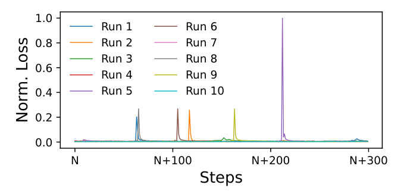
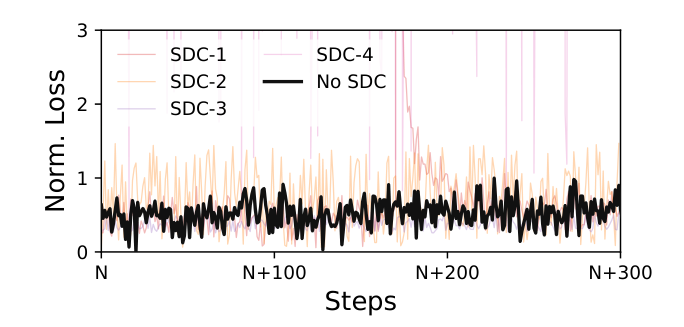
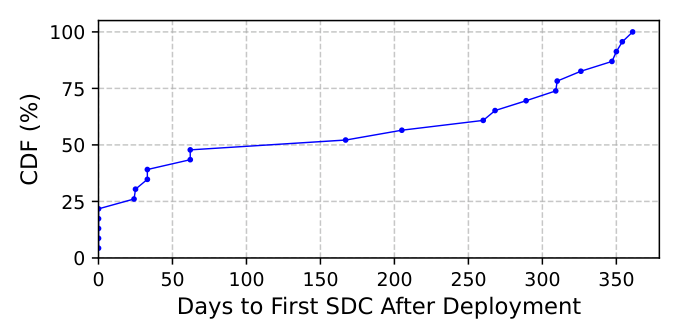
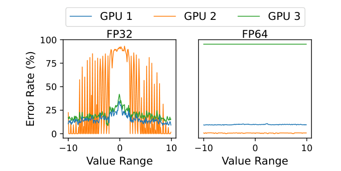
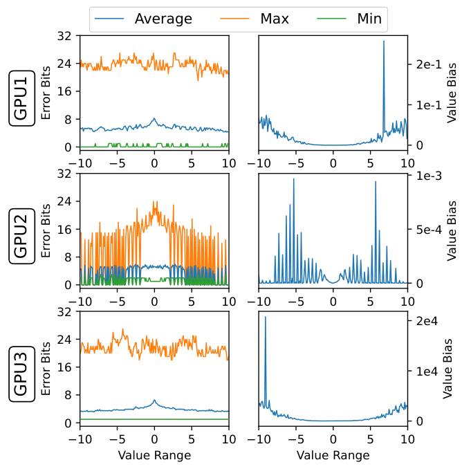
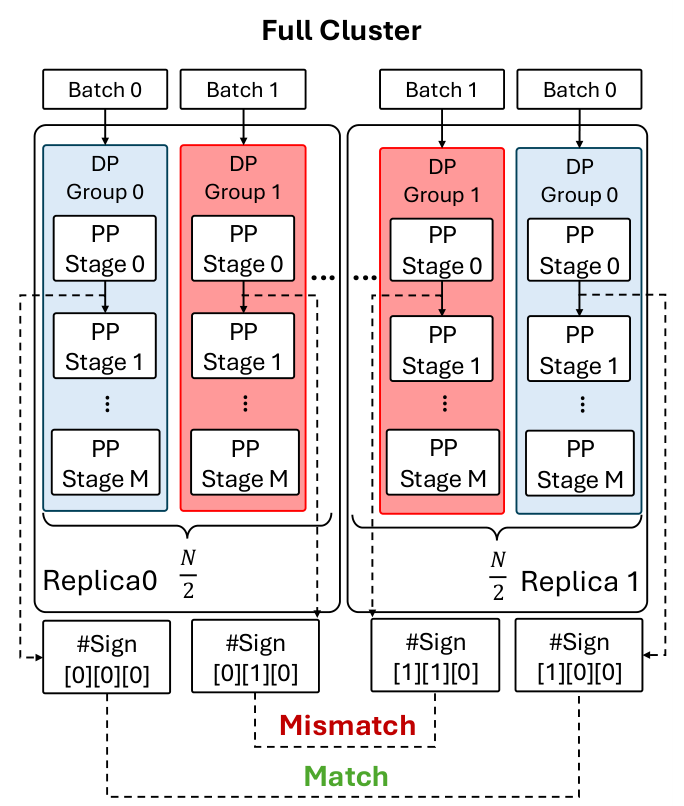
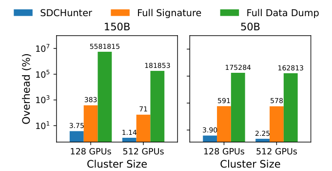

# SDCs in the Wild: Characterizing and Diagnosing SDC-Defective GPUs in Production LLM Training 阅读报告

| 元信息 | |
|---|---|
| **标题** | SDCs in the Wild: Characterizing and Diagnosing SDC-Defective GPUs in Production LLM Training (Operational Systems) |
| **作者 / 机构** | Wenxin Zheng, Wenxiao Wang, Yun Zhang, Mingcong Han, Bin Xu, Jinyu Gu, Xingda Wei, Haibo Chen, Zuquan Song, Gaohong Liu, Yucheng Nie, Zhe Nan, Zhuolin Zheng, Huan Yu, Shuguang Wang, Ziming Zhou, Hang Zhu, Wencong Xiao, Xin Liu（上海交通大学、ByteDance Seed） |
| **发表** | OSDI 2026（Seattle, WA, USA） |
| **链接** | [USENIX](https://www.usenix.org/conference/osdi26/presentation/zheng) |
| **本地文件** | `paper.pdf` |
| **标签** | #silent-data-corruption #fault-diagnosis #deterministic-training #gpu-reliability #production-llm-training |

> 阅读日期：2026-11-03 · 整理：ZCode

## 一句话总结

对 ByteDance 生产集群中 **23 块确认 SDC 缺陷的 GPU** 做了首个大规模生产级刻画，发现 SDC 源于**老化退化**（而非只出现在新硬件）、**强数据/算子依赖**且对 **ECC 与温度监控完全不可见**，导致合成压测漏检 **>60%** 缺陷卡；据此提出诊断系统 **SDCHUNTER**——基于确定性训练的"exact workload replay"，两阶段（PP 边界签名分组 → 全量 tensor 对比定位）把出问题的 DP 组快速隔离、设备级定位挪到离线，生产中已缓解 **40 起** SDC 事故，诊断时间从数天压缩到 **1 小时内**。

## 背景与动机

- **SDC（Silent Data Corruption）**：无任何错误信号的静默数据损坏。单体概率极低，但万卡训练数月的长跑使其必然发生——Meta 报告 16,000 GPU 训练中硬件故障约每 **2.78 小时**一次、其中 ~1.4% 归因 GPU SDC；Google TPU 集群每 1–2 周一次 SDC；ByteDance 三个月记录 **6,096 个 implicit error**。
- **真正的痛点不是频率而是模糊性**：GPU SDC 表现为 shape mismatch、越界访问这类 fail-stop 错误，或 loss spike 这类隐式劣化，与软件 bug / 数值不稳定**无法区分**。工程师本能先查软件，经常浪费数周调试"幻影代码问题"，最后才靠排除法定位到硬件。
- **现有工业实践失效**：标准做法是跑硬件诊断工具和合成压测（如全卡 GEMM 循环），但经验数据显示这些合成测试**漏检超过 60%** 的缺陷 GPU。
- 两个真实案例说明 SDC 的欺骗性：
  - *Case 1（fail-stop）*：SDC 腐蚀 MoE token count 聚合 → scatter 到预分配 buffer 时 shape mismatch / 越界段错误。**崩溃现场的代码是对的**——错误早在之前某个 kernel 就已发生，报错位置是误导。
  - *Case 2（隐式 loss spike）*：同一 checkpoint 起 10 次训练，Run 1/2 复现尖刺、Run 3/4 正常、Run 5/6/8/9 又在**完全不同的步数**出尖刺（见下图）。代码 bug 通常在固定逻辑点失败，这种随机性指向硬件浮点单元故障。


*图 1：SDC 引起的 loss spike——10 次重跑（同 checkpoint），尖刺出现但形态与位置不固定，与软件 bug 的确定性复现模式相悖（摘自原文 Fig. 4）*


*图 2：有无 SDC 的训练 loss 曲线对比（同 checkpoint 采集）。无 SDC 时 loss 保持在窄带内，SDC-1~4 造成明显偏移，后续 checkpoint 可能因此作废（摘自原文 Fig. 5）*

- **发生率跨度是漏检的根源**：定义"SDC 发生率"为确定性重放告警工作负载时产出错误 tensor 的比例，实测跨越 **100% ~ 10⁻⁶%**。低发生率卡在合成压测里几乎不可能暴露。发生率越低，代价越爆炸：

| SDC Rate | 预期步数 | 污染 ckpt | 重训开销 | 调试开销 |
|---|---|---|---|---|
| 100% | ~1 | ≤1 | 0.011% | 0.029% |
| 10% | ~10 | ≤1 | 0.020% | 0.29% |
| 1% | ~100 | ~1 | 0.110% | 2.90% |
| 0.1% | ~1,000 | ≥1 | 1.510% | 29.0% |
| **0.01%** | ~10,000 | ≥10 | 1.510% | **2.9×** |

  按工业界标准软件诊断方法，诊断一张 p=0.01% 的缺陷卡所需并行算力约等于**训练 3 个完整 LLM（≈290%）**——纯软件重放路线在超大规模集群上数学上不成立，必须换打法。

## SDC 缺陷 GPU 的特征刻画（23 块生产实卡）

从时间模式、微架构来源、触发条件、可见性四个维度刻画，每条结论都有明确适用范围声明：

**1. 时间模式：SDC 出现在整个硬件生命周期，主因是老化。**


*图 3：首次 SDC 出现时间分布（CDF）——仅 25% 在部署前 burn-in 检出，40% 在部署约一年后才浮现（摘自原文 Fig. 6）*

只有 **25%** 在 pre-deployment burn-in 检出；25% 在前两个月、10% 在六个月内、**40% 在约一年后**才浮现。厂商分析指向**计算电路的电阻漂移**（长期高负载电应力逐步改变阻值 → 算术错误），是累积退化而非制造缺陷——一旦出现不可逆，且错误率会随时间升级走向永久失效。**结论：需要全生命周期持续监控，一次性验收不够。**

**2. 微架构来源：高精度 CUDA Core 比 Tensor Core 更脆弱。** 首次 SDC 检出 kernel 分布：GEMM 与 InplaceMoE 各 **17.3%**、FlashAttention **13.0%**、RMSNorm / InplaceLinear / Scatter / FusedKernel / Mean / 内部实现各 8.69%。对 GEMM 类 SDC 进一步按精度分析：**FP64/FP32 CUDA Core 出错倾向高于 Tensor Core**——合理解释是高精度 ALU 数据通路更宽、晶体管更多，物理面积更大则故障概率更高。

**3. 触发条件：强数据依赖 + 单元特异性。**


*图 4：单算子（GEMM）在不同输入值域、不同数据类型下的错误率。GPU 1/3 在 FP32 全值域出错，GPU 2 只在特定值带出错；GPU 3 的 FP64 100% 出错且延迟 50×（摘自原文 Fig. 7）*

错误与**输入数值范围、数据类型**强相关（如 GPU 2 的 FP64 错误率 <1% 而 GPU 3 为 100% 且延迟 50×）——一块卡能通过通用测试却在特定训练输入下出错，这正是合成压测漏检的机理。

**4. 可见性：硬件侧零信号，数值侧偏差可极微小。**


*图 5：GEMM（FP32）错误位数与平均数值偏差随输入范围的变化——有的卡大面积翻转，有的卡（如 GPU 2）偏差 <10⁻³，会被下游计算吸收而静默传播（摘自原文 Fig. 8）*

对比健康卡的执行 trace：machine check exception、性能计数器、设备状态寄存器、**ECC 错误计数、频率与温度**均无异常——逻辑级位翻转没有侧信道可查，检测只能依赖**输出正确性校验**（如双算比对）。

## 为什么难诊断：两大挑战

**挑战 1：训练重放确定性。** 差分测试要求健康硬件 bit-wise 复现，但有三重噪声：① *算子随机性*（如 scatter add 的非确定执行顺序）；② *网络拓扑*（NIC 故障/带宽波动使 NCCL 动态切换算法与通道数 → 浮点加法顺序变化 → loss 级分歧）；③ *规模不等价*（缩容重放时框架选不同并行与融合策略，loss 差异**比 SDC 引起的还大**，无法区分来源）。

**挑战 2：损坏可观测性。** ① *loss 掩蔽*：随机扰动 10% tensor 值 1%/10%，loss 相对差 <5% 且随训练推进愈发被掩盖；首个 tensor 错误远早于 loss 异常（论文实测时间差达数量级）；② *插桩 Heisenbug*：重型插桩改变流水线时序与线程调度，GPU 1/2 的错误率**反而下降**、还引入原运行没有的 NaN；③ *粒度-开销权衡*：

| 插桩粒度 | 开销 | 覆盖率 | 可定位到 |
|---|---|---|---|
| Base（无） | +0% | 0% | — |
| 通信边界 | **+4.3%** | 5.65% | Rank |
| Layer 边界 | +36.6% | 22.6% | Rank（弱 Kernel） |
| 逐 Kernel | +683.9% | 73.8% | Rank + Kernel + Tensor |

逐 kernel 校验要 7× 慢速，把调试周期从小时拉长到天。**确定性训练本身的代价极小**：step time 差 **<0.01%**，归一化调试时间降到 0.30×（**-70%**）——这是全文的地基。

## 方法：SDCHUNTER

总思路：**从"模拟"转向"复现"**——不用预定义测试向量，而是从最近 checkpoint 恢复、重放触发故障的原始 iteration，把可疑 GPU 重新暴露在精确的生产 kernel 序列、数值范围与通信顺序下，再用健康副本做差分。

### 前提：确定性训练（生产期常开，非仅重放时）

- **Setup**：开启 `cudnn.deterministic`、`use_deterministic_algorithms`，关闭 `cudnn.benchmark` 等所有确定性开关；
- **计算**：禁用算子库优化启发式、关 GEMM autotuning 锁定 launch 配置、序列化原子归约；elementwise kernel 强制静态 SM-to-row 映射；MoE gating 这类数据依赖路由算子重实现为串行累积/散射；
- **通信**：锁死集合通信算法与通道数（防 NCCL 按拓扑自适应）、MoE 强制确定性 dispatch，训练时记录通信 trace、重放按不可变顺序执行。

关键点：**确定性约束在生产训练时就开启**，保证诊断重放的 kernel 选择与通信顺序和出事故那次完全一致。SDCHUNTER 刻意不用"轻量诊断模型"，因为刻画表明 SDC 与生产 kernel 序列强绑定，小模型会丢失复现稀有数据依赖损坏所需的保真度。

### Phase 1：轻量分组（在线，<100 步）


*图 6：Phase 1 总览——沿 DP 维把集群切成两个 replica 喂相同 batch，在各 PP 边界对通信 tensor 做哈希签名，跨 replica 比对定位分歧的 DP 组（摘自原文 Fig. 15）*

沿 **DP 维**把集群分成两个逻辑 replica（各含一半 DP 组），喂**同一份输入 batch**——确定性训练下健康 replica 输出应 bit-wise 一致。只对 **PP 边界通信 tensor** 做满足结合律的哈希签名（#Sign[replica][dp][stage]），开销仅 **~3%**；重放 **<100 步**，秒级完成签名比对。少数派 DP 组即被标记可疑并**逐出调度**，训练在健康机器上从最近验证过的 checkpoint 恢复——**不等待 Phase 2 的设备级定位**，在线阻塞时间 ≈ checkpoint 重载 + 短重放 + 重启调度器。

*故障模型*：假设单个诊断窗口内至少一个 replica 健康；两个 replica 打平且无多数时，在健康备机上引入第三个 replica 仲裁；所有 replica 以相同方式同时损坏的病态情形退回"已知好机器 + 厂商诊断"离线确认。MoE 的 EP 维签名拿不到——计算/通信融合 kernel 内部不可见，故只沿 DP 维分组。

### Phase 2：精确设备定位（离线，不阻塞在线作业）

对可疑组 + 一个健康参考组做确定性重放，**逐层收集全量 tensor 签名**，做差分分析找到**首个分歧 tensor 及其产出 kernel**，再利用框架级的 tensor 归属、rank 放置与算子顺序知识映射回具体物理 GPU。

### 诊断后验证

先用硬件工具筛永久性故障（失败即送修）；SDC 往往骗过压测，故通过者再用 SDCHUNTER 对告警 trace 做**密集迭代重放** + 全量 tensor 校验，逐步隔离出稳定复现的 kernel 错误，坐实"SDC 缺陷卡"结论。

## 实验与结果

集群：128 / 512 GPU（每主机 8 卡 + RDMA），模型 50B / 150B，ByteDance 生产训练 trace。基线含离线（Hardware tools、GPU-Burn、PEPPA-X）与在线（loss/grad norm 指标、He et al. 的优化器状态界检查、HWSentinel、金标准 Full Data Dump）。


*图 7：端到端开销对比（log 轴）——SDCHUNTER 在 128/512 GPU、150B/50B 下均在 4% 以内，Full Signature ~4× 减速，Full Data Dump 达 10⁵–10⁶% 量级（摘自原文 Fig. 16）*

| 维度 | 结果 |
|---|---|
| **端到端开销** | SDCHUNTER **3.75%–3.90%**（128 GPU）降至 **1.14%–2.25%**（512 GPU）；Full Signature 383%–591%；Full Data Dump 10⁵%+（GPU→host 传输 + 同步等待所致） |
| **真实 trace 检出覆盖率** | SDCHUNTER **100%**（= 金标准 Full Data Dump）；He et al. 50%、PEPPA-X 37.5%、Hardware tools 30%、GPU-Burn 20%、HWSentinel 17.5% |
| **故障注入检出** | SDCHUNTER **91%** 覆盖、平均 **3 步**检出（Full Data Dump 为 100%/0 步但开销 >1000%） |
| **设备级定位准确率** | SDCHUNTER **100%**（真实 trace 与注入均满贯）；在线基线（Loss/He et al./HWSentinel）定位全为 **0%**；GPU-Burn 真实 trace 100% 但注入场景 N/A |
| **恢复与确认时间** | 受影响任务 **1 小时内**恢复（Phase 1 隔离可疑 DP 组后）；缺陷卡离线确认 **<1 小时**，全程不阻塞在线作业 |
| **生产部署** | 已检测出 **40 块** SDC 缺陷 GPU（发生率跨 100% ~ 10⁻⁶%），成为 loss spike 时排查硬件问题的第一步，离线 debug 时间从数天降至 **<1 小时** |

作者还指出 SDCHUNTER 的框架能力顺带可用于检测**慢节点、runtime jitter、导致训练空转的机器问题**。

## 结论

- 对生产 LLM 训练中的 GPU SDC 做了（据作者所知）首个大规模研究：SDC 模仿软件 bug、骗过合成基准与 ECC/温度监控；根因以老化退化为主、覆盖硬件全生命周期。
- SDCHUNTER 通过确定性重放触发故障的原始工作负载定位缺陷设备，生产中识别 40 块缺陷卡，作业阻塞恢复 <1 小时、离线确认 <1 小时。
- 四条部署经验：① 诊断要**集成进训练控制面**而非独立硬件测试，先摘机、后离线确认；② **exact workload replay 优于合成压测**；③ 确定性训练的价值超出 SDC 诊断——把 loss spike 这类模糊症状变成可复现对比，可区分数据/模型/基础设施/算子 bug/硬件腐蚀五类问题；④ 固定时长压测不是可靠验收标准，生产系统应**保留告警 trace** 以复现确认罕见故障。

## 与鲁棒 LLM 训练的关联

- **覆盖链条的哪一环**：**故障检测**（PP 边界签名比对检出 SDC 分歧）+ **故障定位**（两阶段：DP 组分组 → 设备级精确定位，本仓库已读论文中定位粒度最细的一篇）+ **一致性校验**（确定性训练 + bit-wise 差分，方法论核心）。容错恢复是轻量的"驱逐可疑 DP 组 + checkpoint 重启"，检查点一环未做增量（复用现有机制）。
- **与已读论文的关系**：
  - [SOSP 2025 | ByteDance 鲁棒训练](../sosp-2025-robust-llm-training-bytedance/report.md)：同一公司的基础设施谱系。ByteRobust 是全链路框架（巡检+分层诊断+温备换机+checkpoint），其中 bit-wise 对齐测试只是雏形；本文把"确定性重放 + 差分定位"在 SDC 这个最硬的点上做成了系统方法，可视为该链条在**硬件静默故障维度**的深化。
  - [OSDI 2025 | Training with Confidence](../osdi-2025-training-with-confidence/report.md)（TrainCheck）：TrainCheck 管**软件层语义违规**（API 误用/时序破坏），本文管**硬件层数值位翻转**，故障层次正交；TrainCheck 的 tensor 哈希对 SDC 位翻转不敏感，二者在真实故障谱上互补。
  - [OSDI 2026 | TrainMover](../osdi-2026-trainmover/report.md)：TrainMover 优化**显式故障的换机速度**（秒级热迁移），本文解决**静默错误的检测与定位**——TrainMover 假设故障已被外部监控定位，SDCHUNTER 恰是那个"外部监控"在 SDC 维度上的补位者。
  - README 中的 [OSDI 2026 | Online SDC Detection（35M GPU 小时）](https://www.usenix.org/conference/osdi26/presentation/lei)与本文构成 ByteDance SDC 工作的两面：前者在线检测、本文离线诊断定位；论文 Discussion 也提到与 OpGuard [83] 及 SDC 检测工具 [33] 在生产中协同部署。

## 局限性与思考

- **依赖显式告警触发**：SDCHUNTER 是被动响应（loss spike / fail-stop / loss 下降不及预期才启动诊断），不触发告警的高隐蔽 SDC（微小偏差被模型鲁棒性吸收、污染 checkpoint 而无症状）不会进入流程——作者自己把 always-on 监控列为 future work（思路是把哈希计算融合进 Send/Recv kernel，用通信延迟掩盖校验开销）。
- **故障模型的病态情形**：所有 replica 以相同方式同时损坏时共识失效，退回厂商诊断；现实中 SDC 稀有且独立，此假设合理但无理论保证。
- **确定性约束的迁移成本**：禁 autotuning、序列化原子归约、锁通信算法等与诸多性能优化相冲突；论文给出的 <0.01% step time 损失是字节内部栈的数据，其他训练栈的可复现性未验证（个人理解）。
- **故障注入覆盖 91% 而非 100%**：漏检的 9% 形态论文未展开，是值得追问的口子。
- **样本量与数据分布**：23 块缺陷卡、40 起事故已是公开研究中最大的生产样本，但"40% SDC 在一年后出现"的分布可能受集群机龄结构影响；不同 GPU 代际/散热条件下的时间线论文也承认会不同。
- **Phase 1 的重放窗口**：虽 <100 步，但事件驱动地反复发生时累积吞吐损失是否可观，论文未给出长期统计（个人理解）。

---

*BibTeX：*

```bibtex
@inproceedings{zheng2026sdcs,
  author    = {Zheng, Wenxin and Wang, Wenxiao and Zhang, Yun and Han, Mingcong and Xu, Bin and Gu, Jinyu and Wei, Xingda and Chen, Haibo and Song, Zuquan and Liu, Gaohong and Nie, Yucheng and Nan, Zhe and Zheng, Zhuolin and Yu, Huan and Wang, Shuguang and Zhou, Ziming and Zhu, Hang and Xiao, Wencong and Liu, Xin},
  title     = {SDCs in the Wild: Characterizing and Diagnosing SDC-Defective GPUs in Production LLM Training},
  booktitle = {Proceedings of the 20th USENIX Symposium on Operating Systems Design and Implementation (OSDI 26)},
  year      = {2026},
  address   = {Seattle, WA, USA},
  url       = {https://www.usenix.org/conference/osdi26/presentation/zheng}
}
```
