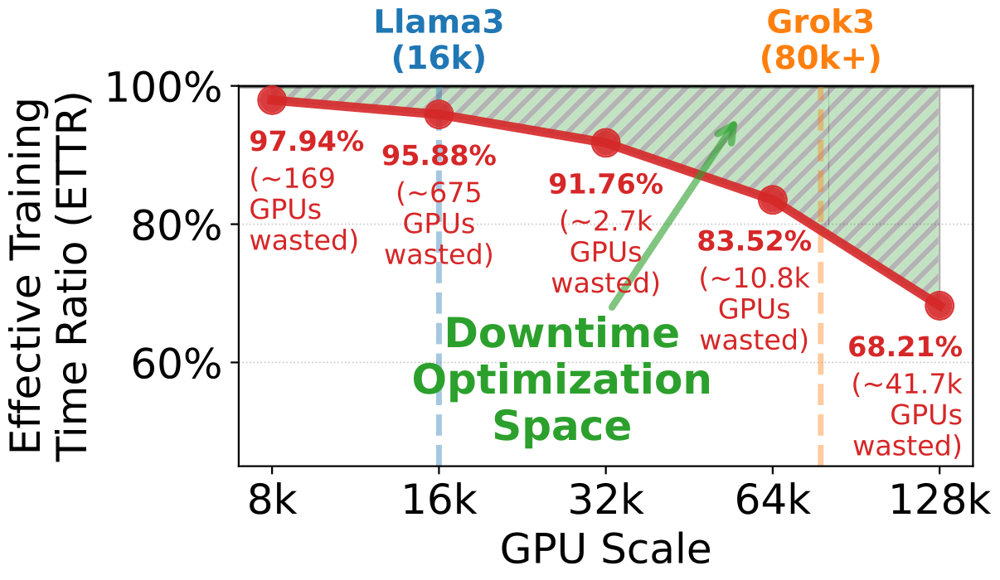
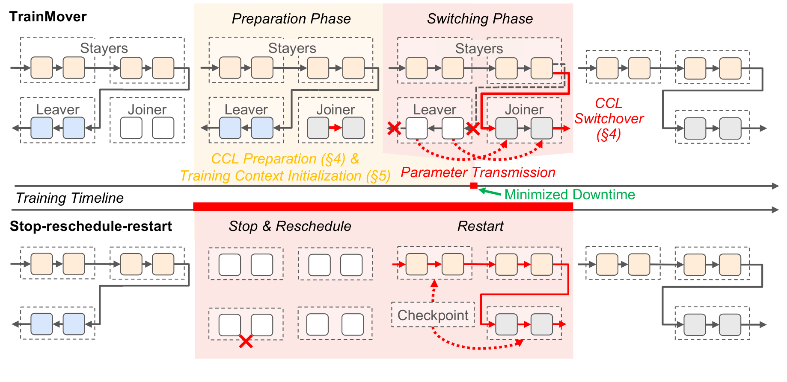
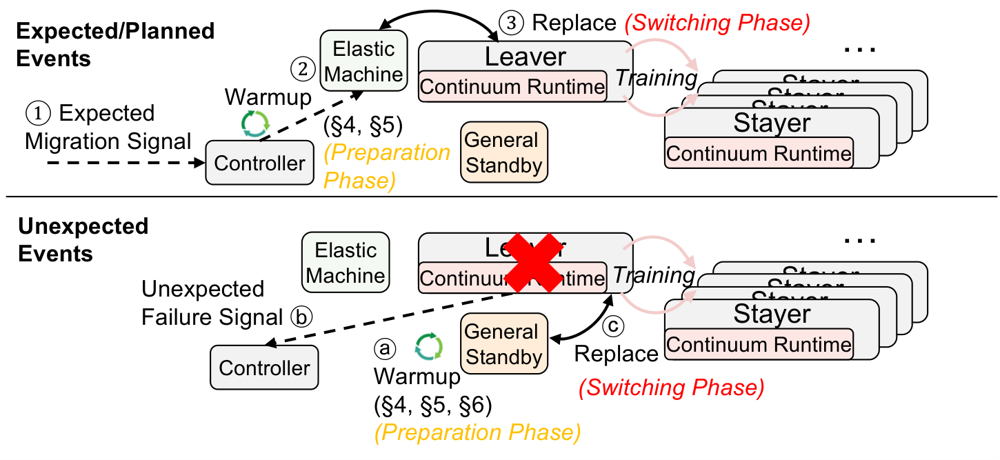
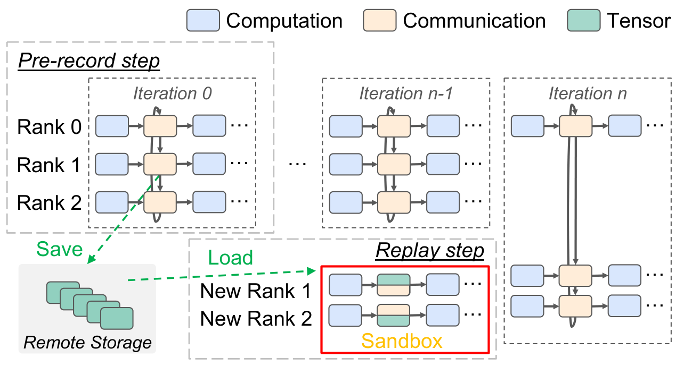
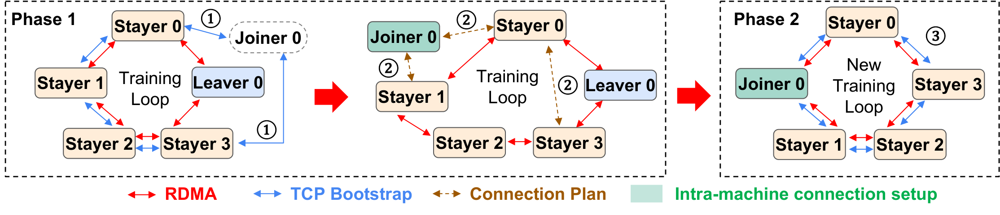
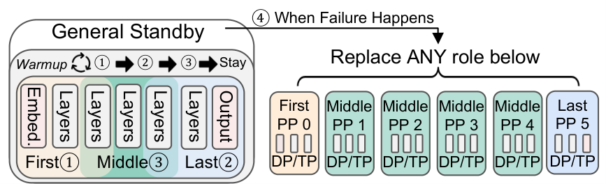
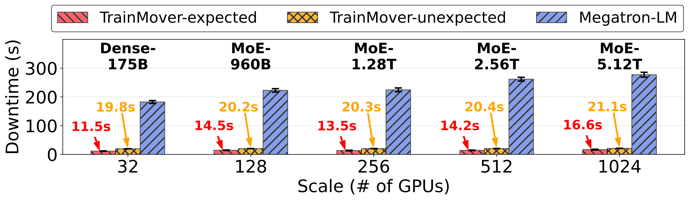
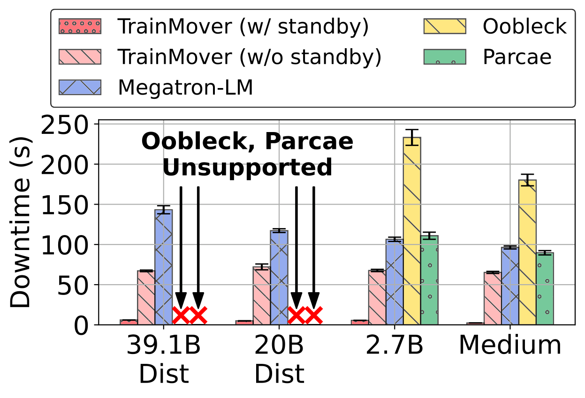
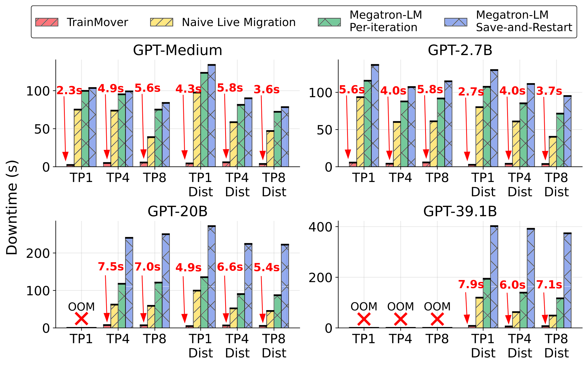
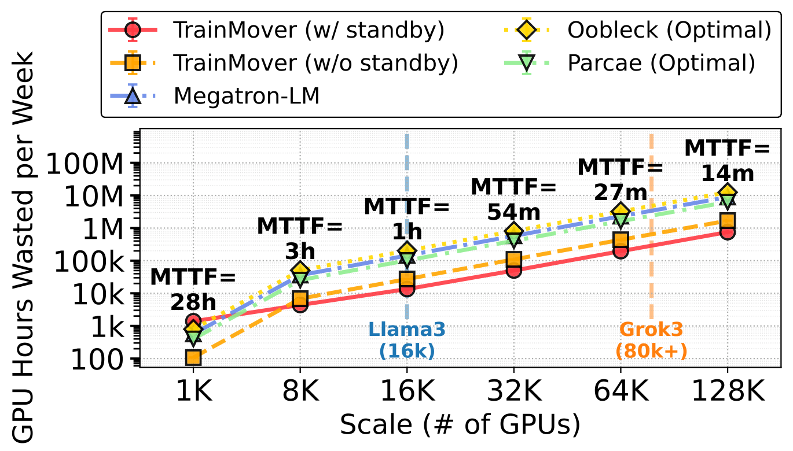

# TrainMover: An Interruption-Resilient Runtime for ML Training 阅读报告

| 元信息 | |
|---|---|
| **标题** | TrainMover: An Interruption-Resilient Runtime for ML Training |
| **作者 / 机构** | ChonLam Lao, Jiaqi Gao, Jiamin Cao, Zhipeng Zhang, Pengcheng Zhang, Jiangfei Duan, Zhilong Zheng, Yu Guan, Yichi Xu, Yong Li, Zhengping Qian, Aditya Akella, Minlan Yu, Ennan Zhai, Dennis Cai, Jingren Zhou（Alibaba Cloud / Harvard / UT Austin） |
| **发表** | OSDI 2026（arXiv v3, 2026-05） |
| **链接** | [arXiv:2412.12636](https://arxiv.org/abs/2412.12636) |
| **本地文件** | `paper.pdf`，`src/`（TeX 源码） |
| **标签** | #fault-tolerance #live-migration #elastic-scheduling #nccl #llm-training |

> 阅读日期：2026-11-03 · 整理：Claude Code

## 一句话总结

大规模 LLM 训练中"换一台机器"（故障替换、维护、rebalancing）的代价是全作业分钟级重启；TrainMover 用三个技术——**两阶段增量通信组切换**、**免通信沙箱影子迭代预热**、**利用训练结构对称性的通用 standby**——把换机停机时间压到 **~20 秒（1024 GPU，期望中断）/ <30 秒（意外故障）**，且**零额外 GPU 显存**；64K GPU 规模预估每周节省 **140 万 GPU 小时**（较最优基线少浪费 55%）。

## 背景与动机

**中断是大模型训练的常态而非例外**：

- 硬件异常：Llama-3 16000-GPU 训练 MTTF 仅 **2.7 小时**；Meta 报告 1024-GPU 作业 MTTF 7.9 小时；
- 软件争抢：Alibaba Falcon 报告 **60%** 大规模训练作业因后台任务/网络异常变慢，JCT 平均 +35%；ByteDance 报告 42.5% 作业因 straggler 慢 ≥10%；
- 管理事件：驱动/固件更新、资源 rebalancing、功耗规划——Llama-3 平均**每天至少一次**维护性中断。

训练布局是为峰值性能精调的（Meta 手工平衡 PP 各 stage 的内存/算力，DeepSeek 调 SM 分配），改配置会掉性能甚至 OOM。因此正确目标是：**用备用机 1:1 替换故障机、完全保持训练布局**——而业界本来就保留 standby 池（Alibaba HPN 每段 6% GPU、ByteDance P99 standby、Google 每 SuperPod 备 TPU cube、Llama-3 在 24K 集群上跑 16K 作业）。

**现有两类方案都过不了"joiner 上线"这一关**：

| 方案 | 代表 | 问题 |
|---|---|---|
| Restart（stop–reschedule–reinitialize） | Megatron-LM + checkpoint，工业界主流 | 某大厂 8192-GPU 生产作业每次中断 **6.47 min**：stop 0.52 + reschedule 1.5 + 初始化 4.45 min（其中 checkpoint 加载 1.56 / NCCL 实例化 1.09 / 冷启动 warmup 1.80）。全同步训练导致**几台机器的事故迫使全集群重启** |
| Runtime reconfiguration | Oobleck / Parcae / ReCycle | 避免全局重启，但加回机器（+1）仍在关键路径：32-GPU 6.7B GPT 上 Oobleck **-1 需 57s、+1 需 >100s**；Parcae -1 21s、+1 >200s——甚至超过 Megatron 冷启动。且依赖 DP 冗余（distributed optimizer / ZeRO 消灭冗余后失效）、改变训练语义 |

规模放大后不可接受：把 4.45 min 重启 + Meta MTTF 数据代入，64K/128K GPU 的 ETTR 损失分别为 **16.47% / 31.79%**，折合每天 **$0.95M / $3.63M**。

*图 1：不同规模下停机时间对 ETTR 的影响：生产规模（64K/128K）吞吐坍塌 16~32%（摘自原文 Fig. 2）*

TrainMover 的核心洞察：joiner 的初始化（checkpoint 加载、NCCL 建组、冷启动 warmup）无法省略，但**可以提前、后台化、与正在进行的训练重叠**，只把不可重叠的"增量切换"留在停机窗口内。

## 方法

*图 2：TrainMover 总览：上半部分为 preparation phase（后台准备）+ switching phase（秒级切换）两阶段，下半部分为传统全局重启（摘自原文 Fig. 3）*

*图 3：TrainMover 处理期望中断与意外故障的工作流（摘自原文 Fig. 4）*

角色定义：被替换的机器是 **leaver**，替补是 **joiner**，其余机器是 **stayer**。期望中断（维护等有预告）：控制器发迁移信号 → elastic 机器作为 joiner 进入后台 preparation phase → 就绪后进入 switching phase，leaver 把最新模型/优化器状态 1:1 传给 joiner、接过角色。意外故障：预先用同样技术预热好的 **standby 机器**直接晋升为 joiner 进入 switching phase。

### 技术一：免通信沙箱（Communication-free Sandbox）——预热计算侧

**难点**：训练初始化隐式且跨层耦合——JIT 编译、CUDA context、显存分配、dataloader 都只在真实数据到达时触发；首迭代比稳态慢 **6×**（GPT-10B 约 44s），单次中断的 warmup 约 150s。逐条解耦这些隐藏初始化路径不现实。

**方案：record–replay 影子迭代**：

- **Pre-record**：作业最开始（首个/前几个迭代），指定机器上的 hook 层（位于 PyTorch 与 CCL 之间）拦截所有 collective 调用，把**输出 tensor** 记录到持久存储；之后 hook 移除，全程零开销（无论后续多少次中断/重启）；
- **Replay**：joiner 进入沙箱后拉取 checkpoint 初值，跑一次影子迭代——所有跨沙箱通信被拦截并用录制的 tensor 应答（`barrier`/`send` 直接 bypass），从而**独立触发全部隐式初始化**，不需要任何在线机器协助；
- **正确性**：现代 LLM 框架天然确定（静态 kernel 调度、静态内存布局、固定 collective 顺序），影子迭代能正确触发初始化；且 leaver 的最新状态最终会在 switching 阶段覆盖沙箱状态，正确性有兜底。MoE 路由等输入相关路径极少覆盖不到，未触发的初始化在切换阶段 ms 级补齐；
- **低开销**：只录"跨沙箱边界"的通信——机内 TP 流量在沙箱内原生跑，重复角色去重；GPT-5.12T MoE 的录制存储可降到 **<300 GB**。

*图 4：沙箱初始化工作流——pre-record 录制 tensor，replay 时回放（摘自原文 Fig. 5）*

### 技术二：两阶段增量 CCL 组设置——预热通信侧

**难点**：NCCL 组创建慢（8 机 64×A100、GPT-10B：bootstrap 2.48s + 拓扑发现 9.40s + 机内连接 21.49s + 机间连接 17.07s ≈ **50s**）且**成员静态**——换一台机器需要全局拆掉重建；后台并行预建新组虽快但吃额外 GPU 显存。

**方案**：把建组拆成两阶段，只在 Phase 2 停机：

- **Phase 1（preparation，与训练重叠）**：stayers 调 `CCL_prepare_stayers(new_topology)`——复用既有 TCP bootstrap 连接与新 joiner 握手，交换拓扑信息后各方**本地计算 delta topology**，生成 channel 级重配置计划。机内连接（NVLink）直接继承复用；joiner 本地可建的 channel 先建。TCP/拓扑状态在 **CPU 内存**，不占 GPU 显存；
- **Phase 2（switching，唯一网络停机来源）**：`CCL_switchover()` 在 **RDMA queue pair 级别**把 stayer–leaver 的机间连接切到 stayer–joiner，组从 ready-to-switchout 态转正常态并回收旧资源。兼容分层拓扑与 SHARP。

零显存技巧：状态传输用的 NCCL 组复用 leaver 即将释放的梯度缓冲；joiner 在 Phase 1 未建机间连接，留出临时显存余量，传完即拆。

*图 5：两阶段 CCL 迁移工作流（摘自原文 Fig. 6）*

### 技术三：通用 Standby（General Standby）——覆盖任意角色的意外故障

**难点**：意外故障不可预知发生在哪台机器/角色；给每个角色各备一台 standby 在大规模下浪费。

**方案**：利用训练的**结构对称性**——TP/DP/EP 下所有机器的模型分区、算子集合、CUDA kernel、通信模式完全一致；PP 只引入最多 **3 种角色**（首/中/末 stage；word embedding 与 output layer 同形 weight-tying）。因此：

- 一台 standby 顺序跑最多 3 个影子迭代（首/末/中 stage 各一次）即可为**任意角色**预热，之后保留中间 stage 角色；首/末 stage 真实故障时只需补齐小 delta 层（embedding/output）的参数与优化器状态；
- standby 停在 CCL Phase 1，显存低于峰值几百 MB，足够容纳三种角色的 JIT 产物（每角色几百 KB）；
- 意外故障恢复：standby 晋升 joiner → switching 阶段；无冗余（distributed optimizer/ZeRO）时 joiner 从 checkpoint 取最新状态、其余机器回滚到同一 checkpoint（依赖 per-iteration checkpoint 系统，如 Gemini/ByteRobust）；有 DP/CPU 冗余则直接从 stayer 拷贝；
- 并发多机故障概率极低（MTTF 乘积），实践中 **1–2 台** standby 覆盖所有 stage 类型；无 standby 时走重叠恢复路径兜底。

*图 6：通用 standby——一台机器顺序为三种 PP 角色预热（摘自原文 Fig. 7）*

### 实现

Python + C/C++，约 **12K LoC**：控制器 1.9K（Python）；Megatron-LM 扩展 7.8K（Python）；PyTorch `c10d` 扩展 1.1K（多全局 CCL 组、两阶段初始化 API、tensor 拦截层）；NCCL 扩展 1.5K（C，`CCL_prepare_*` / `CCL_switchover` 等 API）。代码声明发表后开源。

## 实验与结果

**设置**：1024-GPU 测试床（最大模型 GPT-5.12T MoE，TP8/PP8/EP16）；32-GPU 规模与 Oobleck/Parcae 对比（Oobleck 模板生成时间无法 scale、Parcae 不支持 TP，且二者都不支持 distributed optimizer——大模型场景直接不可用）。

*图 7：不同 GPU 规模下的停机时间对比：TrainMover 期望中断 <20s、意外故障 <30s，32→1024 GPU 仅增加 <10s；Megatron-LM 重启达 ~300s（摘自原文 Fig. 8）*

*图 8：意外故障停机：有 standby 时 <10s 接近 live migration；无 standby 也全面优于基线（摘自原文 Fig. 11）*

*图 9：各模型/并行配置下的迁移停机：TrainMover 秒级，较 Megatron-LM Save-and-Restart 至少 15×（摘自原文 Fig. 10）*

| 实验 | 设置 | 关键结论 |
|---|---|---|
| 大规模停机 | 32→1024 GPU，含 5.12T MoE | 期望中断 **<20s**、意外故障 **<30s** @1024 GPU；Megatron-LM ~300s（未含分钟级 reschedule）。delta 设计对规模不敏感 |
| 投影 GPU 浪费 | 外推至 128K GPU（Meta MTTF + 1:8.9 期望/意外比） | ≥8K GPU 后 TrainMover(w/ standby) 浪费最低：8K 时较 Parcae **-82.77%**；128K 时较 w/o standby **-55%**、较 Parcae **-88%**；64K 规模**每周省 140 万 GPU 小时** |
| 意外故障 | 32-GPU 4 模型 | 有 standby：**<10s** 全模型；无 standby：仍优于全部基线（重叠恢复路径），Megatron-LM 最多慢 **3.48×**；DO 启用的 20B/39.1B 上（Oobleck/Parcae 不支持）比 Megatron-LM 快 **2.1×/1.6×** |
| 期望迁移 | 32-GPU 多模型/TP 设置 | 比 Megatron-LM Save-and-Restart **≥15×**（后者 GPT-39.1B 需 ~400s）；naive 1:1 直传已有 1.745× |
| 多机齐迁 | 4%~33% GPU 同时迁移 | 停机稳定 **≤6.15s**（leaver-joiner 成对并行）；checkpointing 迁 4% 即 138s |
| Straggler 处理 | 1024-GPU，单 GPU 慢 20% | 效率仅损失 **4.7%**（全场最低），比 restart 类最多高 **43%**，甚至超过理想 per-iteration checkpointing **22.8%** |
| 高频 rebalancing | 每 10 分钟换机 | 128→1024 GPU ETTR 全程 **≥0.97**（Megatron-LM 0.50→**0.42**）；32-GPU 全模型 **0.99** vs Megatron-LM 最低 0.68、Oobleck 20B/TP8 为 0.00 |
| 设计分解 | GPT-5.12T MoE | Megatron-LM 221s（ckpt 47%/warmup 30%/CCL 23%）→ naive 迁移 1.8×↓ → +两阶段 CCL：CCL 时间 51s→**7s**（-86%）→ +沙箱 warmup：总停机 **16s** |
| 网络瓶颈 | 0.25~2 GB/s per GPU | TrainMover 稳定 6–9s；Megatron-LM 在 0.25 GB/s 时 ckpt 加载达 **320s(20B)/750s(39.1B)** |
| 显存 | 迁移全程网络/内存时间线 | **零额外 GPU 显存**（复用 leaver 梯度缓冲 + Phase 1 未建机间连接的临时余量） |

**关键数字**：**~20s 停机 @1024 GPU**；**55%/88% GPU 浪费削减**（64K/128K，vs 最优基线）；**140 万 GPU 小时/周**（64K 规模）；10 分钟级 rebalancing 下 ETTR **0.97+**。

*图 10：大规模部署的投影 GPU 小时浪费：8K GPU 起 standby 版本全面领先（摘自原文 Fig. 9）*

## 结论

TrainMover 是一个中断韧性 LLM 训练 runtime：两阶段增量通信组切换 + 免通信沙箱预热 + 通用 standby，使期望与意外中断都能以**秒级停机、零额外显存**完成机器替换。1K-GPU 实测 20s 停机，64K 投影少浪费 55% GPU 时（140 万 GPU 小时/周），支撑 10 分钟级高频 rebalancing 与 straggler 换机等新用法。

## 与鲁棒 LLM 训练的关联

- **覆盖链条的哪一环**：**容错与恢复**（live migration / 故障恢复）+ **弹性调度**（rebalancing、straggler 替换、维护窗口化）。明确不覆盖：故障检测（假设即时定位隔离，依赖 Falcon/Aegis 类外部监控）、SDC 等正确性问题（用户级 bug 与数据损坏在范围外）；意外故障且无冗余时仍回退到 checkpoint 回滚——与**检查点**一环（Gemini、ByteCheckpoint 类 per-iteration 系统）是互补而非替代。
- **与已读论文的关系**：
  - [SOSP 2025 | ByteDance 万卡鲁棒训练](../sosp-2025-robust-llm-training-bytedance/report.md)：同样走"备用机 1:1 换机保 layout"的路线；TrainMover 把换机动作本身从分钟级重启压到秒级热迁移，可视为该路线在**换机开销**维度上的极限优化，二者关注的生产故障画像高度重合（单机故障为主、多机并发罕见）。
  - [OSDI 2026 | SDCs in the Wild](../osdi-2026-sdcs-in-the-wild/report.md)：SDC 是"静默出错"（换机也救不回已污染的状态），TrainMover 是"显式故障的快速换机"；前者管检测正确性、后者管恢复速度，正交互补。

## 局限性与思考

- **不做检测**：所有实验假设故障即时定位与隔离；实际部署中检测延迟（监控周期、超时阈值）会叠加在 20s 之外。
- **意外故障仍有进度丢失**：无冗余时全体回滚到 checkpoint，丢失量取决于 checkpoint 频率——TrainMover 优化的是恢复时间，不是恢复点；与 per-iteration checkpointing 系统配合才能把 RPO 也压到迭代级。
- **对称性假设**：通用 standby 依赖 dense/MoE LLM 的结构对称；异构、多模态、非静态执行路径（动态路由、CUDA graph capture）覆盖有限（作者自己列为 limitation）。
- **栈侵入性强**：需要改 Megatron-LM / PyTorch c10d / NCCL 三层（12K LoC），且依赖 NCCL 暴露两阶段 API——对框架版本升级是持续维护成本；standby 机本身在 1K 规模反而略增浪费（闲置），收益要到 ≥8K GPU 才显现。
- **投影而非实测**：64K/128K 收益全部由 1K/32-GPU 测量外推（对 Oobleck/Parcae 用其 32-GPU 数据对其有利，算保守），无超大规模实测验证。
- （个人理解）20s 停机的主体是状态传输（模型 + 优化器态，单机数十 GB 级）与 RDMA QP 切换；文中早期注释提到 400 Gbps 网络下传输可降到 ~1.7s，说明瓶颈会随网络代际持续缓解。值得跟进的点：standby 池的最优容量规划（文中只论证 1–2 台够用，但 128K 规模 MTTF 降至分钟级时该结论是否还成立）；以及该两阶段 CCL API 是否会被上游 NCCL 采纳为标准能力。
