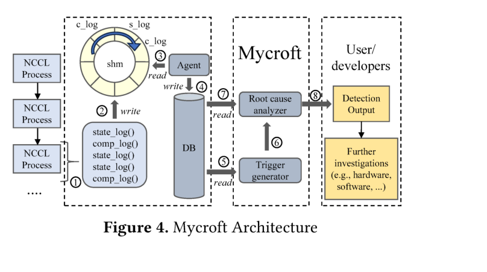
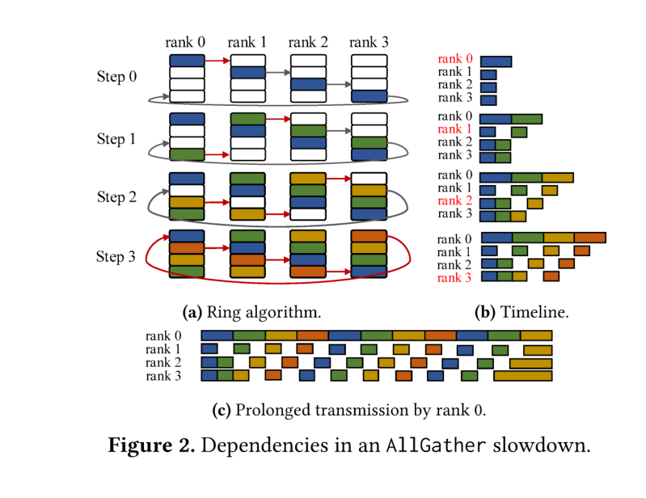
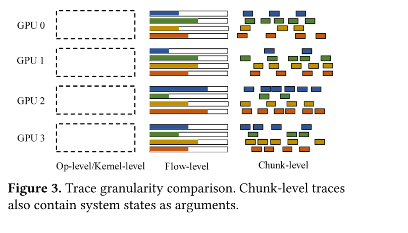
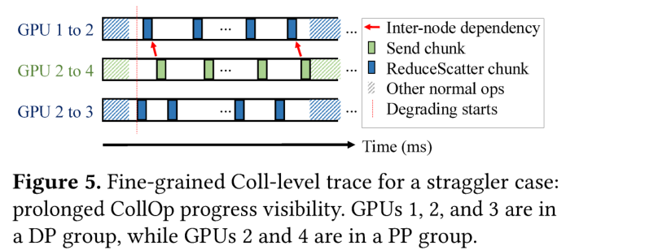
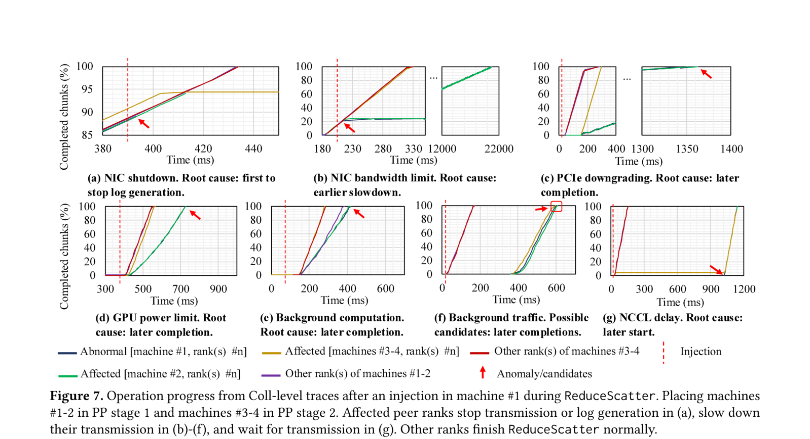
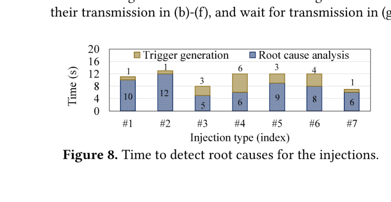
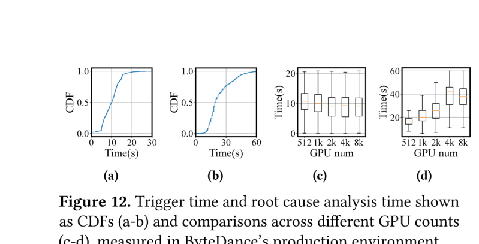

# Mycroft: Tracing Dependencies in Collective Communication Towards Reliable LLM Training 阅读报告

| 元信息 | |
|---|---|
| **标题** | Mycroft: Tracing Dependencies in Collective Communication Towards Reliable LLM Training |
| **作者 / 机构** | Yangtao Deng*, Lei Zhang*†, Qinlong Wang, Xiaoyun Zhi, Xinlei Zhang, Zhuo Jiang†, Haohan Xu, Lei Wang, Zuquan Song, Gaohong Liu, Yang Bai, Shuguang Wang, Wencong Xiao, Jianxi Ye, Minlan Yu, Hong Xu（CUHK / ByteDance / ByteDance Seed / Harvard；* 共同一作，† 通讯作者） |
| **发表** | SOSP 2025 |
| **链接** | [arXiv:2509.03018](https://arxiv.org/abs/2509.03018) |
| **本地文件** | `paper.pdf`（TeX 源码不可用，arXiv 提供的源码即 PDF） |
| **标签** | #fault-detection #gray-failure #root-cause-analysis #collective-communication #nccl #observability |

> 阅读日期：2026-11-03 · 整理：Claude Code

## 一句话总结

LLM 训练依赖的集合通信库（NCCL 等 CCL）是黑盒，灰故障（gray failure）与性能降级发生时无法观测 CollOp 内部状态、定位根因极难。Mycroft 直接在 NCCL 内插桩（<10 个 tracepoint），以 flow 级 + chunk 级的轻量追踪暴露通信内部的控制 / 数据依赖，再利用"谁先停止日志、谁先变慢、谁最晚启动"等依赖特征做根因分析：字节跳动部署 **6 个月以上**，**90% 异常 15 秒内检出、60% 根因 20 秒内定位**，训练开销 **<1%**（迭代时间 1116→1119 ms）。

## 背景与动机

- **故障频繁且代价高**：Microsoft 报告集群平均每 45 分钟一次故障；Meta 在 LLaMA 3 预训练 54 天内观测到 419 次中断；ByteDance 集群每天至少一次故障。快速检测与止损直接决定 ETTR（Effective Training Time Ratio）。
- **黑盒 CCL 是定位瓶颈**：作者给了一个真实案例——一块 GPU 训练中变坏，所有 rank 几乎同时卡在集合通信上，**无任何异常输出**，10 分钟后 NCCL 超时任务失败，事后无证据定位故障机，只能多机重跑 GPT-2 六小时以上才复现。
- **现有观测工具的粒度都不对**（Table 1）：
  - Op-level（Kineto / Chakra / Mystique / GREYHOUND）：只在 PyTorch Coll API 层记录起止时间，CollOp 卡住时既无事件产生也无内部状态可查；
  - Kernel-level（Nsight / NPKit / NVRx / XPUTIMER）：粒度过细开销大——NPKit 使总线带宽掉到约 1/3，Nsight 只能单机，NVRx 每 60 秒才报告一次；
  - RDMA-level（Aegis）：只记录 RNIC 统计，无法跟踪异常在 GPU 间传播。
- **目标**：在问题发生的层级（Coll-level）提供实时、低开销、可分布式的观测与根因定位。

## 方法


*图 1：Mycroft 架构：在 NCCL 内插桩写共享内存环形缓冲，agent 异步上传 Kafka→云数据库，后端做 trigger 生成与根因分析（摘自原文 Fig. 4）*

### 依赖：问题的传播路径

集合通信内部存在多层依赖：节点内 CPU（NCCL proxy 线程）/ GPU（CUDA kernel 拷贝 chunk）/ NIC / PCIe 协同，数据被切成 chunk 分散到多条网络流（channel/QP）上独立传输，全部完成才算完成；节点间则通过 DP/PP/TP 的通信依赖把单点问题级联到全集群——实验显示异常可在**几百毫秒内传遍集群**。下图展示一个 AllGather 中 rank 0 变慢如何沿依赖传播：


*图 2：AllGather 变慢案例中的依赖——(a) Ring 算法、(b) 时间线、(c) rank 0 传输变慢拖累下游（摘自原文 Fig. 2）*

### Coll-level 追踪（flow 级 + chunk 级）


*图 3：Op/Kernel 级与 flow/chunk 级的粒度对比，chunk 级还携带系统状态（摘自原文 Fig. 3）*

- **Flow-level**：按每条网络流（channel/QP）记录。网络拓扑实际定义在 flow 级而非 Op 级——只影响单条流的尖刺 / 抖动 / 拥塞在 Op 级聚合后不可见。
- **Chunk-level**：不逐 chunk 记录起止时间（那是 Kernel 级的开销），而是每 100 ms 聚合一次各组件的操作量，得到三个累计计数：`GPU_ready`、`RDMA_transmitted`、`RDMA_done`。
- **两类 tracepoint**：completion log（CollOp 完成时写元数据）+ real-time state log（CollOp 进行中每 100 ms 写进度）。共 **<10 个 tracepoint、1100 行 C++**（基于 NCCL 2.21.5）。
- **零锁采集**：预分配固定 512 MB 共享内存环形缓冲，tracepoint 直接拿槽位指针写入，独立 agent 只读异步上传（Kafka → 云数据库），无锁、无反压。

### 实时触发机制

为控制上万 GPU 的数据量，后端**采样监测**：每个 DP 组至少 1 个 rank、全集群最多 10 个 rank（异常快速级联 ⇒ 任意采样点都能看到）。每 10 秒执行一次规则（Algorithm 1）：

- 有实时状态日志、但无 completion log ⇒ **failure trigger**（卡死）；
- 吞吐减半或 CollOp 间隔翻倍 ⇒ **straggler trigger**（性能问题）。

### 依赖驱动的根因分析

触发后在 (t−Δ, t) 窗口内取日志构建**全局状态机**（Algorithm 2）：先按 MinOp / MinData 定位受影响的 Coll 组，再用规则表判定根因类别（Table 4 节选）：

| 状态（1/2/3 = GPU_ready / RDMA_transmitted / RDMA_done 的 chunk 数） | 本地视角 | 远端视角 |
|---|---|---|
| 1=2=3=0（Not started） | Uninitialized | Blocked |
| 1>2（Not transmitted） | **RDMA issue** | Receiver not ready |
| 2>3（Not delivered） | Receiver failed | **RDMA issue** |
| 1=2=3>0（GPU not ready） | **GPU issue** | — |

再结合时间维度（同一 rank 反复出现固定模式）与空间维度（sender 视角 vs receiver 视角对比，如 sender 报 1>2 而 receiver 报 2=3 ⇒ 问题在接收方）定位到具体 rank / flow。straggler 用"起止比其他 rank 晚 1 秒"等阈值判定。


*图 4：GPU 1 变慢沿 DP 组（1-2-3）与 PP 组（2-4）依赖传播的 Coll-level trace，Mycroft 定位 GPU 1 为根因（摘自原文 Fig. 5）*

### 与其他系统协同

Mycroft 只覆盖 CCL 层，与 py-spy（dump Python 栈，查 dataloader / checkpoint 卡住）、Flight Recorder（dump PyTorch CollOp 环形缓冲，查同步问题 / 死锁）互补：三者同时触发，py-spy / FR 查不出 ⇒ 问题在 CCL 层 ⇒ Mycroft 负责暴露根因。

## 实验与结果

测试床：**32× A100-80GB-SXM4**（4 机器，每机 4× ConnectX-6 RNIC），GPT + Megatron-LM，TP=8 / PP=2 / DP=2，CUDA 12.2 / Torch 2.1.0。

### 故障注入（7 类生产常见故障）


*图 5：7 种注入后 Coll-level trace 的完成进度：(a) 停止传输/日志、(b)-(f) 变慢、(g) 等待传输；其他 rank 正常完成 ReduceScatter（摘自原文 Fig. 7）*

| # | 注入 | Mycroft 定位信号 | 结论 |
|---|---|---|---|
| 1 | NIC shutdown | 异常 rank **最先停止日志生成** | 根因：最早停止者 |
| 2 | NIC bandwidth limit | DP 组减速，且 GPU_ready > RDMA_transmitted | 根因：NIC |
| 3 | PCIe downgrading | 异常 DP 组延迟，PP stage 2 因依赖晚启动 | 根因：更晚完成者 |
| 4 | GPU power limit | 机内 8 rank 全慢、8 个 DP 组受累，起止几乎同时 | 根因：比较完成时间定位 machine #1 |
| 5 | Background computation | 计算变慢成瓶颈，第二 PP stage 反而快 | 根因：更晚完成者 |
| 6 | Background traffic | 受累 rank GPU_ready = RDMA_transmitted 但 RDMA_done 偏小（**延迟 ACK**） | 根因：网络 |
| 7 | NCCL delay（proxy 以 p=1e-6 sleep 1s） | 异常 rank **最晚启动**传输 | 根因：晚启动者 |

对照 Nsight：NIC shutdown 时 Nsight **完全 trace 不到**受影响的 ReduceScatter kernel，无法定位故障机；带宽受限时 Nsight 只见所有 rank 同时延迟，无法区分。


*图 6：7 种注入从异常发生到根因输出的延迟，整体 ≤13 s，大头是控制器上的集中式根因分析（摘自原文 Fig. 8）*

### 开销对比

| 指标 | Baseline | **Mycroft** | Nsight (CUDA trace) | Nsight (backtrace) | NVRx | NPKit |
|---|---|---|---|---|---|---|
| GPT 迭代时间 (ms) | 1116 | **1119（<1%）** | 1125 | **1900** | 1124 | — |
| NCCL Tests 总线带宽 | 基准 | **与 baseline 几乎重合** | 几乎重合 | — | — | **掉到约 1/3** |
| 追踪数据量 / 迭代 / 机 | — | **46.8 KB**（1200 机时 ~186 KB/机） | 15 MB | 更多 | — | — |
| 报告延迟 | — | **秒级** | 离线 | 离线 | 60 s | — |

CPU 利用率不增加；内存占用 1.85% → 2.43%。对照 XPUTIMER 训 Llama-70B 时每 GPU 产生 0.78 MB 日志。

### 生产环境（2024.10 部署，11–12 月数据，>128 GPU 任务、最多 20 并发）


*图 7：生产环境 trigger 时间 (a-b) 与不同 GPU 规模下的对比 (c-d)（摘自原文 Fig. 12）*

| 指标 | 数值 |
|---|---|
| 检出的训练中断（全部任务，两月） | **13221 次，100% 检出率**（交叉核对所有已知异常任务） |
| 根因分析执行次数 | 1253 次，其中 **705 例定位到单一网络流** |
| stuck 检测延迟 | **90% ≤ 15 s** |
| 根因定位延迟 | **60% ≤ 20 s**，全部 ≤ 1 min |
| 规模扩展性 | trigger 时间与规模无关；RCA 时间随规模增长（主要是取回 10 s 窗口数据的 DB 开销），>10000 GPU 需进一步去中心化优化（未来工作） |
| 资源占用 | 后端单服务器，<64 CPU 核、<100 GB 内存；10000 GPU 任务约 3 TB/天，保留 1 天 |

### 生产案例（Section 8）

1. **FSDP AllGather 偶发慢**：4 条 NCCL channel 中 1 条要 75 ms（其余 30 ms）；chunk 级状态定位到中间拖慢数据准备的故障 GPU，flow 级排除网络硬件（其余 3 条流正常）⇒ 指向异常 SM 行为。
2. **配合 py-spy**：栈网格中红 rank 卡在 dataloader、其余 rank 卡在 forward_step 等 broadcast ⇒ 定位故障 rank。
3. **配合 Flight Recorder**：(a) 蓝 rank 从未 launch 任何 CollOp（GPU 挂）；(b) 用户配置错误致两组进程组 AllReduce/AllGather 死锁。

## 结论

- 作者结论：CCL 级的依赖追踪是可靠的 LLM 训练中缺失的一环；Mycroft 以 <1% 开销把 Coll 级灰故障 / 性能问题的检测与根因定位压到**秒级**，已在 ByteDance 生产环境长期运行。
- 教训：插桩必须直接改 NCCL 源码而非仅用 plugin——plugin 拿不到控制路径与负载相关信息。

## 与鲁棒 LLM 训练的关联

- **覆盖链条的哪一环**：**故障检测 + 根因定位**（通信层的灰故障 / fail-slow / straggler），不负责恢复（定位后换机 / 重启仍靠外部流程）。
- **与已读论文的关系**：
  - [SOSP 2025 | Robust LLM Training Infrastructure at ByteDance](../sosp-2025-robust-llm-training-bytedance/report.md)：同属 ByteDance 鲁棒训练体系；该文给出整体分层基础设施（含 Minder 故障机检测），Mycroft 深入 CCL 黑盒内部，可视为通信层观测的"下钻"补丁——前者回答"哪台机器坏了"，Mycroft 回答"CollOp 内部哪个组件、哪条流坏"。
  - [MLSys 2026 | Guard](../mlsys-2026-guard/report.md)：Guard 做 straggler 检测与节点健康管理（找出慢节点、换掉），Mycroft 提供更底层的通信证据与根因归因（GPU / NIC / 接收方 / 网络），两者是"检测异常 + 定位根因"的上下游。
  - [ESEC/FSE 2026 | Reflex](../fse-2026-reflex/report.md)：同为故障定位，Reflex 走框架 / 事件驱动的应用层视角，Mycroft 走 CCL 内部依赖视角，层级互补。
  - 与 [OSDI 2026 | SDCs in the Wild](../osdi-2026-sdcs-in-the-wild/report.md) 正交：SDC 是静默数值错误（结果错但不挂），Mycroft 针对的是挂起 / 变慢（挂但不报错）——两类"静默"问题需要不同检测手段。

## 局限性与思考

- **只有通信层视野**：观测被限定在集合通信，无端到端可见性；无法理解应用层意图（通信计算重叠、设计好的并行度），复杂拓扑下区分真异常与良性变化仍有困难。
- **深层根因仍需离线诊断**：如案例 1 定位到"异常 SM 行为"后，最终确认仍靠离线硬件检查；作者将与其他诊断工具的更紧集成列为未来工作。
- **启发式阈值手工调**：50% 带宽下降、1 s straggler、10 s 检测间隔均来自运行经验（带宽降到 80% 可能只是通信重叠的正常波动），自动调参留作未来工作。
- **规模上限**：>10000 GPU 时 RCA 时间随规模增长（DB 取数瓶颈），需去中心化等工程优化。
- **维护成本（个人理解）**：直接改 NCCL 源码意味着每次 NCCL 升级都要 rebase 插桩；论文也承认若未来 NCCL plugin 能传控制信息，此教训不再适用。
- **可跟进的点**：与 Guard / Reflex 这类上游检测系统的事件打通，把 Mycroft 的 Coll 级证据作为自动换机 / 弹性调度决策的直接输入，形成"检测 → 定位 → 恢复"闭环。

---

*BibTeX（源码无 .bib，按 arXiv 页面信息整理）：*

```bibtex
@inproceedings{deng2025mycroft,
  title     = {Mycroft: Tracing Dependencies in Collective Communication Towards Reliable LLM Training},
  author    = {Deng, Yangtao and Zhang, Lei and Wang, Qinlong and Zhi, Xiaoyun and Zhang, Xinlei and Jiang, Zhuo and Xu, Haohan and Wang, Lei and Song, Zuquan and Liu, Gaohong and Bai, Yang and Wang, Shuguang and Xiao, Wencong and Ye, Jianxi and Yu, Minlan and Xu, Hong},
  booktitle = {Proceedings of the 31st ACM Symposium on Operating Systems Principles (SOSP '25)},
  year      = {2025},
  note      = {arXiv:2509.03018}
}
```
