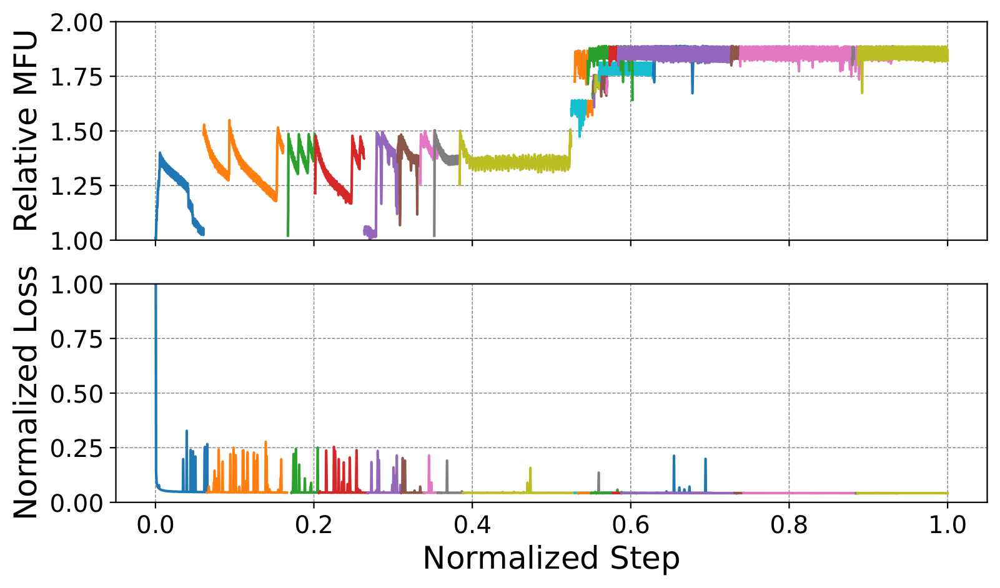
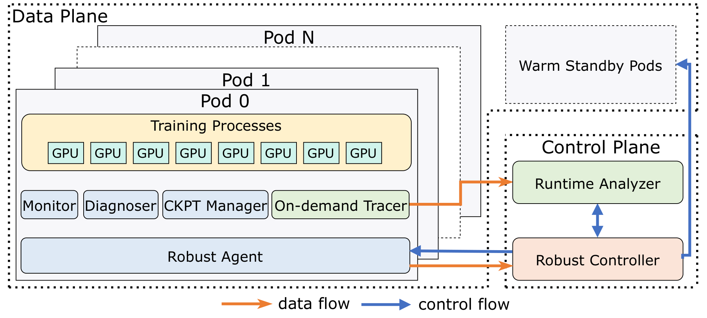
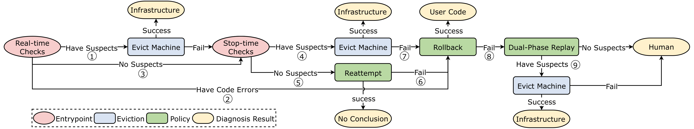
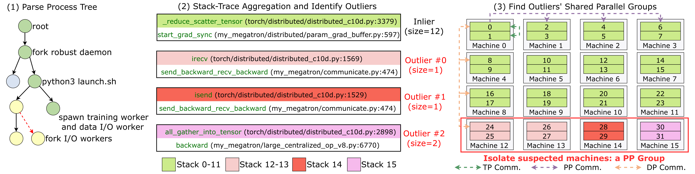
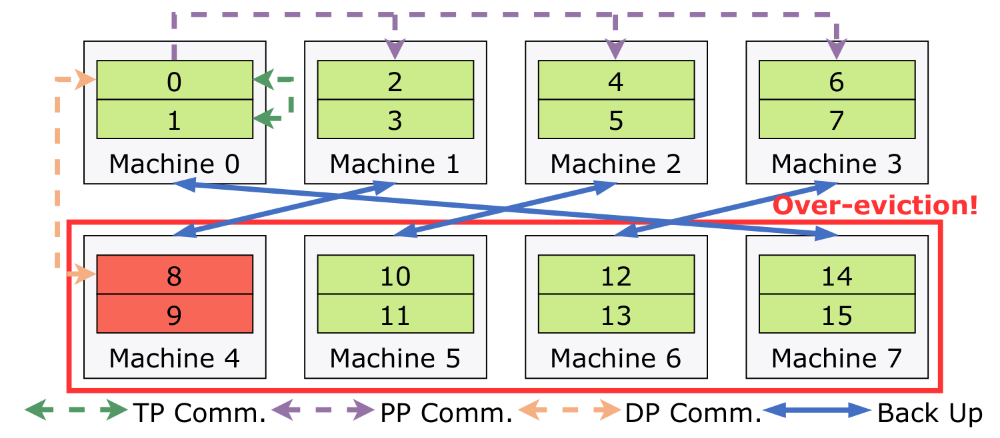
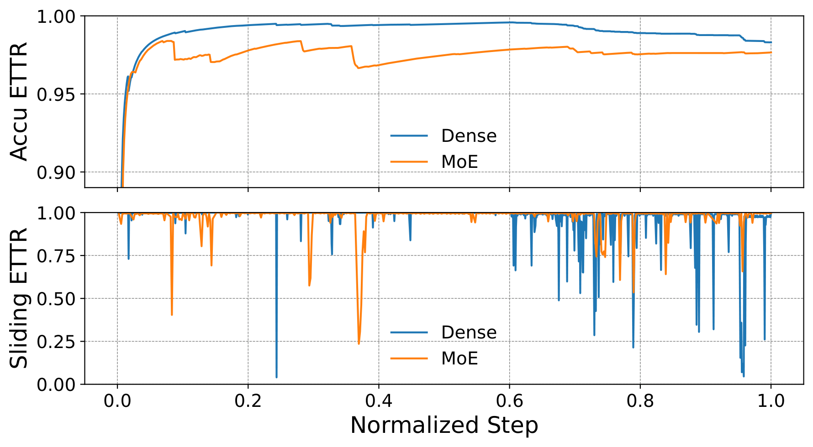
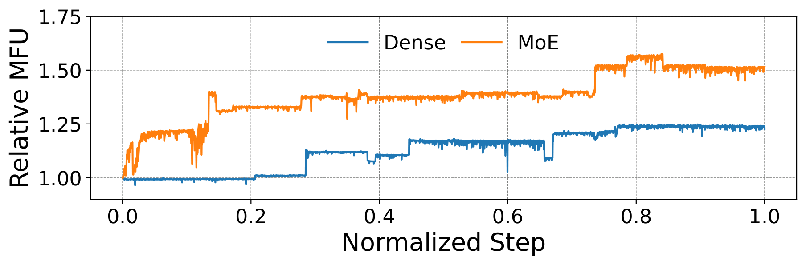

# Robust LLM Training Infrastructure at ByteDance 阅读报告

| 元信息 | |
|---|---|
| **标题** | Robust LLM Training Infrastructure at ByteDance |
| **作者 / 机构** | Borui Wan, Gaohong Liu, Zuquan Song, Jun Wang, Yun Zhang, Guangming Sheng 等 35 人（ByteDance Seed；Chuan Wu — The University of Hong Kong） |
| **发表** | SOSP 2025 |
| **链接** | [arXiv:2509.16293](https://arxiv.org/abs/2509.16293) · [ACM DL: 10.1145/3731569.3764838](https://dl.acm.org/doi/10.1145/3731569.3764838) |
| **本地文件** | `paper.pdf`，`src/`（TeX 源码） |
| **标签** | #fault-tolerance #failure-detection #failure-localization #silent-data-corruption #checkpointing #warm-standby #elastic-scheduling |

> 阅读日期：2026-11-03 · 整理：Claude Code（基于 arXiv TeX 源码通读）

## 一句话总结

字节跳动把内部 LLM 训练的容错基础设施系统化为 **ByteRobust**：以"**快速隔离优先于精确定位**"为总纲，用实时巡检 + 分层停机诊断 + 栈聚合过驱逐 + 双阶段重放定位故障机器，用原地热更新 + 温备机 + 跨并行组备份的内存检查点把恢复做到分钟级，最终在 **9,600 GPU 上三个月的训练任务中做到 97% ETTR**（有效训练时间占比）。

## 背景与动机

**大规模训练中故障是常态。** LLaMA 3 405B 用 16,384 H100 训练 54 天，Meta 报告其间硬件故障约**每 2.78 小时一次**；字节自己 175B 模型用了 12,288 GPU。同步训练范式下任一 GPU/机器的故障都会拖垮整个任务（万卡任务中断 5 分钟 ≈ 32 卡闲置一整天）。


*图 1：生产环境 1,000 GPU 上 10 天训练 span 内 28 次重启。loss 持续下降、MFU 持续上升——每次重启都伴随并行策略调整、算子融合等工程优化；部分曲线重叠对应回滚若干步做 bitwise 一致性验证（摘自原文 Fig. 2）*

论文基于三个月、778,135 个 LLM 训练作业的生产统计（Table 1），把事件分三类：

| 类别 | 典型症状 | 数量 | 占比 |
|---|---|---|---|
| Explicit（显式失败） | CUDA Error 19,968 / CPU Overload 6,095 / CPU OOM 5,567 / 磁盘不足 2,755 / IB Error 1,599 / HDFS 1,104 … | ~38.2k | ~71.6% |
| Implicit（隐式失败） | Job Hang 5,506 / MFU Decline 442 / NaN 148 | ~5.9k | ~10.9% |
| Manual Restart（主动重启） | 代码/数据调整 | 9,582 | 17.3% |

三条核心痛点：

1. **根因跨域缠绕**：同一症状可能来自基础设施或用户代码（Job Hang：21 例基础设施 vs 5 例用户代码；illegal memory access：21 vs **41**）。新代码版本刚上线就故障时几乎无法归因。
2. **隐式失败难检测难定位**：Job Hang 占比 >10%，要等 NCCL 超时（30–60 分钟）才有信号；MFU 下降时所有机器的 IO/计算/通信指标同步下滑，无法区分谁慢；SDC（静默数据损坏）不可复现——作者曾遇到数据类型相关的 GPU SDC 计算错误，**离线压测 8 小时以上**才定位到坏卡。
3. **failover 昂贵且不确定**：万卡规模上一次 failover（重新调度、重建 pod、远端拉 TB 级检查点、重算）往往 **>10 分钟**；且没有足够备机整批换机器，必须精确定位并隔离坏机器。

**机遇**（作者观察）：LLM 训练可预测（周期性，指标偏离即信号）；GPU 按并行策略分组、同组栈高度对称（可聚类找异类）；故障虽频繁但**绝大多数只涉及单机**（可以用少量温备机 + 二项分布 P99 估算备机数）。

## 方法


*图 2：ByteRobust 架构。控制平面（Robust Controller + Runtime Analyzer）在训练作业之外做检测/定位/恢复决策；数据平面是每个 Pod 内的 Robust Agent，下辖 Monitor、Diagnoser、On-demand Tracer、CKPT Manager 四个子模块（摘自原文 Fig. 4）*

三条设计哲学贯穿全文：

1. **快速隔离优先于精确定位（Prioritize rapid isolation, not precise localization）**——万卡空转面前，精确定位的收益不如尽快把疑似机器整组驱逐出去（over-eviction）。
2. **把人为错误纳入设计（Incorporate human error）**——数月训练中代码持续演化，代码缺陷是常态故障源；自动回滚 + 重试是标准动作，代码变更"搭"故障恢复的车懒更新（lazy update）。
3. **恢复过程中控制变量（Control variability during swift recovery）**——换码不换机（原地热更新）、换机先自检（温备机预验证）、检查点避开故障域备份。

### 1. 自动故障容忍框架（Automated Fault Tolerance）


*图 3：自动故障容忍决策树。实时检查 → 停机检查 → 重试 → 回滚 → 双阶段重放，逐级升级（摘自原文 Fig. 5）*

**实时检查（Real-time Checks）**：Monitor 以秒级间隔做系统巡检（不占 GPU）：网络侧（NIC down/抖动、丢包、交换机 down）、GPU 侧（DCGM 状态、PCIe 带宽、显存行重映射、温度）、主机侧（dmesg 里的 Xid 等）。高置信事件（GPU Unavailable、Disk Fault）**跳过停机诊断直接驱逐**；网络类瞬态故障则容忍数次告警（如 5 分钟内 2 次）再驱逐。同时收集三类指标：训练指标（loss/梯度范数/MFU，5× 突变或 NaN 即告警）、stdout/stderr 与退出码、CUDA/RDMA/主机/存储事件（RDMA 流量、TensorCore 利用率骤降是 hang 的前兆）。

**分层停机检查（Hierarchical Stop-time Checks）**，四级递进：

1. **Diagnose**：分析日志/退出码跑定向测试。如 `NCCL Internal Error` → 先跑 NVIDIA EUD 查 GPU，再跑机内 all-to-all 验证卡间带宽，再跑跨机 all-gather 验证连通性；发现疑似机器即驱逐并拉温备机重启。
2. **Reattempt**：全部通过 → 判定为瞬态故障（链路翻转、交换机瞬断等），直接重启。
3. **Rollback**：重启仍失败 / 驱逐后再次崩溃 → 怀疑最近用户代码更新有风险，用热更新机制回滚代码再重启；恢复成功即归因为代码问题，通知相关团队，训练不停。
4. **Dual-Phase Replay**（兜底，对付 SDC 等不可复现故障）：单机压测会破坏 3D 并行的通信模式和数据依赖、无法复现，因此**保持 TP/PP 不变、只缩 DP**，把机器按水平/垂直两种方式分组（m×n 网格，m 取 PP size 的倍数），各轮重放定位故障组，两组的交集解出故障机器。m=4, n=6 的例子中重放两轮即隔离出 SDC 机器 #13（Alg. 1 + Fig. 6）。多机同时 SDC 的场景宁可过驱逐也不延长诊断。

> **Lesson（论文原文经验）**：19 个 ≥9,600 GPU 的大规模作业统计——实时检查直接驱逐解决 **32.52%**，重试 **22.70%**，回滚 **9.20%**，只有 **1.23%** 走到双阶段重放。简单方法解决绝大多数事件。

**NaN loss 诊断案例**：EUD + NCCL 测试 → 通过则跑 bit-wise 对齐测试（每台机器起一个与目标作业结构一致的参考模型，加载预定义权重、固定并行配置与输入，跑一步训练，收集输出比对 bitwise 精度，错者即隔离）→ 再依次 reattempt / rollback → 仍失败则双阶段重放。

### 2. 数据驱动过驱逐（Data-Driven Over-Eviction）

针对 hang / MFU 下降这类**无日志可查**的隐式失败：收到触发消息后，On-demand Tracer（py-spy + flight-recorder 实现）抓取所有训练进程的栈，Runtime Analyzer 做三步聚合：


*图 4：反向传播通信 hang 的栈聚合定位。TP=2, PP=4, DP=4。机器 15 卡在 `all_gather_into_tensor`，机器 14 卡在 `isend`，机器 12–13 卡在 `irecv`，其余 12 台机器已进入优化器的梯度同步——异类栈共享同一个 PP group，整组驱逐（摘自原文 Fig. 7）*

1. 解析各 Pod 的进程树，识别训练相关进程（torchrun、dataloader、checkpoint 进程等，故障根因常在子进程里）；
2. 栈按字符串匹配聚合成组，**多数组判健康，剩下的组是 outlier**；
3. 找 outlier 的共享并行组（如一个 PP group），整组过驱逐，不追求定位到具体哪台。

MFU 下降（fail-slow）场景则每 10 秒重复一轮聚合、连续 5 轮累计被标记最多的并行组判为劣化源驱逐。

**评估 hang 案例**：栈聚合隔离出一条跨 6 台机器的 pipeline（中间若干 stage 卡在 P2P 通信）→ 6 台机器自动拉黑驱逐、温备机补位恢复训练；后台数天压测最终确认根因是其中 **2 台机器 CUDA core 缺陷**。

### 3. 受控快速恢复（Controlled and Swift Recovery）

- **原地热更新（In-place Hot-Update）**：改代码不销毁 pod、不动机器。紧急 bug 修复立即停训应用；非关键更新（新优化实验、版本升级）则入队，**搭下一次故障恢复的便车**应用（故障本来平均 2.78 小时一次），最长 24 小时窗口兜底强制应用。所有变更持久化到数据库，可追溯可复现。
- **温备机（Warm Standby）**：按二项分布 **P99** 估算备机数（1,024 台机器的任务只需 **4 台**备机），备机完成自检 + 环境安装后进入低功耗睡眠；驱逐发生时唤醒补位，同时异步补充备机池。好处：故障后只有极少数机器变化，其余机器环境完全不变，恢复的可控性和诊断的确定性都更好。
- **过驱逐感知的检查点（Over-Eviction-Aware Checkpointing）**：分层存 CPU 内存 + 本地 SSD，**不依赖远端存储**（统计里有 1,104 次 HDFS 错误，前端网络也是瓶颈）。调度上利用前/反向计算期间的空闲通信周期，用独立 CUDA stream 以 P2P 把本 rank 的分片状态发给备份机的 peer rank，checkpoint I/O 与训练异步重叠，只有本 rank 自身存档需 optimizer step 等待完成。


*图 5：跨并行组备份策略。TP=2, PP=4, DP=2。每个 rank 把分片的 optimizer/model state 备份到与自己**不在同一 PP/DP/TP 组**的机器上——过驱逐通常整组驱走一个 PP group，跨组备份保证备份永远落在故障域外（摘自原文 Fig. 9）*

## 实验与结果

生产部署（9,600 Hopper GPU：稠密 70+B 三个月 + MoE 200+B 一个月两个作业）+ 微基准（1,024 台 × 16 张 L20 48GB = **16,384 GPU**，PCIe 30GB/s 互连）。

### 故障检测时间（Table 3）

| 故障 | ByteRobust 巡检 | 基线（超时/指标告警） |
|---|---|---|
| NIC crash / Port flapping | **30 s** | ~10 min（NCCL 超时） |
| GPU Driver Hang / GPU Lost | **10 s** | ~10 min |
| OS Kernel Fault | **2 s** | ~10 min |
| High Temperature | **10 s** | 需多个 iteration 统计才能发现 MFU 下降 |

### 事件解决方式分布（Table 4，两个生产作业）

| 机制 | Dense（显式/隐式/手动） | MoE（显式/隐式/手动） |
|---|---|---|
| AutoFT-ER（诊断后驱逐+重启） | **73.1%** / – / – | **56.8%** / – / – |
| AutoFT-HU（热更新） | – / – / 11.4% | – / – / 24.8% |
| Analyzer-ER（栈聚合过驱逐） | – / 8.6% / – | – / 7.2% / – |
| Rollback（回滚） | – / 6.9% / – | 0.8% / 10.4% / – |

隐式失败共 24 起由栈聚合自动解决，**无需人工介入**。与既有实践（选择性压测）比，CUDA Error 平均解决时间 **93 s vs 518 s（降 84.5%）**；NaN 从 >7,200 s（甚至无法定位）降到 4,289 s；代码/数据调整类基线根本无法定位，热更新 57 s 搞定。

### 端到端指标


*图 6：两个生产作业的累计 ETTR 与 1 小时滑动窗口 ETTR。累计 ETTR 稳在最高 **97%**，单次不可用时间最长不超过 50 分钟；后期（长上下文功能首次上线 + 集群老化）滑动 ETTR 波动增大但都被快速消化（摘自原文 Fig. 10）*


*图 7：相对 MFU 曲线。每次跳变对应一次热更新部署的新版本训练代码；相比初始版本，稠密/MoE 作业 MFU 分别提升 **1.25× / 1.58×**（摘自原文 Fig. 11）*

MoE 的 ETTR 低于稠密：MoE 需要大量自定义优化（kernel 调优、计算通信重叠、负载均衡），回滚和手动重启更多——**MFU 换 ETTR**。

### 恢复速度微基准

| 机制 | 对比 | 结果 |
|---|---|---|
| 温备机 | vs requeue（整个重排）/ reschedule（只补缺） | 恢复加速 **10.87× / 5.36×**，距 oracle 上界仅差 5.19% |
| 热更新 | vs requeue | 加速 **11.04×**（1,024 台规模：65 s vs 768 s），且随规模基本恒定，requeue 则线性恶化 |

### 检查点开销（Table 6，70B/256B MoE，逐 step 存档）

| 方法 | 阻塞时间 | MFU（相对无 checkpoint） |
|---|---|---|
| Megatron save | 6.77–13.02 s | 39–43% |
| Memory save（Gemini 式） | 0.18–1.84 s | 70–96% |
| **ByteRobust save** | **0.01–0.04 s（↓99.69% / 95.10%）** | **≥99.1%（损失仅 0.71%）** |

**关键数字**：每步 checkpoint 开销 <0.9%；三个月内自动处理 **38,236 次显式 + 5,948 次隐式**失败。

## 结论

ByteRobust 已在字节生产 GPU 集群部署一年以上，把故障特征、诊断能力与 LLM 训练特性（并行对称性、周期性、代码持续演化、单机故障为主）融合成一套端到端自动容错框架：实时检测 + 分层诊断 + 数据驱动隔离 + 温备机/热更新/检查点三板斧，在 9,600 GPU 三个月任务上实现 **97% ETTR**。

## 与鲁棒 LLM 训练的关联

**覆盖链条**：这篇是本仓库主题的**全链路论文**——

- **故障检测**：秒级系统巡检 + 训练/事件指标监控（对应"检测"环）；
- **故障定位**：分层停机诊断、栈聚合找异类、双阶段重放（"诊断/定位"环）；
- **容错与恢复**：温备机、原地热更新、代码回滚、过驱逐策略（"容错恢复 + 弹性调度"环）；
- **检查点**：跨并行组备份的分层内存检查点、每步存档 <0.9% 开销（"检查点"环）；
- **一致性校验**：bit-wise 对齐参考模型测试（雏形，见下）。

**与已读论文的关系**：

- **OpGuard（OSDI 2026，同为字节）**：本文 NaN 诊断里的 bit-wise 对齐测试是单点工具；OpGuard 把"bitwise 对齐"发展成系统的精确调试方法，可视为本工作的深化。
- **Online SDC Detection（OSDI 2026）/ SDCs in the Wild（OSDI 2026）**：本文坦承 EUD 召回率仅 ~70%、双阶段重放开销大——这正是后续 SDC 专文要解决的问题，本文的 Lesson 一节是它们的直接动机。
- **Training with Confidence（OSDI 2025）**：同为"自动前置检查"思路（可校验不变量 vs 本文的巡检项 + 指标阈值），可对照两类检测粒度。
- **Mycroft（SOSP 2025）**：本文栈聚合只能回答"卡在哪个通信原语、哪组机器"；Mycroft 进一步追集合通信的依赖图，定位粒度互补。
- **FlowCheck（EuroSys 2025）**：同做检查点优化，路径不同——FlowCheck 解耦 checkpoint 与训练，本文走内存分层 + 跨组备份 + 通信重叠，把开销压到近零。
- **TrainMover（OSDI 2026）/ Anchor（SOSP 2026）**：同属"减少中断代价"谱系（迁移式运行时 / 浅故障内存解耦），与本文热更新 + 温备机互为参照。
- **MegaScale**（字节前作，文中 related work）：用 RDMA 流量监测发现隐式异常但仍需人工定位；ByteRobust 把这条路线全自动化。

## 局限性与思考

- **过驱逐的代价**：3D 并行下为快速隔离常整组驱逐一个 PP group（9,600 GPU 作业中一组 8 台机器，实际坏的往往只有 1–2 台），**6–7 台是误伤**；论文的论证是万卡规模下这个代价比延长诊断小——但备机池和集群利用率会受到持续压力（论文只说 "minor impact"）。
- **SDC 处理仍是硬骨头**：EUD 召回 ~70%，MiniGPT 验证套件的合成负载无法完美复现生产模型状态；**≥2 台同时 SDC 会绕过双阶段重放的分组检测**（Alg. 1 假设单故障）。作者自己呼吁需要更高效的 SDC 检测/隔离/诊断技术——这也解释了后续 OSDI 2026 两篇 SDC 论文的出现。
- **诊断工具本身会闯祸**：一个案例里 EUD 诊断过程意外解除了频率锁，导致 GPU 降频、MFU 下降——"医生致病"被他们真实踩到。
- **数据驱动方法的分布假设**：栈聚合假设"单一隐式故障下大多数健康机器栈完全一致"；模型结构不均匀（如 MoE 专家并行、异构流水线）时多数组判定是否稳健，论文未展开（个人理解）。
- **每步检查点的前提**：近零开销依赖 ZeRO 式并行下前/反向的空闲通信周期；若通信本身已是瓶颈（长上下文/EP 密集场景），重叠空间会被压缩（个人理解）。
- **评估口径**：ETTR 的"有效时间"以 productive training time 计，温备机空转的 GPU 时不算在该作业的 wall-clock 内，但确实是集群成本（论文在 warm standby 一节承认了 idling 与集群利用率的 trade-off）。

---

*BibTeX：*

```bibtex
@inproceedings{wan2025byterobust,
  author    = {Wan, Borui and Liu, Gaohong and Song, Zuquan and Wang, Jun and Zhang, Yun and Sheng, Guangming and Wang, Shuguang and Wei, Houmin and Wang, Chenyuan and Lou, Weiqiang and Yang, Xi and Zhang, Mofan and Jiang, Kaihua and Ren, Cheng and Zhi, Xiaoyun and Yu, Menghan and Nan, Zhe and Zheng, Zhuolin and Zhong, Baoquan and Wang, Qinlong and Yu, Huan and Chi, Jinxin and Zhang, Wang and Li, Yuhan and Du, Zixian and Zhao, Sida and Zhang, Yongqiang and Tang, Jingzhe and Liu, Zherui and Wu, Chuan and Peng, Yanghua and Lin, Haibin and Xiao, Wencong and Liu, Xin and Xiang, Liang},
  title     = {Robust LLM Training Infrastructure at ByteDance},
  booktitle = {Proceedings of the 31st ACM SIGOPS Symposium on Operating Systems Principles (SOSP '25)},
  year      = {2025},
  doi       = {10.1145/3731569.3764838},
  note      = {arXiv:2509.16293}
}
```
